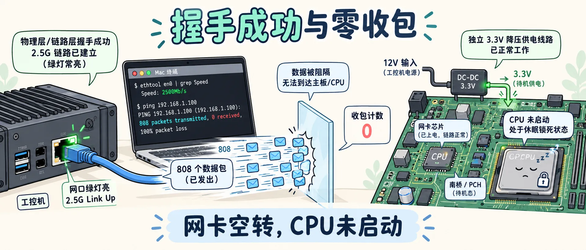
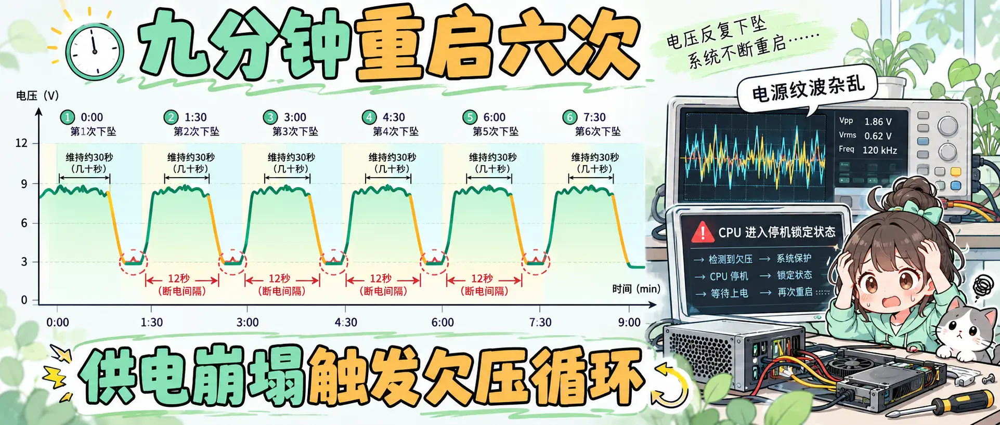
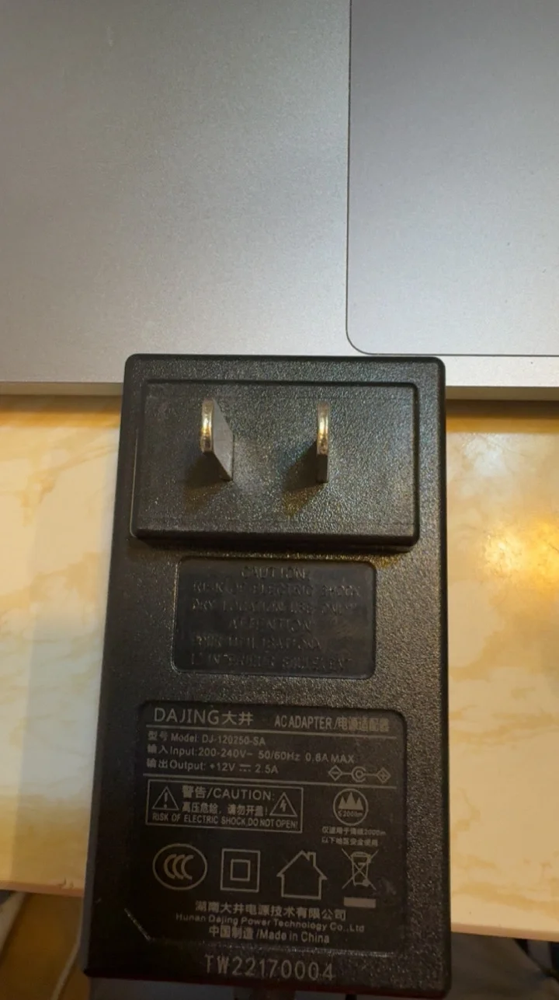
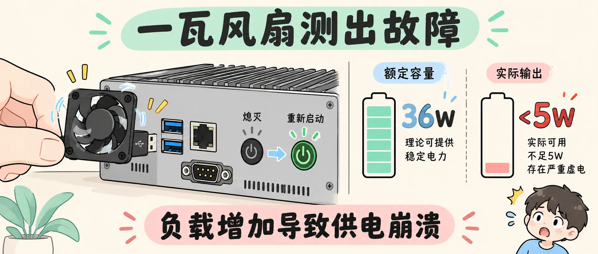

<!-- baoyu-skill cover prompt: 2.35:1小清新治愈知识漫画封面，柔和米白到浅青灰渐变底色，干净纤细线稿，薄荷绿/淡暖杏/天蓝清新平涂，留白充足。画面左侧一台深灰色工控软路由连接着发热的旧电源适配器，指示灯微弱闪烁；右侧外卖骑手送来一个新的电源盒，旁边摆着Mac Studio与直连网线；中央一行清秀的字符显示「12V 4A」。顶部居中中文大标题「家里断网查了一晚」，底部辅助文字「罪魁祸首是那个12V电源」。中文文字端正清晰可读。 --ar 2.35:1 -->

大家好，我是 Jason。

周六下午出门在外面，手机弹出告警，家里的内网服务全部断开。

登录远程控制，家中节点全灰。

回到家，客厅路由器指示灯变红。换上备用路由顶替主网关 `192.168.x.1`，恢复全家 Wi-Fi。

上一次是网线导致的电信这一路断流，当时还是 Codex 帮我找到的问题。这次整个网络彻底瘫痪，我把挂掉的主路由 J4125 拆下，抱到书桌上，插上网线直连 Mac Studio 网口。

折腾了4个小时，换掉一个电源适配器，网络恢复。

整个过程差点把 OpenWrt 系统重新刷了，这一次 AI 又帮了大忙。写下排查记录，供参考。


---

<!-- baoyu-skill prompt: 2.35:1小清新知识漫画，淡米白背景，清线描边，薄荷绿/天蓝平涂，留白充足。画面左侧工控机网口绿灯亮起，Mac终端显示2.5G连接，发出的808个数据包撞在透明阻隔上，收包计数显示为0；右侧展示主板芯片供电结构，独立3.3V降压线路通电，CPU芯片处于休眠锁死状态。顶部中文「握手成功与零收包」，底部「网卡空转，CPU未启动」。中文文字工整清晰。 --ar 2.35:1 -->

### 物理层通了，数据包不回

网线插入 Mac Studio 的 `en0` 网口，工控机面板的指示灯亮起。

在 Mac 终端查看网卡状态：

```bash
ifconfig en0
```

终端打印输出：

```text
en0: flags=8863<UP,BROADCAST,SMART,RUNNING,SIMPLEX,MULTICAST> mtu 1500
    inet 169.254.x.x netmask 0xffff0000 broadcast 169.254.255.255
    media: autoselect (2500Base-T <full-duplex,flow-control>)
    status: active
```

网卡握手在 `2500Base-T`，协商速率 2.5Gbps 全双工。

接着看数据收发计数：

```bash
netstat -I en0 -b
```

输出显示：

```text
Name  Mtu   Network     Address            Ipkts Ierrs Ibytes Opkts Oerrs Obytes
en0   1500  <Link#10>   xx:xx:xx:xx:xx:xx      0     0      0   808     0 367376
```

Mac 发出 808 个包，收到 0 个包。

面对这种反常状态，我先是怀疑主板坏了，甚至找出 U 盘准备重刷 OpenWrt 系统。

我和 AI 一起做交叉排查（cross check）。AI 提醒我不要急着动系统，留意主板的供电机制：

J4125 主板上的 Intel i225 网卡芯片由独立的 3.3V 降压电路供电，功耗 1 到 2W。外部 12V 供电跌落到 8V，这路 3.3V 降压电路依然能工作，网卡物理层完成速率协商。

但如果 12V 供电带载不足，CPU 会进入欠压锁死状态。机器卡在自检阶段，系统内核没有加载，网卡接收队列无驱动接管，二层收包自然为 0。

顺着这个线索，排查方向从软件系统转向供电端。



---

<!-- baoyu-skill prompt: 2.35:1小清新知识漫画，柔和浅灰到淡绿渐变，细线稿，薄荷绿/橘黄/天蓝平涂，留白充足。画面展示一条时间轴，记录9分钟内六次电压下坠波形，每次波峰维持几十秒便跌入低谷，断电间隔精确标注12秒；右侧示波器显示杂乱的电源纹波，CPU进入停机锁定状态。顶部中文「九分钟重启六次」，底部「供电崩塌触发欠压循环」。中文文字端正清晰。 --ar 2.35:1 -->

### 查日志：九分钟重启六次

在 AI 的提示下，我调出 macOS 底层链路日志，查看直连期间的断网记录：

```bash
/usr/bin/log show --info --predicate 'eventMessage CONTAINS "en0 link" OR eventMessage CONTAINS "DHCP en0: status"' --last 2h --style compact
```

终端打印出工控机的运行记录：

| 启动轮次 | 在线时间段 | 运行时间 | 断电重启耗时 | 状态 |
| :--- | :--- | :--- | :--- | :--- |
| 第 1 次 | 19:46:16 - 19:46:56 | 40 秒 | 12.4 秒 | 启动至电流增大阶段断电 |
| 第 2 次 | 19:47:08 - 19:48:10 | 61.8 秒 | 11.6 秒 | 运行 1 分钟后电压跌落复位 |
| 第 3 次 | 19:48:22 - 19:49:03 | 41.5 秒 | 13.1 秒 | 再次断电复位 |
| 第 4 次 | 19:49:16 - 19:51:54 | 158 秒 | 13.3 秒 | 维持 2 分半后断电 |
| 第 5 次 | 19:52:08 - 19:54:12 | 124 秒 | 12.8 秒 | 维持 2 分钟后断电 |
| 第 6 次 | 19:54:25 - 19:55:04 | 38.8 秒 | 5 分 24 秒 | 崩溃后长时断连 |
| 锁死阶段 | 20:00:28 之后 | 持续连接 | 不再重启 | CPU 欠压锁死，网卡空转 |

九分钟内，这台机器自动断电重启六次。

每次断开耗时固定在 12 秒上下，对应电源跌落触发保护到重新上电的时间。

到 20 点整，机器不再重启，指示灯常亮，进入欠压死锁状态。



---

<!-- baoyu-skill prompt: 2.35:1小清新知识漫画，浅杏色底，清线描边，薄荷绿/淡红/天蓝平涂，留白充足。画面左侧工控机USB接口插入一只小巧的黑色散热风扇，风扇扇叶刚刚转动半圈，主机电源指示灯熄灭并重新启动；右侧对比显示额定36W容量与实际不足5W的虚电标尺。顶部中文「一瓦风扇测出故障」，底部「负载增加导致供电崩溃」。中文文字端正清晰。 --ar 2.35:1 -->

### 压死骆驼的一瓦风扇

排查中途出现一个插曲。

换网线测试时，握手速率由 2.5G 降为 100Mbps。抓起线身一看，拿错了抽屉里的老百兆线，换回六类线恢复 2.5G 协商。

确认物理线路无误，做了一组对照。

我找出一只 5V 0.2A 的 USB 外挂散热小风扇，功率在 1W 上下。

将小风扇插头插入 J4125 的 USB 口。

风扇扇叶转动半圈，工控机指示灯熄灭，整机断电重启。

拔掉风扇，指示灯恢复常亮。

翻过坏掉的原装电源看铭牌，上面印着大井电源的 12V 2.5A（30W）：



内部输出滤波电容失效。空载能出电压，带载能力衰退到 5W 以下。

1W 的微小负载接入，拉穿母线电压阈值，触发主板重置。

系统没有坏，主板没有坏，坏的是电源。



---

<!-- baoyu-skill prompt: 2.35:1小清新知识漫画，米白渐变，清线描边，薄荷绿/暖橙/天蓝平涂，留白充足。画面展示故障时间回溯表：16点48分链路质量下降，16点54分DNS中断，16点57分断网报警；右侧展示美团骑手送来新电源接通后，Mac终端刷出绿色ARP回复，所有容器全部恢复运转。顶部中文「换上新电源，全网复活」，底部「底层日志还原崩溃时刻」。中文文字端正清晰。 --ar 2.35:1 -->

### 换上新电源与日志回溯

确认电源损坏后，选配新电源还要核对 DC 插头尺寸。工控机常用的是 5.5×2.5mm 规格，如果买成 5.5×2.1mm 会插不紧或者接触不良：


打开美团，搜索航嘉 12V 4A（5.5*2.5）直流电源适配器，21 点 47 分下单闪送：


半小时后骑手敲门，送来新的 12V 4A（48W）适配器。

接上工控机，网线插回局域网。

看 Mac 终端屏幕：

```text
22:42:37.215 ARP 192.168.x.1: response received (xx:xx:xx:xx:xx:xx)
```

22 点 42 分，网关收到响应。内网容器、穿透服务全线拉起。

网络恢复后，我调用 Mac 过去 7 天的 `configd` 与 `symptomsd` 日志，还原旧电源损坏时刻：

| 时间（10月31日） | 状态 | Mac 系统日志记录 | 硬件实际情况 |
| :--- | :--- | :--- | :--- |
| 10-24 至 16:48 | 正常 | 7 天连续运行无报错，DHCP 续租响应正常 | 电源输出稳定 |
| 16:48:48 | 波动 | symptomsd: Realtime LQM changed: new-lqm 50 old-lqm 100 | 电源纹波增大，链路质量腰斩 |
| 16:54:28 | 异常 | symptomsd: DNS failure tell health status stage | 供电不稳，DNS 进程卡住 |
| 16:55:01 | 断流 | SYMPTOM_LIBNETCORE_DATA_STALL | 软路由转发停摆 |
| 16:57:05 | 宕机 | configd: Process router ARP failure: en1 | 电源输出崩溃，J4125 停机 |
| 16:57 - 19:15 | 中断 | 累计报出 1380 次 ARP 失败 | 持续断网 2 小时 18 分 |
| 19:15:37 | 救急 | Process router ARP alive: en1 (xx:xx:xx:xx:xx:xx) | 接入备用路由器接管内网 |
| 22:42:37 | 复活 | ARP 192.168.x.1: response received (xx:xx:xx:xx:xx:xx) | 换上 12V 4A 新电源上线 |

电源从产生纹波到失去输出能力，经历了 8 分钟。

16 点 57 分断电停机，吻合手机收到告警的时间。


---

### 避坑建议

1. **指示灯与物理层协商存在欺骗性**。
   开关电源损坏多为带载电压跌落。网卡由 3.3V 降压模块独立驱动，功耗小，依旧可以点亮并建立 2.5G 物理协商。CPU 在欠压状态下停机。排查设备先看收发包计数，不看指示灯。
2. **遇到周期性断电先拔电源**。
   滤波电容失效后，直流输出附带高频尖峰纹波。长时间欠压重启容易损坏固态硬盘或主板元件。
3. **更换冗余电源**。
   小主机随附的电源用料简易，长期通电容易老化。选购台达、明纬等品牌的 12V 4A 或 5A 规格，留出功率余量。
4. **macOS 终端是实用的网络分析工具**。
   在没有外接屏幕的情况下，通过 Mac 有线直连，读取 `netstat -I en0 -b` 与 `log show` 日志，能够定位系统停摆的层级与时间点。

---

### 相关阅读

- [远程桌面试了一圈，我把所有机器切到了自建RustDesk]({{ site.baseurl }}/rustdesk-tunnel-setup-mac-remote)
- [今年买了近40万的苹果设备跑Agent：10月24日，我又添了一台M5 Ultra]({{ site.baseurl }}/m5-ultra-96g-agent-machine-400k-apple)
- [一人公司生存图鉴：我是如何做到年入100万的]({{ site.baseurl }}/one-person-company-million-claude-code)
