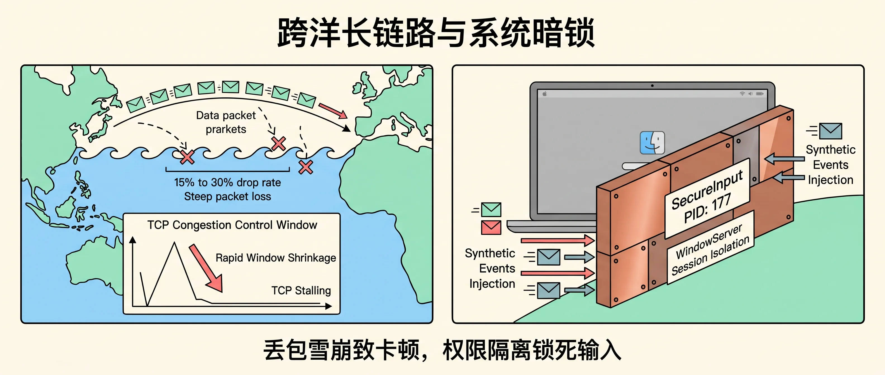
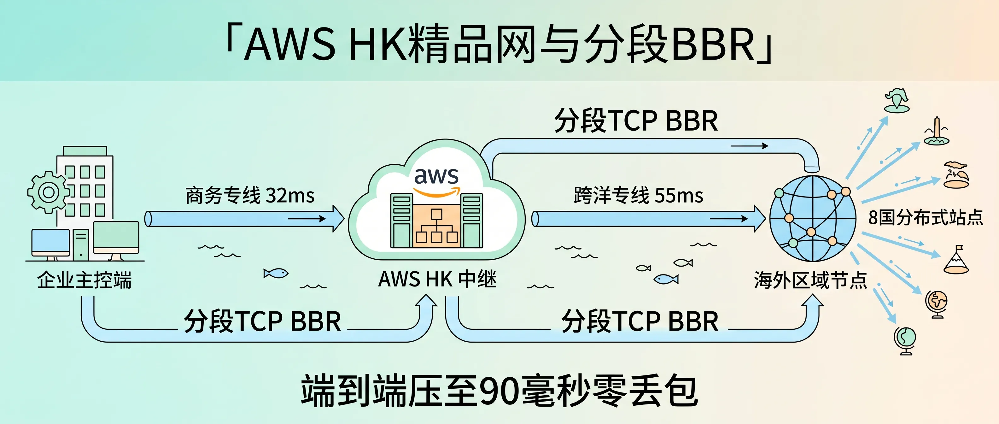
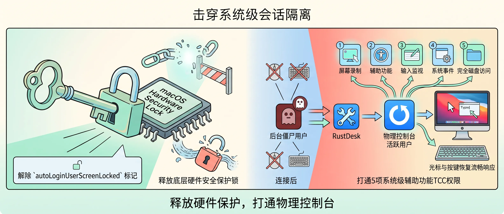
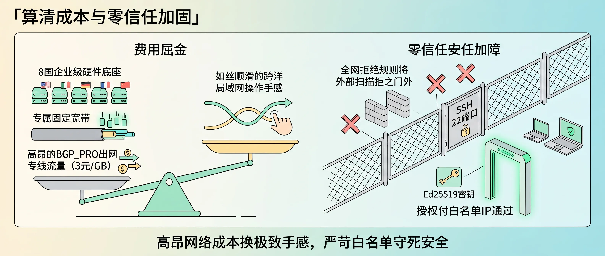

<!-- baoyu-skill cover prompt: 2.35:1小清新治愈知识漫画封面，柔和米白到浅青灰渐变底色，干净纤细线稿，薄荷绿/淡暖杏/天蓝清新平涂，留白充足。禁止品牌logo与深色赛博UI。画面左侧一位工程师在企业主控台前操作键盘，屏幕里投射出分布在8个国家的远端Mac主机（标注东亚、东南亚、大洋洲、北美等区域站点）；一条翠绿色发光高速商务专线经由香港云节点无缝连通各地，管道上方标注「90ms」「0%丢包」；背景展现全球海缆专网与现代城市剪影。顶部居中中文大标题「跨洋远程调出局域网手感」，底部辅助文字「连接8国节点，付出高昂网络成本」。中文文字端正清晰可读。 --ar 2.35:1 -->

大家好，我是 Jason。

这周，我一直在调试海外分布式算力节点的跨洋远程连接网络。

中间插进来一个突发事件：周六下午家里断网，工控软路由的 12V 电源老化，换上新适配器才救回来。处理完，我回到跨洋网络上。

我们的海外运行节点分布在亚太、大洋洲与北美的 8 个国家。日常设备巡检、构建任务管理与状态监控，全部采用自建的企业级 RustDesk 服务。

在这 8 个国家的所有节点里，东南亚节点经过我们第三阶段优化，时延稳定在 89ms，零丢包，操作跟手。这个节点成了我们的黄金基准标杆，本次排障全程保持配置不动。

但其他跨洋节点，尤其是大洋洲与东亚节点，此前网络体验极差，成为阻碍全局体验的两块硬骨头：
- 东亚节点的 Mac mini，公网直连时延在 262ms 徘徊，网络抖动在 50ms 到 180ms 之间起伏；开机进入锁屏界面后，画面显示正常，键盘按键无法敲入字符。
- 大洋洲节点的 Mac mini，跨洋公网丢包率常年在 15% 到 30% 波动。画面定格成幻灯片，鼠标点击无反应。

为了最好的体验，我们在网络专线和海外基础设施上付出了非常高的成本。经过系统与网络底层的深度重构，不仅解决了东亚与大洋洲节点的痛点，也把这 8 个国家的连接全部调成了和本地局域网一致的质感。


---

<!-- baoyu-skill prompt: 2.35:1小清新知识漫画，淡米白背景，清线描边，薄荷绿/淡红/天蓝平涂，留白充足。画面左侧展示跨洋网络：发出的数据包在大洋波浪中遭遇15%到30%的断崖丢包，TCP滑动窗口急剧缩水跌停；右侧展示一台锁屏状态的Mac主机，系统底层弹出一道严密的铜墙铁壁，标注「SecureInput PID: 177」与「WindowServer 会话隔离」，阻挡了合成事件的注入。顶部中文「跨洋长链路与系统暗锁」，底部「丢包雪崩致卡顿，权限隔离锁死输入」。中文文字工整清晰。 --ar 2.35:1 -->

### 跨洋网络的两处暗坑

远程卡顿来自两层故障：传输层丢包，系统权限拦截。

先看网络层。

跨洋长距离直连大洋洲节点，物理直线距离近八千公里。民用公网经过多级跨洋海缆与运营商拥堵节点，丢包率在 15% 到 30% 起伏。

系统默认的 Cubic 拥塞控制遇丢包就将滑动窗口（CWND）砍半。在 200ms 以上的长 RTT 链路上，窗口爬升缓慢。丢包频繁触发时，吞吐跌停，可用带宽由 25Mbps 跌落到不足 200Kbps。视频流滞留缓冲队列，主控端画面定格。

再看系统层。

两台远端 Mac mini 均出现画面可见但无法交互的现象，排查确认触发了 macOS 的两套安全机制：

**东亚节点的键盘锁死：SecureInput 安全输入保护**

东亚机器开机后，RustDesk 建立连接并捕获登录窗口。在本地敲击键盘，输入框没有反应。

登录远端 SSH 抓取系统输入源状态：

```bash
ioreg -l -w 0 | grep -i secureinput
```

终端打印输出：

```text
"kCGSSessionSecureInputPID" = 177
```

系统的 `loginwindow` 进程（PID 177）占用了 `SecureInput` 模式。

排查系统配置，机器内写入了 `autoLoginUserScreenLocked = 1`。系统开机自启后落入锁屏状态。macOS 为防止软件截获锁屏密码，在内核与 WindowServer 层启动安全保护：当 `SecureInput` 激活时，底层阻断第三方应用调用 `CGEventCreateKeyboardEvent` 注入按键事件。画面在推流，按键事件被系统丢弃。

**大洋洲节点的鼠标失效：WindowServer 跨用户会话隔离**

大洋洲机器键盘有响应，鼠标在屏幕上能移动，点击无反应。

检查底层进程树：

```bash
ps aux | grep -i rustdesk
```

输出显示：

```text
user_bg  505  ... /Applications/RustDesk.app/Contents/MacOS/rustdesk --server
```

RustDesk 守护进程挂在后台用户 `user_bg`（UID 505）名下，当前物理控制台登录的是主用户 `user_console`（UID 501）。

macOS 自 Catalina 起启用会话沙箱隔离（Session Boundary）。后台用户名下的进程，受系统安全策略限制，无法向当前活跃的物理桌面（`/dev/console`）分发鼠标事件（`CGEventCreateMouseEvent`）。视频捕获模块能读取桌面帧，点击事件全被 TCC 拦截。



---

<!-- baoyu-skill prompt: 2.35:1小清新知识漫画，柔和浅青向米白渐变，细线稿，薄荷绿/淡暖杏/天蓝平涂，留白充足。画面展示网络拓扑加速图：企业主控端通过国际专线直连 AWS HK EC2 中继，时延32ms；香港中继经由亚太顶级海缆直达东亚节点，时延55ms，辐射连接分布在8国的各处站点；中间香港节点两侧分别拉出平稳的高速水管，标注「分段TCP BBR (fq+bbr)」，将原本数千公里的长链路隔断为两段高吞吐管道。顶部中文「AWS HK精品网与分段BBR」，底部「端到端压至90毫秒零丢包」。中文文字工整清晰。 --ar 2.35:1 -->

### AWS HK精品网与分段BBR

找到病灶后，网络层优先改造。

跳过拥挤的民用公网出口，引入香港中继节点，配合分段 TCP BBR 隔断跨洋丢包。

香港是连接亚太、大洋洲及北美顶级海缆的天然国际商务枢纽。我们在 AWS HK（亚太区域香港 `ap-east-1`）开通高可用 EC2 实例（2核2G内存，运行 Ubuntu 24.04），绑定固定 Elastic IP（`203.0.113.x`），作为贯通 8 国节点的企业中继枢纽。

网络线路选择 **BGP_PRO（企业精品网）**，直连高品质国际商务专线通道：
- **企业主控端 $\leftrightarrow$ AWS HK**：走高品质专线直达，时延稳定在 **32ms**，全天 0% 丢包。
- **AWS HK $\leftrightarrow$ 东亚节点**：走亚太顶级海缆直连，时延稳定在 **55ms**，全天 0% 丢包。
- **辐射全网**：顺畅中继东南亚、大洋洲与北美的长跨洋路由。

两段叠加，从主控端到东亚节点的端到端时延由原本直连的 **262ms 高抖动**，压缩到 **90ms 零丢包**，追平东南亚节点的 89ms 标杆水平。

拓扑打通后，处理大洋洲方向的跨洋物理丢包。

大洋洲到主控端的超长物理跨度决定了往返时延在 190ms 到 210ms 之间，这是物理定律决定的下限。优化目标是消灭丢包带来的滑动窗口雪崩。

在中继服务器上启用 Linux 内核的 `fq` 队列与 `TCP BBR` 拥塞控制：

```bash
cat <<EOF | sudo tee /etc/sysctl.d/99-bbr.conf
net.core.default_qdisc = fq
net.ipv4.tcp_congestion_control = bbr
net.ipv4.tcp_rmem = 4096 87380 16777216
net.ipv4.tcp_wmem = 4096 65536 16777216
EOF
sudo sysctl -p /etc/sysctl.d/99-bbr.conf
```

执行后验证状态：

```bash
sysctl net.ipv4.tcp_congestion_control
# 输出: net.ipv4.tcp_congestion_control = bbr
```

分段 BBR 的工作逻辑：
把从主控端到大洋洲节点的单根跨洋长链路，在中继点切断为两段独立的传输通道：
- **通道 A**：企业主控端 $\leftrightarrow$ AWS HK EC2 中继（RTT 32ms）。
- **通道 B**：AWS HK EC2 中继 $\leftrightarrow$ 大洋洲被控端（RTT 160ms）。

两端分别由香港中继的内核维持独立的数据收发队列。BBR 算法基于网络瓶颈带宽（BtlBw）与最小往返时延（RTprop）建立传输模型，不再把随机丢包作为窗口砍半的触发器。

当长跨洋链路上产生 15% 的偶发丢包时，香港中继利用两段各自的滑动窗口在局部毫秒级内完成快速重传，不拖累对端的传输速率。链路可用带宽全程稳定在 25Mbps 以上，轻松承载日常 2~5Mbps 及峰值 15Mbps 的 H.265 视频流，消除跳帧与画面卡死。

在大洋洲 Mac mini 上，为了避免重配客户端导致连接中断，我利用本地回环别名完成透明分流：

```bash
sudo ifconfig lo0 alias 198.51.100.x/32
```

配合本地转发守护进程，客户端逻辑地址依然指向原中继，底层流量全部通过香港精品网通道静默接力。



---

<!-- baoyu-skill prompt: 2.35:1小清新知识漫画，米白渐变，清线描边，薄荷绿/珊瑚粉/淡蓝平涂，留白充足。画面展示macOS会话层修复流程：左侧一把钥匙解除 autoLoginUserScreenLocked 标记，释放底层的安全保护锁；右侧展示被控端 RustDesk 守护进程从后台僵尸用户切换绑定至物理控制台活跃用户，打通5项系统级辅助功能TCC权限，光标与按键恢复流畅响应。顶部中文「击穿系统级会话隔离」，底部「释放输入保护，打通物理控制台」。中文文字端正清晰。 --ar 2.35:1 -->

### 拆掉macOS的系统级安全锁

网络管道铺平后，处理 macOS 的两处底层安全死锁。

**解除 SecureInput 释放键盘**

东亚节点的锁屏输入死锁，根源在系统的自动登录锁屏标记。

在远端终端中执行命令，清除锁屏标记：

```bash
sudo defaults delete /Library/Preferences/com.apple.loginwindow autoLoginUserScreenLocked
```

随后重启登录窗口服务，释放 PID 177 的保护占位（注意：该命令会重置当前桌面会话，执行前确保无未保存文档）：

```bash
sudo killall -9 loginwindow
```

进程重启后再次执行 `ioreg -l -w 0 | grep -i secureinput`，输出清空，`kCGSSessionSecureInputPID` 归零。

重新连入 RustDesk，键盘事件注入恢复，密码与终端命令能够录入。

**绑定物理控制台会话释放鼠标**

大洋洲节点的鼠标失效，根源在服务运行所属的会话上下文。

杀死运行在后台用户 `user_bg` 下的守护进程：

```bash
sudo pkill -9 -u user_bg rustdesk
```

获取当前连接在物理桌面（`/dev/console`）上的活跃用户：

```bash
CURRENT_USER=$(stat -f "%Su" /dev/console)
echo "当前物理控制台用户: $CURRENT_USER"
```

终端返回 `user_console`。

将 RustDesk 服务切换至当前物理桌面用户的会话空间（UID 501）拉起，并配置对应的 LaunchAgent 确保开机随桌面启动：

```bash
sudo launchctl asuser 501 /Applications/RustDesk.app/Contents/MacOS/rustdesk --service &
```

随后在系统设置中核对并授权 5 项 TCC 系统权限：
- 屏幕录制（Screen Capture）
- 辅助功能（Accessibility）
- 输入监控（Input Monitoring）
- 完全磁盘访问权限（Full Disk Access）
- 系统事件发送权限（System Events）

服务在物理用户会话上下文就绪后，合成鼠标事件 `CGEventCreateMouseEvent` 穿透会话边界，远端屏幕上的鼠标点击恢复响应。



---

<!-- baoyu-skill prompt: 2.35:1小清新知识漫画，奶油白向浅湖蓝渐变，干净细线稿，薄荷绿/淡暖黄/浅灰平涂，留白充足。画面左侧展示成本天平：左端托起8国企业级硬件底座、专属固定宽带与高昂的BGP_PRO出网专线流量（3元/GB），右端换来如丝顺滑的跨洋局域网操作手感；右侧展示零信任安全屏障：全网拒绝规则将外部扫描拒之门外，SSH 22端口关闭，只有持有Ed25519密钥的授权白名单IP通过。顶部中文「算清成本与零信任加固」，底部「高昂网络成本换极致手感，严苛白名单守死安全」。中文文字端正清晰。 --ar 2.35:1 -->

### 算清这笔昂贵账单

优质网络从来不是廉价的。为了让跨洋连接达到局域网手感，我们付出了非常高的成本。

为什么普通公网方案走不通？普通国际 BGP 出口带宽每 GB 标价不足 1 元，但晚高峰在骨干网上严重拥堵排队，丢包率飙到 30%，画质被强行压缩成马赛克，打字和操作频繁中断，对于严肃生产环境来说等于不可用。

要达到本地局域网一样的体验，我们在基础设施和专线带宽上进行了重投入：

#### 高单价的出网专线流量

- **BGP_PRO（企业精品网）出网单价为 3.00 元 / GiB**。
- 这个单价是普通公网流量的三倍以上，专为对延迟和丢包极度敏感的跨境企业业务设计。
- 远程桌面保持 60 帧 H.265 高画质传输时，日常编码操作码率在 2Mbps 到 5Mbps 之间，频繁拖拽与滚动时峰值达 10~15Mbps；分布在 8 个国家的机器多路并发查看终端日志、传输镜像与工程代码，单台机器连续高频运行便能消耗数十 GB 流量。
- 多国节点与工位全天候并发运行，每月在精品网流量与专线带宽上就是一笔持续的高昂开销。

#### 覆盖 8 国的多节点算力与网络底座

- **AWS HK 云端高可用中继**：EC2 算力（2核2G内存）结合 gp3 高性能云盘与 Elastic IP 实例保有，维持全天候待命与 50Mbps 突发带宽储备。
- **海外本地硬件与宽带**：在横跨亚太、大洋洲与北美的 8 个国家，分别部署独立的 Apple Silicon 硬件主机，接入当地高品质商业宽带，保障物理链路稳定。
- **主控端网络冗余**：多路宽带配合软路由动态分流与灾备，保障国际商务通道不断流。

在跨国生产环境里，最昂贵的是工程师和 Agent 团队的时间。跨洋延迟抖动、按键迟滞、会话频繁中断重连，打断的是整个生产节奏。用高昂的专线与硬件成本换取平稳、不卡顿的操作手感，在商业生产力面前是最划算的账。

成本越高，安全防护越不能马虎。如果精品网 IP 遭到公网扫描盗刷，高昂的流量费会带来不可控损失。

我对中继节点落地了零信任安全加固：
- **安全组默认全网拒绝**：安全组规则入方向对 `0.0.0.0/0` 全部丢弃（DROP）。公网 SSH 22 端口彻底关闭，所有日常维护走 AWS Systems Manager (SSM) 专用通道，外部扫描器探测时静默无回包。
- **精准 IP 白名单**：自定义高位业务中继端口仅放行授权的指定机器公网 IP。
- **Ed25519 签名密钥强制配对**：RustDesk 服务端启动时挂载 `-k _` 参数，只有携带对应私钥签名的客户端才能完成信令握手，杜绝外部盗用中继带宽。
- **端到端加密**：视频流与按键采用 ChaCha20-Poly1305 与 AES-256-GCM 双向端到端加密，AWS HK EC2 仅做 L4 传输层零拷贝转发，不解密任何操作明文。



---

### 跨国多节点，调出局域网手感

改完配置，在企业主控端拉起远程画面做验收：

| 节点位置 | 优化前状态 | 优化后状态 | 核心体验改变 |
| :--- | :--- | :--- | :--- |
| **东南亚 Mac mini** | 第三阶段优化后 89ms，0% 丢包 | **保持原状（89ms）** | 黄金基准，作为对照标杆 |
| **东亚 Mac mini** | 262ms 高抖动；开机锁屏键盘被锁死 | **端到端 90ms 零丢包** | 握手直达，打字无顿挫感 |
| **大洋洲 Mac mini** | 丢包 15%~30%，画面幻灯片，鼠标无效 | **零丢包，25Mbps+ 可用带宽** | 鼠标秒级跟手，会话打通 |

在东亚节点的终端里敲入命令，字符即时在屏幕上回显。90ms 的端到端时延，配合 60 帧 H.265 锐利画质，操控手感与本地局域网一致。

大洋洲节点的长跨洋物理时延无法突破光速限制，但在分段 BBR 保持的 25Mbps 稳定带宽支撑下，鼠标划过窗口平滑连贯，没有出现过画面跳跃或事件丢失。

这套网络中继与优化策略不仅拉平了东亚和大洋洲节点的连接体验，更为我们分布在 8 个国家的分布式算力基础设施搭起了一条平稳的高速通道。

跨洋远程网络从不是低成本的游戏。我们在海外专属宽带、高单价 BGP_PRO 流量和商务中继上投入了高昂的预算。但当我在主控端的键盘上按下回车，远端各区域节点的终端屏幕字符即时回显，没有跳帧，没有丢包，操作手感与本地局域网无异。能买来确定、平稳、顺畅的生产力，这笔高昂的账单付得踏实。

---

### 避坑建议

1. **跨洋远程不能全怪网络延迟，先看系统层 SecureInput 保护**。
   画面能推流但键盘无法输入，优先排查 macOS 的 `SecureInput` 安全隔离。排查 `autoLoginUserScreenLocked` 配置，用 `ioreg -l -w 0 | grep -i secureinput` 找出占用模式的 PID。
2. **多用户环境留意 WindowServer 桌面沙箱**。
   macOS 禁止后台未登录用户的进程向物理控制台（`/dev/console`）分发鼠标与按键事件。远程控制服务端必须挂载在物理屏幕当前登录的用户名下，否则鼠标只会移动无法点击。
3. **跨洋丢包严重时，上分段 BBR 胜过单纯堆带宽**。
   长距离 RTT 下传统 Cubic 算法遇丢包会雪崩式降速。在优质中继点启用 `fq + bbr`，把长链路拆分成两段短传输队列，能在丢包环境中维持峰值吞吐。
4. **精品网中继必须关掉公网 22 端口并上白名单**。
   BGP_PRO 出网流量每 GiB 单价 3 元。未加防护的中继一旦暴露在公网，遭受端口扫描与暴力破解会产生安全风险，同时耗尽流量额度。关闭 22 端口、开启安全组精准单 IP 白名单，配合 `-k _` 签名认证，是自建跨境中继的基础规则。

---

### 相关阅读

- [家里断网查了一晚，差点重刷OpenWrt：罪魁祸首是那个12V电源]({{ site.baseurl }}/home-network-down-j4125-power-supply-fix)
- [远程桌面试了一圈，我把所有机器切到了自建RustDesk]({{ site.baseurl }}/rustdesk-tunnel-setup-mac-remote)
- [今年买了近40万的苹果设备跑Agent：10月24日，我又添了一台M5 Ultra]({{ site.baseurl }}/m5-ultra-96g-agent-machine-400k-apple)
- [一人公司生存图鉴：我是如何做到年入100万的]({{ site.baseurl }}/one-person-company-million-claude-code)
