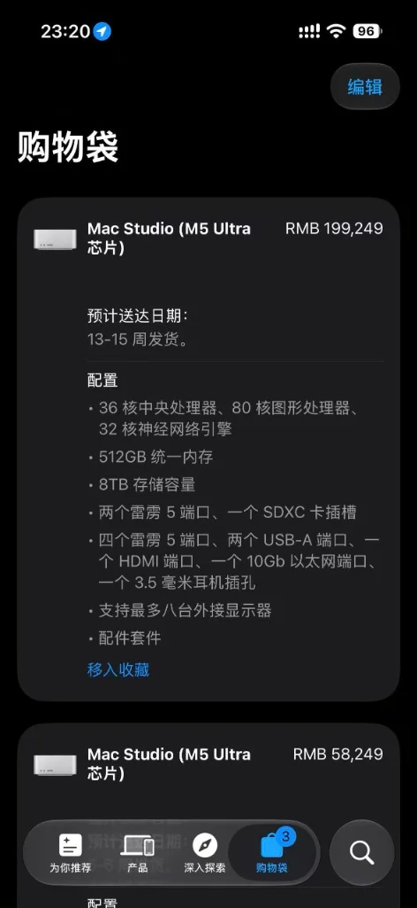

<!-- baoyu-skill cover prompt: 2.35:1小清新治愈知识漫画封面，柔和米白到浅天蓝渐变底色，干净纤细线稿，薄荷绿/暖杏/天蓝清新平涂，留白充足。禁止品牌logo与深色赛博UI。画面中央一台银色桌面工作站，屏幕上显示停滞的红色进度条与沙漏图标，顶部醒目标注「512G 统一内存」；旁边散落着长文本数据卷轴与秒表，秒表指针走过大半圈；右侧坐着一位程序员手托下巴看屏幕。顶部居中中文大标题「想买 M5 Ultra 512G？」，底部辅助文字「单台推理慢到怀疑人生」。中文文字端正清晰可读。 --ar 2.35:1 -->

大家好，我是 Jason。

前段时间我买了台 Mac Studio M5 Ultra 96G + 4T，到手 58,232 元。当时买它的初衷很明确：一台机器放在家里，负责跑 Agent 自动化，顺带给本地视频项目剪辑转码。

文章发出去后，不少读者在后台问：96G 跑不了本地大模型，如果加钱把 512G 统一内存买回来，能不能直接一步到位？

我打开苹果官方商店，点进定制页，勾选 36 核 CPU、80 核 GPU、512G 统一内存和 8T 存储。购物车跳出价格：199,249 元，发货排到了 13 到 15 周。下方还留着我买的那台 58,249 元的 96G 记录。

近 20 万元的桌面算力。购物车停在结账页，我没有付款。

这两周，我和几位已经拿到 512G 机器跑大模型的朋友聊了聊，也看了多组真实测试数据。在 DS-V4 Flash 与 muse-spark 这些模型上，512G 确实装得下权重。

但实测数据给所有人泼了一盆冷水：单台 M5 Ultra 跑大模型推理，慢到怀疑人生。

云端挑一个最慢的商业 API，响应速度也甩开眼前这台机器。

---

### 内存装得下，首字吐不出

512G 统一内存给足了容量。

DS-V4 Flash 放进去，muse-spark 放进去，几百 G 权重进入显存。系统监控界面平静，显存没报溢出，内存指示条留有余量。

装下权重，不等于跑完推理。

卡点在首 Token 时间（Time to First Token，TTFT）。

输入两百字短文本，机器两三秒吐出首字。把上下文拉长到 32k、64k，输入包含十个文件的代码库，整台机器陷入沉默。

控制台光标在黑底白字间闪烁，风扇静止，系统卡死在预填充计算环节。起身倒满茶水走回桌前，屏幕依然没有打出第一个字。

同样的长文本发给公有云 API，云端集群三秒内回传第一段结果。

<!-- baoyu-skill prompt: 2.35:1小清新知识漫画，淡暖杏向米白渐变，清线描边，薄荷绿/蜜桃/天蓝平涂，留白充足。禁止品牌logo与深色赛博UI。画面左侧一个透明玻璃水箱标着「512G 显存」，模型积木码在水箱内部，标注「DS-V4 Flash 权重就位」；右侧一条出水管道被代表「长上下文」的石块堵在入口，秒表显示等待时间；旁边画有一只小蜗牛趴在管道上方。顶部中文「内存装得下，首字吐不出」，底部「显存填满，卡死在长文本预填充」。中文文字工整清晰。 --ar 2.35:1 -->

---

### 本地模型配 Agent 成了泥潭

单次问答等两分钟，咬牙还能看结果。把本地模型放进 Agent 流程，整套流水线停工。

Agent 依靠连续交互运转：读写文件、检索目录、调用终端看报错输出。每执行一次外部工具，输出结果拼进上下文，Prompt 长度跳跃增长。

跑完三轮工具调用，上下文从 4k 撑到 30k。模型推导下一步前，必须把积累的几万 Token 从头重做一遍预填充。

单台 M5 Ultra 困死在预填充死循环里。界面冻结，进度条停滞。坐在工位前等十分钟，Agent 停在第二步敲命令。

苹果官方推理工具链缺少长链路工具调用的调度方案。显存碎片无法高效回收，计算管线堵死在重复计算中。

<!-- baoyu-skill prompt: 2.35:1小清新知识漫画，奶油白底色，清爽细线勾勒，薄荷绿/天蓝/暖黄平涂，留白充足。禁止品牌logo与深色赛博UI。画面呈现一条工作流水线，三个小机器人分别拿着放大镜、扳手和命令行终端，向中间的银色电脑搬送厚厚一叠日志文件夹；电脑屏幕弹出黄色沙漏，提示「Prefill 重新计算中」；旁边一位开发者趴在桌边看手表。顶部中文「Agent 的死循环」，底部「工具调用膨胀上下文，交互停摆」。中文文字端正清晰可读。 --ar 2.35:1 -->

---

### 算力利用率的断层

大模型推理的技术关隘，不在显存能不能装下。

英伟达 N 卡集群跑得快，依靠推理侧积累的工程调优。

把 GPU 利用率从 50% 提升到 90%，需要底层团队编写配套机制：算子融合消除访存开销，PagedAttention 整理显存页，分块预填充切碎长文本。这些优化靠工程团队一行行手写代码完成。

苹果现有的 MLX 与 Metal 只搭好基础骨架。

苹果生态缺少算子融合与并行调度，1.2TB/s 内存带宽转化不出有效算力。显存吃满几百 G，GPU 算力单元停工等待数据搬运。纸面参数写得齐整，实际输出慢如蜗牛。

<!-- baoyu-skill prompt: 2.35:1小清新知识漫画信息图，浅湖蓝向米白渐变，干净纤细线稿，薄荷绿/暖阳黄平涂，留白充足。禁止品牌logo与深色赛博UI。画面左右对比：左侧英伟达跑道上，齿轮管道咬合运转，标注「算子融合」「PagedAttention」「分块预填充」，齿轮旋转将利用率推到 90%；右侧苹果跑道上，宽阔传送带标着「1.2TB/s 统一内存」，传动轴空转，计算小人在原地等待搬砖，标注「缺少底层优化，GPU等待访存」。顶部中文「算力为何空转」，底部「显存容量买得到，工程优化买不到」。中文文字工整清晰。 --ar 2.35:1 -->

---

### 适合剪辑棚，不适合推理端

这台机器放错了地方。

视频极客工作室买下它，配三台 6K 屏，剪辑 8K 多轨 ProRes，调色加特效，机身安静，功耗几十瓦。内置的媒体引擎把音视频处理得顺滑。

买单台 512G M5 Ultra 跑本地主力大模型、跑 Agent 自动化，劝你收手。

单台统一内存再大，缺少底层优化框架，也顶不住长文本预填充的耗时。十几万花下去，换来的是面对终端长吁短叹。

<!-- baoyu-skill prompt: 2.35:1小清新知识漫画，浅米色到淡青渐变，清线描边，薄荷绿/暖杏/天蓝平涂，留白充足。禁止品牌logo与深色赛博UI。画面左右分割：左边是明亮的剪辑工位，Mac Studio 连着三台显示器剪辑多轨 8K 视频，进度条打着绿色对勾，顶上写着「视频渲染利器」；右边是暗色终端屏幕，跑着大模型推理脚本，终端停在预填充光标不动，顶上写着「本地推理停滞」。顶部中文「各归其位」，底部「剪辑调色得心应手，大模型推理暂且绕行」。中文文字端正清晰可读。 --ar 2.35:1 -->

---

幸好我没有花那 20 万买 512G。

我手里这台 96G + 4T，分工清清楚楚：本地开终端、装依赖、跑无头浏览器、给 Agent 当工位，顺带剪片做视频。重活全交给云端大模型。

买单台 512G M5 Ultra 跑本地主力大模型、跑 Agent 自动化，劝你收手。

单台统一内存再大，缺少底层优化框架，也顶不住长文本预填充的耗时。近 20 万花下去，换来的是面对终端长吁短叹。

本地推理大模型，现阶段成本会比较高，对于普通人而言，把算力交给云端集群，把本地设备留给终端和工位，算下来最省心。

---

### 相关阅读

- [今年买了近40万的苹果设备跑Agent：10月24日，我又添了一台M5 Ultra]({{ site.baseurl }}/m5-ultra-96g-agent-machine-400k-apple)
- [Apple M5 Ultra 512G 月底发售：12 到 15 万的桌面算力，你会买吗？]({{ site.baseurl }}/m5-ultra-studio-512g-local-compute)
- [为了把跨国分布式节点调出局域网手感，我们付出了昂贵的网络成本]({{ site.baseurl }}/cross-ocean-remote-desktop-bgp-pro-relay)
