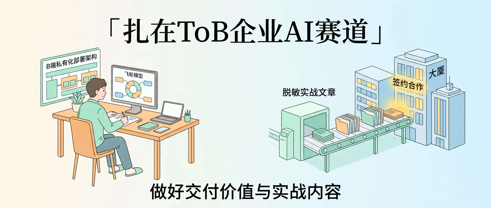
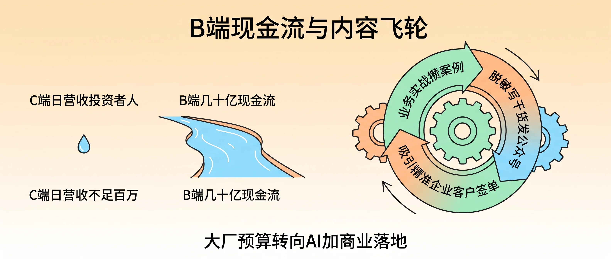
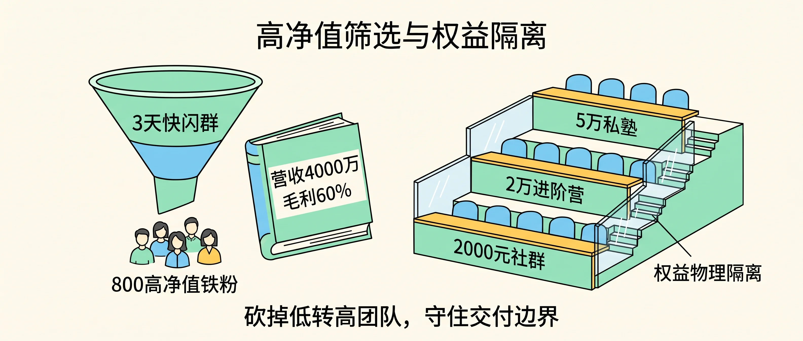
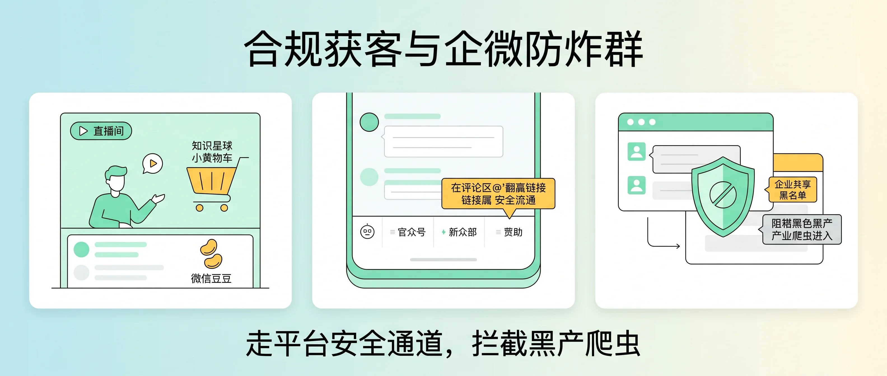

<!-- baoyu-skill cover prompt: 2.35:1小清新治愈知识漫画封面，柔和米白到浅天蓝渐变底色，干净纤细线稿，薄荷绿/暖杏/天蓝清新平涂，留白充足。禁止品牌logo与深色赛博UI。画面左侧一位创业者坐在原木办公桌前编写企业AI交付方案，屏幕显示B端私有化部署架构与飞轮模型；右侧一条清爽的传送带将脱敏实战文章送往几家企业大厦，大厦亮起签约合作的暖黄灯光。顶部居中中文大标题「扎在ToB企业AI赛道」，底部辅助文字「做好交付价值与实战内容」。中文文字端正清晰可读。 --ar 2.35:1 -->

大家好，我是 Jason。

上周五在陆家嘴见了一位做科技自媒体的老朋友。他把手机推到桌面上，后台躺着四十万粉丝，十月份接了两单软件推广，扣掉编导工资和买量投流，账面只剩两万多块钱。

他看着我手机里跳出来的 Stripe 订阅入账和企业对公水单，问我：你平时公众号阅读量就几千，写的全是修软路由、调跨洋 90ms 专线、给客户装私有化大模型，怎么单子一签就是大几万甚至几十万的年框？

我跟他说，你写东西是为了让几十万人图个乐，我写东西只为了让几十个手握预算的企业主看懂我们在干什么。

创立寻绎科技、打磨 Zaokit AI 产品矩阵这三年半，我越来越不想写那些讨好大众的口水文。扎在 ToB 企业 AI 服务这条赛道上，把产品磨成客户离不开的生产力，把一线交付的真东西剥开写成内容，这两件事就够我们吃得很饱了。

---

### 现金流藏在企业的内网与机房里

普通散户的钱有多难赚，拆开头部大厂的财报就明白了。市面上日活几亿的国民级 AI 应用，每天从 C 端散户手里收上来的会员费还不到一百万；真正撑起它们几十亿现金流的，全是底下的 B 端云服务和企业 API 接口。

这也是为什么 Zaokit 从一开始就围着企业级场景长出来：
跨国快消巨头的数据不能出内网，我们把 **Zaokit AI PPT** 做成私有化部署，一个部门接一个部门往下铺；企业员工需要能干活的“数字同事”和培训路演材料，我们交付 **Zaokit Cowork** 与 **Zaokit AI Edu**；外贸老板、极客工作室和家族办公室需要绝对私密的本地大模型，我们推出 **Zaokit Local 私有化算力部署**（`local.zaokit.app`），用三台机器搭起 27B 加双 9B 的内网协同集群，连同 **Zaokit AI Gateway** 和 **AI 安全护栏** 一起交到客户手上；再往下走，**Zaokit SSO**、**Zaokit OA**、**Zaokit MDM** 和 **Zaokit iPaaS 数据 ETL 平台** 直接替企业把数字底座焊牢。

连甲方金主的预算风向都在印证这件事。今年前三个季度，各家大厂还在到处找博主测纯工具功能；一进十月，市场部的投放清单全改成了“AI+商业财经”和能讲透“B端企业落地故事”的账号。谁手里有真实的行业落地案例，下半场的预算就往谁怀里钻。

很多同行把写公众号当成主业之外的纯消耗，写半年就把自己掏空了。在 Zaokit，内容长在业务飞轮的咬合齿轮上：白天我带着工具给客户调试 **Zaokit ClaudeOps** 在八个国家的原生宽带物理机，或者去给企业验收三机私有模型；晚上回到书桌前，把客户敏感信息抹掉，把架构图、终端命令和算过的成本账写成复盘发出去。正在为同样问题头疼的 CTO 和业务老板搜到文章，看完不用我们推销，顺着底部菜单加过来直接聊合同。

要是你不想天天追着热搜跑，不如走向上社交的窄门。把硅谷一线创始人和顶级风投的非共识认知嚼碎，摸透国内大厂掌门人和投资人平时看问题的颗粒度，融进你的技术与商业拆解里。哪怕全网只有三百个投资人和企业高管常年看你的文章，你手里的 ToB 定制单和资源撮合就忙不过来。

当然，单打独斗的超级个体（OPC）接多了外包也容易累垮。身边几个跑通的同行组了个局：三五个分别懂底层架构、懂企业商务、懂内容表达的人合资开家小公司。项目谁主理谁有一票否决权，回款先留四成在公司公账上做储备，剩下六成按大伙儿的实际贡献分掉。几个人联手写行业蓝皮书、接大企业的整包 AI 改造，直接把头部预算吃下来。

<!-- baoyu-skill prompt: 2.35:1小清新知识漫画，淡暖杏向米白渐变，清线描边，薄荷绿/蜜桃/天蓝平涂，留白充足。禁止品牌logo与深色赛博UI。画面左侧对比C端散户小水滴（标注「C端日营收不足百万」）与B端云服务宽阔水渠（标注「B端几十亿现金流」）；右侧展示一个咬合旋转的飞轮：业务实战攒案例、脱敏写干货发公众号、吸引精准企业客户签单。顶部中文「B端现金流与内容飞轮」，底部「大厂预算转向AI加商业落地」。中文文字工整清晰。 --ar 2.35:1 -->

---

### 高客单筛选与严苛的物理隔离

做 ToB 和高客单业务，千万别迷信微信里的好友总数。四十万泛粉带来的利润，比不上八百个认准你专业度的高净值铁杆客户。在企业服务赛道，八百个核心客户足够撑起四千万营收，还能拿到六成毛利。

我从不养庞大的电销团队去搞“九块九引流再洗高客单”那套。现在跑得最顺的打法很轻：借着一次新产品发布（比如十月中旬 **Zaokit ClaudeOps** 或 **Zaokit Local** 上线）开场直播，拉一个提前说好“只存续三天”的快闪群。那七十二小时里，我往群里密集抛出一线算力部署和 Agent 落地的真问题，看谁在认真接招、谁在追问业务细节。把这批主动冒头的同行和老板一对一加上微信，深聊半小时，直接签几千美金的集群部署或年度代运营。三天一到，群准时解散，不留死群。

给产品定什么价，取决于你在哪个渠道收钱。指望读者看完一篇公众号推文当场扫码付款，两百到三百块钱就是决策天花板。一旦客单价越过一千块，或者像我们交付几千上万块的私有化算力和企业陪跑，前头就得搭好信任台阶：先用一份轻量的架构诊断破冰，接一场直播看真实终端演示，再带客户跑一个为期七天的业务 POC 体验营，客户亲眼看到效率提上来了，大单尾款自然水到渠成。

要是你手里没有专门的转化团队，起步就把门槛立高。直接从四千九百八、九千八的专项陪跑，或者像 **Zaokit Local** 单机 $499、集群 $1,199、企业 $2,999 的标准包卖起。高客单是最好的过滤器，直接替你把那些花几十块钱却要求二十四小时伺候的白嫖党挡在门外。留下的全是算得清时间账的聪明人，到期续费率反而高得出奇。

当我们把产品线拉开梯度，比如在 **Zaokit ClaudeOps** 里划分 1x（$99/月）、5x（$399/月）、20x（$699/月），或者在咨询圈子里区分两千块社群、两万块进阶营、五万块私塾，有一条不能碰的铁律：**做好权益的物理隔离**。就像我们在澳洲、美国、新加坡等八国机房给 ClaudeOps 客户配单租户物理隔离的 Mac Studio 一样，不同档位的服务边界必须用铁丝网隔开。千万别心软给低价档位超额干活，一旦越界，不仅把你自己累趴下，那些付了顶配费用的大客户觉得吃了亏，转头就会离开。

至于平时顺手写出来的薄套壳工具，看淡一点。现在同行抄一个界面只要一两周，底层大模型隔半年升一次级，大半套壳产品直接灰飞烟灭。我们在研发 **Zaokit Cowork** 和内部工具链时攒下了不少好用的自动化 Skills，要么趁着窗口期封装成云端小工具收一波快钱，要么干脆打包进几万块的私有化算力与企业陪跑里当成赠品，让高客单的主业务更有杀伤力。

<!-- baoyu-skill prompt: 2.35:1小清新知识漫画，奶油白底色，清爽细线勾勒，薄荷绿/天蓝/暖黄平涂，留白充足。禁止品牌logo与深色赛博UI。画面左侧一个漏斗写着「3天快闪群」，筛出「800高净值铁粉」，旁边账本标注「营收4000万 毛利60%」；右侧展示三层阶梯教室，分别标着「2000元社群」「2万进阶营」「5万私塾」，每层之间立着透明隔断墙，标注「权益物理隔离」。顶部中文「高净值筛选与权益隔离」，底部「砍掉低转高团队，守住交付边界」。中文文字端正清晰可读。 --ar 2.35:1 -->

---

### 摸准平台规则与守住企微群门

每推一款新产品或开一个新圈子，动手前先写一份“客户小传”。比如我们做 **Zaokit Local** 时就画得很死：一类是怕询盘和底价泄露的外贸老板，一类是天天跑 Agent 怕封号的极客工作室，还有一类是看重隐私的家族办公室；而如果面向二三线城市的普通白领，痛点就得换成“怎么用 **Zaokit AI PPT** 早点交差、少加一小时班”。受众切得越窄，推广时每一句话就越能扎进肉里。

公域获客的洼地也在变。现在用视频号开播、发短视频挂车，再投一点“微信豆”加热，获客成本比其他买量渠道便宜一大截。而且视频号小店刚刚打通了直接挂载知识星球，直播间里演示完 Zaokit 的自动化工作流，感兴趣的朋友点开小黄车就能进圈子，再也不用像以前那样对着镜头举二维码、提心吊胆怕被平台秒封号了。

公众号往私域引流同样得讲究合规。现在一关注就自动弹二维码、文末明晃晃写“加微领资料”、或者阅读原文直接跳外部链接，极易触发公众号降权。稳妥的接法只有两条：把个人号或企微码藏进公众号底部的固定菜单栏，或者在文章评论区第一条置顶一段带文字链的留言，点击后跳转到另一篇专门放二维码的纯文字短推文。

做企业服务还要防一手黑灰产。千万别在公开网页或长期不删的推文里贴死微信群二维码，外面的黑产爬虫二十四小时扫网，顺着码混进群就开始刷诈骗链接炸群。我们建客户群全部走企业微信，建群先开满防骚扰规则，再去企微后台把“企业共享黑名单”勾上，把那些有前科的诈骗黑号直接拦在门外。

如果做面向开发者的轻量订阅或付费圈子，阶梯涨价是最好的催化剂。从最早的四十九、九十九一路阶梯涨到两百四十九，或者像我们的云存储与算力套餐留出限时特惠窗口，每次上调价格前结合节假日发一次倒计时通知。人都有损失厌恶心理，看着优惠窗口要关上，观望的客户自己就会做决定。

<!-- baoyu-skill prompt: 2.35:1小清新知识漫画信息图，浅湖蓝向米白渐变，干净纤细线稿，薄荷绿/暖阳黄平涂，留白充足。禁止品牌logo与深色赛博UI。画面分为三格清爽卡片：第一格视频号直播间挂载「知识星球」小黄车并投喂「微信豆」；第二格公众号底部菜单栏与评论区置顶链接安全引流；第三格企业微信群开启防骚扰盾牌与「企业共享黑名单」，把黑灰产爬虫挡在门外。顶部中文「合规获客与企微防炸群」，底部「走平台安全通道，拦截黑产爬虫」。中文文字工整清晰。 --ar 2.35:1 -->

---

### 让云端Agent守夜，把人味留给客户

既要写代码交付 Zaokit 的企业项目，又要维护客户社群，怎么防断更？圈内验证过一套“4+3 排期法”：周一到周四由主理人输出硬核实战干货；周五到周日全员禁发闲聊水贴，只开放“交实战作业”与互评。这既能防止前两个月亢奋日更、后面精力掏空断更，也能避免新付费的客户进来看见满屏水贴，在三天无理由期内直接点退款。

微信群也不必见人就塞。把微信群当成高阶客户的荣誉奖励：规定每周在星球或实战营里交作业排名前五的人，才由我主动加微信、拉进核心小群。免去了每天管理几百人死群的折磨，小群里全是真动手跑代码、做业务的同行，随便聊几句都能促成生意。

维护铁杆客户，花小钱办高温度的事最管用。到了年底，用我们自己的 AI 脚本把铁杆会员这一年分享的几十篇优质实战帖抓取出来自动排版，去淘宝花二十块钱印成一本装帧精致的实体《个人作品集》寄到他手上。这种被认真对待的感动，会让他的续费率和转介绍意愿直接拉满。

至于那些每天消耗心神的群消息巡检，早就被我们交给 Agent 了。在企业微信里配好原生的“大圆”或者挂载了 **Zaokit Cowork** 自定义 Skills 的云端机器人，每天半夜，Agent 自动巡检几百个静音的行业群，把里头有人问企业 AI 部署、找 API 接口和私有算力的商机捞出来；同时检查白天有没有漏回的 VIP 客户消息，自动排查未来七天内 **Zaokit ClaudeOps** 或企业服务即将到期的客户名单，顺手把当天的群精华生成一份日报。第二天一早打开电脑，照着清单干活就行。

AI 狂飙突进到今天，拉齐八十分的工业化水准只需要三个小时。但越是这样，最后那二十分属于人类的东西反而越来越贵：你的审美、你在机房排障时的真实感受、你和客户在线下泡一壶茶建立的深度连接。

上个月我把“多做好事”写进了 Zaokit AI 的使命和价值观里。不忽悠客户买近二十万却跑不动推理的顶配硬件，帮企业用最合脚的方案把业务跑通。AI 可以替我们写代码、替我们半夜巡群，但那最后二十分的真诚与信用，才是让客户愿意跟着寻绎和 Zaokit 走上八年、十年的真正护城河。

<!-- baoyu-skill prompt: 2.35:1小清新知识漫画，浅米色到淡青渐变，清线描边，薄荷绿/暖杏/天蓝平涂，留白充足。禁止品牌logo与深色赛博UI。画面左侧一只云端小机器人「大圆Agent」在夜间巡检静音群，捞出VIP客户消息与询价商机，旁边的日历标着「周一至周四干货，周五至周日交作业」；右侧一位创作者将一本印着《个人作品集》的实体小册子递给读者，天平上「20分真实审美与真诚」压过「80分AI工业化评测」。顶部中文「Agent巡检与最后20分人味」，底部「机器替人减负，真诚留住十年客户」。中文文字端正清晰可读。 --ar 2.35:1 -->

---

### 相关阅读

- [一人公司生存图鉴：我是如何做到年入100万的]({{ site.baseurl }}/one-person-company-million-claude-code)
- [Zaokit私有算力服务正式向全球开放：四年经验倾囊相授，少走弯路多做好事]({{ site.baseurl }}/zaokit-private-compute-local-launch)
- [Claude代运营上线：在不确定的环境里，买一份确定的顶尖生产力]({{ site.baseurl }}/zaokit-claude-ops-global-launch)
- [写在公司营收第一个100万：创业头三年，除了你自己哪还有什么团队]({{ site.baseurl }}/first-million-revenue-three-years)
