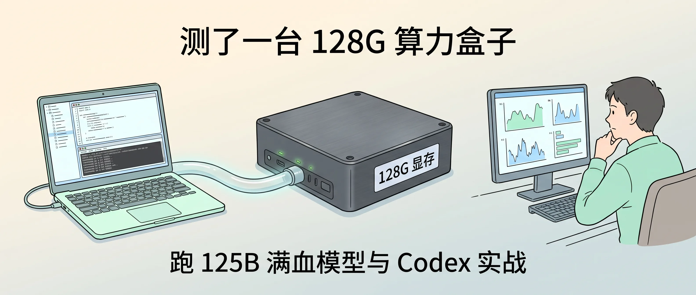
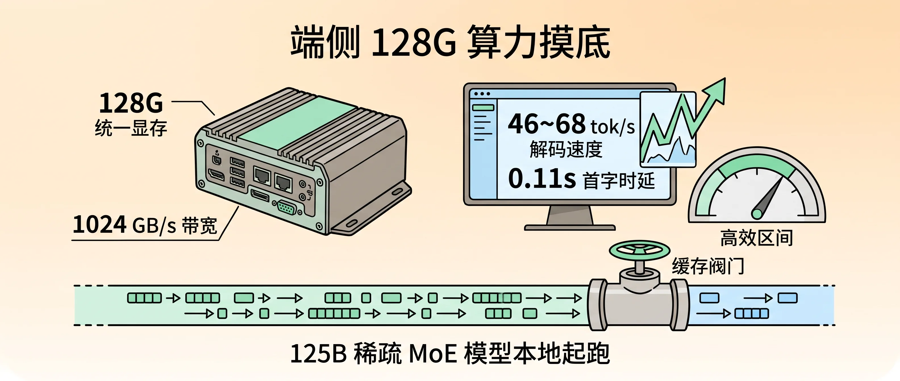
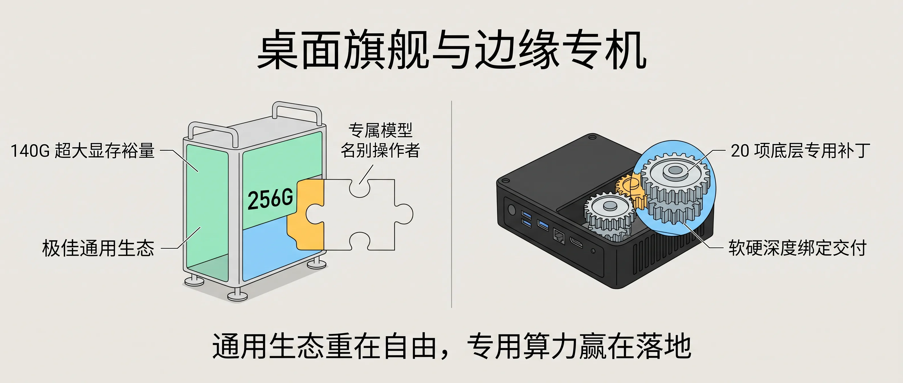

<!-- baoyu-skill cover prompt: 2.35:1小清新治愈知识漫画封面，柔和米白到淡青灰渐变底色，干净纤细线稿，薄荷绿/天蓝/暖灰平涂，留白充足。禁止品牌logo与深色赛博UI。画面中央摆放一台银灰色金属质感的紧凑型智算盒子，机身微亮绿色工作指示灯，标注「K50 Edge 128G 显存」；左侧连着一条半透明发光数据管道通往笔记本电脑，终端界面上整齐排列着代码与命令流；右侧坐着一位程序员手托下巴观察屏幕上跳动的测试数据。顶部居中中文大标题「测了我们共建的 128G 算力盒子」，底部辅助文字「把 125B 满血模型装进桌面」。中文文字端正清晰可读。 --ar 2.35:1 -->

大家好，我是 Jason。

这几个月我和团队一直在推 Zaokit Local 的私有化算力交付。很多企业客户和极客朋友提过同一个诉求：受够了公有云按 Token 计费的水表、数据出境的合规顾虑，以及写代码到半夜突发的网络断流，能不能有一台直接摆在桌面上的实体机器，把真正能打的大模型和 Agent 算力完全锁在内网里。

带着这个目标，我和朋友公司（增乘 AI）联合共建了一款专门面向个人工作站、实训教学与企业机房的边缘智算终端——增乘 AI K50 Edge（我们内部研发代号叫 T5000）。

第一批工程机前天完成了系统固件封包。机身用的是整块铝合金 CNC 切削，银灰金属质感，拿在手里沉甸甸的。整机尺寸只有 160 × 146.4 × 60 毫米，比两本叠放的平装书还要小一圈。

在这台小盒子里，我们塞进了一套硬核底座：14 核 64 位 ARM 处理器，2560 核 GPU 与 96 个张量计算单元，最高提供 2070 TFLOPS（FP4）AI 算力；配了 128G LPDDR5X 统一内存，CPU 与 GPU 共享显存；外加万兆与 2.5G 双网口。整机功耗在 40W 到 130W 之间滑动。

里面直接装载了阿里最新的 Qwen3.8-Flash-Next：一个总参数 125B、单 Token 激活 5B 的超大稀疏 MoE 模型。

硬件组装成型只是第一步。机器通电，接上网线，连入 Tailscale 虚拟网卡，我坐到屏幕前，用主力开发机对它进行了一轮从底层协议调试、并发压测到长链路 Agent 实操的完整摸底。



---

### 把 125B 模型塞进桌面

把设备连上电源适配器，接通网线。机身双风扇发出轻微气流声，几秒后转入低转速温控状态，噪音隐入室内背景。

```text
设备型号: 增乘 AI K50 Edge (代号 T5000)
AI 算力: 最高 2070 TFLOPS (FP4)
计算核心: 2560 核 GPU + 96 个张量计算单元 / 14 核 ARM 处理器
内存配置: 128 GB LPDDR5X (CPU/GPU 共享统一内存)
存储接口: 2 TB NVMe SSD + 10GbE 万兆以太网 + 2.5GbE 以太网
系统环境: Ubuntu 24.04 LTS (出厂预装深度学习运行时)
```

后端服务跑在 Docker 容器内部，核心是经过定向修剪的 `tensorfold-native` 服务。

参数配置锁死在最高规格：上下文窗口开放至 262,144 tokens（256K），启用 FP8 格式的 KV Cache，单批次开放 5 路并行处理，单次最多输出 32,768 tokens。

打开测试脚本，直接向端口发送推理请求：

```text
短文本测试（思考模式开启）：
输入 57 tokens，输出 77 tokens
首字时延（TTFT）：0.115 秒
解码速度：46.2 tokens/s
投机命中率：51.3%

长文本追问（Prompt 缓存命中）：
前置上下文 2,120 tokens，缓存命中 2,047 tokens
首字时延：0.370 秒
解码速度：68.8 tokens/s
投机命中率：67.2%
```

短文本输入在 120 毫秒内吐出首字。多轮追问命中前置缓存后，解码吞吐稳定在 68.8 tok/s。

把一个 125B 参数体量的模型压缩在百瓦功耗的书本级设备内，单人交互手感已经追平了主流商业 API。



<!-- baoyu-skill prompt: 2.35:1小清新知识漫画，淡暖杏向米白渐变，清线描边，薄荷绿/暖灰/浅天蓝平涂，留白充足。禁止品牌logo与深色赛博UI。画面左侧展示一台紧凑的工业级金属算力盒子，标注「K50 Edge」「128G 统一显存」「2070 TFLOPS」；右侧是跳动的数据看板，显示「46~68 tok/s 解码速度」「0.11s 首字时延」，指针落在绿色高效区间；下方画有一段数据流顺畅流过缓存阀门。顶部中文「端侧 128G 算力摸底」，底部「125B 稀疏 MoE 模型本地起跑」。中文文字工整清晰。 --ar 2.35:1 -->

---

### 连上 Codex，撞上第一道报文屏障

基准跑分过关，接下来必须放进真实生产流水线。

我的主力编码工具是 OpenAI Codex CLI。打开配置文件，将 Provider 指向新机器的端点，敲下回车：

```bash
codex -p t5000
```

会话窗口弹出，我随手敲入第一条测试指令：“请用三句话介绍你运行的硬件平台。”

两秒后，终端吐出一行红色报错：

```json
{"error": {"message": "incomplete request body", "type": "invalid_request_error", "param": null, "code": null}}
```

换成单个词“hi”，同样的红字再次出现。

调出通信抓包工具，检查两端进出流量，故障根源在客户端的报文组装。

Codex CLI 启动时扫描系统全局，把环境中配置的全部 MCP 插件和云端工具打包进每轮对话请求。Canva、Google Drive、ChatCut、Node REPL 等 30 多个工具的定义被整块塞进报文，且工具类型标为 `type: "namespace"`。

单次请求的 JSON 体积被顶到了 773 KB。

K50 Edge 上跑的原生 Zig 引擎遵循严格的 OpenAI 规范，只解析 `type: "function"`。遇到非标的 `namespace`，服务端立即返回 HTTP 400 并切断 TCP 握手。

连接断开，传输字节未达到声明的 Content-Length，服务端保护机制吐出了 `incomplete request body`。加上本地运行着代理客户端，Tailscale 内网跨网段流量遭遇二次劫持，请求彻底卡死。

我在 Mac 本地写了一个透明适配守护进程（`t5000-adapter.py`），监听本地 `127.0.0.1:18888`：

* 动态遍历 `tools` 列表，过滤非 function 的冗余定义，单次请求体积从 773 KB 压缩至 70 KB；
* 绕过本地系统代理池，强制直连内网虚拟网卡；
* 采用底层的 `read1()` 缓冲调度，保持 SSE 流式吐字平滑。

将适配器注册进系统的 LaunchAgent 常驻服务，重新唤醒 Codex 输入测试：

```text
codex › 刚敲了一条命令，你的 Mac 立刻回了我：现在是 2026-11-03 16:34:18（东八区），系统 Darwin arm64，1+1=2——所以我确实在跑。
tokens used: 402
```

模型自主调用本地 Shell 工具完成自检并回传结果，连通障碍排除。


<!-- baoyu-skill prompt: 2.35:1小清新知识漫画，奶油白底色，清爽细线勾勒，薄荷绿/天蓝/淡橙平涂，留白充足。禁止品牌logo与深色赛博UI。画面左侧展示一只背着巨大包裹（标注「773KB 冗余插件」）的小机器人被标着「400 拒绝」的安检门挡住；中间放置一个轻量过滤器（标注「本地透明适配器」），将包裹迅速拆解压缩至「70KB 合规工具」；右侧小机器人轻快通过绿色安全通道，将数据递送给后方的金属智算盒子。顶部中文「报文瘦身与协议对齐」，底部「剥离非标工具，打通调用链路」。中文文字端正清晰可读。 --ar 2.35:1 -->

---

### 十万 Token 连续调用的时序死结

连通单次对话远远不够，真正的考验是让 Agent 承担长链路自动化任务。

在终端中给它下达具体任务：跨节点检查远程服务器上的智能合约项目。

Codex 启动自治循环，开始在后台生成脚本并连续下发命令：

* 生成 `p4.sh`，扫描待处理任务列表；
* 生成 `p5.sh`，抓取项目文档与排期；
* 生成 `p6.sh`，校验线上与本地打包文件的 MD5；
* 发起 SSH 远程连接比对资产文件；
* 一路连续执行到 `p8.sh`。

八轮交互过后，终端屏幕滚动，工具回传的大段输出累加进会话历史。

单次请求的上下文体积飙升至 434 KB。服务端的 Prompt 长度突破了 **100,401 tokens**。

第 8 轮刚敲完回车，熟悉的红色报警再次浮现：

```text
Sanitized tools: 29 -> 10 (body 434507 bytes)
T5000 HTTPError 400: {"error": {"message": "incomplete request body", ...}}
```

调阅设备后端的 Docker 日志，服务端在同一秒打出了状态：

```text
info: prompt cache: 100401 tokens, resumed at 99837, kept 1; 2 states, 3825 MiB and 0 MiB spare of 4215 MiB
[tensorfold] <client-ip> "POST /v1/responses HTTP/1.1" 400
```

服务端的 Prompt 缓存已被占满，剩余可用空间降为 0 MiB。

翻查底层 `http_conn.zig` 与 `http_body.zig` 源码，问题出在长连接时序重叠上。

当单次请求体积超过 400 KB，客户端协议头默认附带了 `Connection: keep-alive` 与 `Expect: 100-continue`。

在跨网段的长链路上传输大体积报文时，Python 客户端连接与服务端的 Zig 监听线程发生时序竞争。底层 socket 提前读到断开标记，接收字节数少于头部声明数值，服务端判定报文不完整，抛出 400 保护。

我们立即对本地适配器进行了二次升级：

1. **改写数据读取机制**：改用循环累加的内存缓冲块，读满指定字节数再交付，阻断本地截断；
2. **清除长连接竞争**：剔除 `Expect` 声明，强制注入 `Connection: close`，要求每轮十万 Token 的交互使用独立的干净 TCP 链路；
3. **内存自愈重试**：在适配器中暂存单轮完整报文，若检测到底层网络抖动引发的 400 截断，0.2 秒内自动发起重新传输。

升级部署完毕，我直接向设备压入一组 30 万字节（5 万 Token）的长文本请求：

```text
Testing upload of 300,113 bytes with Connection: close...
Success! Status: 200 in 84.71s
```

返回刚才停顿的终端，敲下“继续”，Codex 接上断点，顺利跑通了后续全部脚本。


<!-- baoyu-skill prompt: 2.35:1小清新知识漫画，浅天蓝向米白渐变，清线描边，薄荷绿/暖杏/天蓝平涂，留白充足。禁止品牌logo与深色赛博UI。画面描绘一条长距离赛道，上方标着「100,000 Tokens 长上下文马拉松」；跑道中途设有一个水站，工程师正用扳手更换「Connection: close 独立管线」与「自动重试缓冲器」；前方的大型数据包顺利滑过终点线，亮起绿色「200 OK」灯光。顶部中文「突破十万上下文屏障」，底部「长连接时序重构，保障多轮自治稳定」。中文文字工整清晰。 --ar 2.35:1 -->

---

### 换成顶配 M5 Ultra 能否打平？

把这套链路调通后，有同行问我：如果直接采购一台 256G 顶配的 Mac Studio（M5 Ultra），能不能省去这套底层软硬件的折腾？

我把手头的测试数据与官方模型卡进行了交叉比对。

如果是 96G 内存的 M5 Ultra，完全跑不动这套模型。4-bit 量化后的权重分布在 22 个分卷中，总大小达到 **105.46 GB**。macOS 限制单个进程调用显存不能越过物理内存的八成，直接加载会触发 Metal OOM 闪退。

换成 256G 内存的 M5 Ultra，硬件素质上完全过关：

* **显存容量**：吃掉 105G 权重，机器还留有 140G 内存，支撑 256K 上下文没有压力；
* **解码速度**：官方在 M3 Studio 上使用 oMLX 跑出的基准为 31.4 tok/s。结合 M5 核心算力与带宽提升，理论速度可落在 **55 到 70 tok/s**，体验上完全能对齐 K50 Edge。

核心的分水岭落在软件工程的交付形态上。

K50 Edge 之所以能把 125B 稀疏 MoE 跑得顺畅，核心是固化在系统镜像里的 20 项定制底层补丁：针对寄存器的 16 行专家切片、针对中文投机词表的 pread 读取器，以及定制的 FP8 KV 缓存调度。这套软硬件深度咬合的工程，做到了开箱即用。

通用桌面工作站更适合跑标准化开源大模型；而面对定制深度调优的私有化模型与多模态边缘任务，专用硬件盒子用扎实的软硬一体化，守住了自己的交付壁垒。



<!-- baoyu-skill prompt: 2.35:1小清新知识漫画信息图，浅米灰底色，干净细线，薄荷绿/暖阳黄/天蓝平涂，留白充足。禁止品牌logo与深色赛博UI。画面左右对比：左侧是一台银色优雅的 256G 桌面工作站，上方标注「140G 超大显存裕量」「极佳通用生态」，但在特殊模型算子处留有一块待拼合的拼图；右侧是紧凑坚实的金属边缘终端，内部精密齿轮紧扣，标注「20 项底层专用补丁」「软硬深度绑定交付」。顶部中文「桌面旗舰与边缘专机」，底部「通用生态重在自由，专用算力赢在落地」。中文文字工整清晰。 --ar 2.35:1 -->

---

### 算力归硬件，手感归工程

测完这台 K50 Edge，我对端侧大模型的落地有了更具体的坐标。

硬件规格决定了计算性能的上限，而真实的业务手感取决于中间那层网络与协议调优。

把一台强劲的端侧设备放在工位上，如果协议对不齐、报文过大被阻断、长连接时序发生错位，再高的算力参数也只会换来终端里的报错红字。

通过本地适配器抹平生态差异，清洗请求头，把十万 Token 交互的长连接做实隔离，这台体积不到两本书的小盒子，才真正转变成一把靠谱的本地开发利器。

端侧大模型正在从“能否在本地点亮”的验证期，进入“能否连续稳定干活”的工程交付期。把中间每一处时序与协议卡点夯实，桌面上这方寸之间的算力，才算真正变成了长在自己业务上的生产力。

如果你有相关的端侧算力需求、或者对这套 128G 盒子与本地专线方案感兴趣，欢迎随时私信我，我给你安排连入试用体验。

---

### 相关阅读

- [想买 M5 Ultra 512G 跑大模型？单台推理慢到怀疑人生]({{ site.baseurl }}/m5-ultra-512g-slow-inference-agent)
- [今年买了近40万的苹果设备跑Agent：10月24日，我又添了一台M5 Ultra]({{ site.baseurl }}/m5-ultra-96g-agent-machine-400k-apple)
- [围着Zaokit做ToB企业AI服务，我把实战写成了增长飞轮]({{ site.baseurl }}/tob-ai-service-value-and-content)
