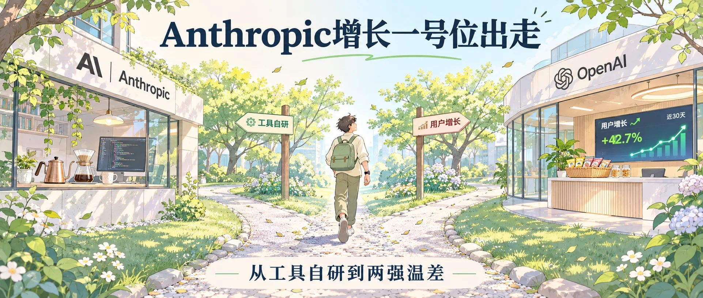
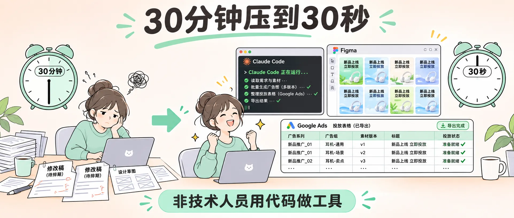
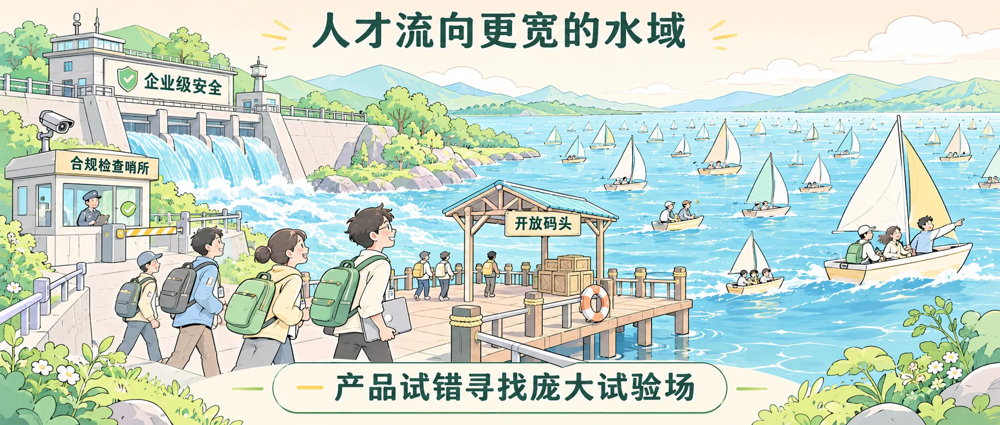

<!-- baoyu-skill cover prompt: 2.35:1小清新治愈知识漫画封面，柔和米白到浅蓝微光渐变，干净纤细线稿，薄荷绿/暖杏/浅天蓝平涂，留白充足。禁止品牌logo与深色赛博UI。画面展示两条明亮的林荫小径连接两栋风格各异的办公大楼，树影斑驳，微风吹拂落叶。左侧大楼窗内摆放着考究的手冲咖啡壶与代码屏幕，右侧大楼前台摆着装满零食的竹篮与跳动的用户增长看板；中央一条细石子路上一位背包青年迈步前行，身影从容。顶部居中中文大标题「Anthropic增长一号位出走」，底部辅助文字「从工具自研到两强温差」。中文文字端正清晰。 --ar 2.35:1 -->

大家好，我是 Jason。

Austin Lau 发出离职帖，脱下 Anthropic 工牌，走进 OpenAI。

两天前，带队做出 Claude Code 的 Cat Wu 走了相同的路。

Anthropic 传出筹备上市的消息，两位带头人相继出走。一位掌管终端代码产品，一位负责拉动用户规模。

---

<!-- baoyu-skill prompt: 2.35:1小清新知识漫画，米白色细腻底色，清爽细线勾勒，暖橙/淡绿/天蓝平涂，留白充足。禁止品牌logo与深色赛博UI。画面展示一条清晰的用户流转通道：左侧是刚出厂的代码齿轮与软件盒子，中间一位增长专员正在检查广告看板、搜索排名跳动曲线与邮箱图标，右侧通向许多正在操作电脑的新用户。顶部中文「增长团队的日常齿轮」，底部「把软件推向更多人的双手」。中文文字端正工整。 --ar 2.35:1 -->

### 增长团队抓什么

很多人不知道增长团队做什么。

程序员写完功能，代码推上服务器，事情只做了一半。新产品摆上货架，需要有人拉来第一批使用者，促成留存。

买广告曝光、梳理搜索引擎抓取规则、缩短注册填表步骤、给新邮箱推送操作手册，这套杂务落在增长团队肩上。科技公司把干这类事情的部门叫做增长团队。

2024 年 7 月营销平台 Passionfroot 采访过 Lau。他是 Anthropic 招入的第一位增长员工，指标明确：让更多人打开 Claude 聊天窗口。在此之前，他在 Dropbox 和 Notion 操盘增长业务。

---

<!-- baoyu-skill prompt: 2.35:1小清新知识漫画，淡暖杏向米白渐变，清线描边，薄荷绿/天蓝平涂，留白充足。禁止品牌logo与深色赛博UI。画面左侧展示过去的工作台：闹钟指着30分钟，桌上散落着等待排期的修改稿与设计草图；右侧展示全新的工作流：终端窗口内Claude Code正在运行，Figma画布瞬间排满多版广告图，旁边Google Ads表格整齐导出，闹钟指针定格在30秒。顶部中文「30分钟压到30秒」，底部「非技术人员用代码做工具」。中文文字端正清晰。 --ar 2.35:1 -->

### 30 分钟压缩到 30 秒

Anthropic 官方在今年 1 月专门发文介绍 Lau 的工作流程。

Lau 过去没写过代码。以往投放广告，写完文案后，需求交进设计部排期。设计师修改尺寸，再交前端切图，几天时间耗在跨部门沟通里。

Lau 打开 Claude Code，给自己做了两套工具。

第一套，Figma 插件。按一下按键，系统批量排出不同比例与文案组合的海报。

第二套，谷歌搜索广告词助手。文案敲定，直接导出表格，上传广告后台。

官方文章写明：制作单条广告耗时从 30 分钟压至 30 秒。

增长人员过去只能提需求等排期。AI 拆掉代码门槛，非研发人员拿起代码工具，把流水线装进个人电脑。

---

<!-- baoyu-skill prompt: 2.35:1小清新知识漫画，浅湖蓝向米白微光渐变，干净纤细线稿，薄荷绿/暖阳黄平涂，留白充足。禁止品牌logo与深色赛博UI。画面左右对比：左侧桌面上摆放着冒着热气的手冲咖啡、精致饮品瓶与厚重的技术文献；右侧桌面上堆着色彩多样的零食袋、苏打水罐与跳动着数亿访问量的监控屏幕。中间坐着一位思索的工程师，面前放着新旧两张工牌。顶部中文「咖啡与零食背后」，底部「两家AI公司的节奏温差」。中文文字工整清晰。 --ar 2.35:1 -->

### 咖啡与零食

Lau 在告别帖里写，他在 Anthropic 参与组建增长团队，结识优秀同仁，处理了职业生涯最棘手的一批考题。

帖文末尾他留下一句闲话：Anthropic 的咖啡和饮料更好，OpenAI 的零食更棒。

两句闲话带出两家公司的脾气。

Anthropic 带着学者气质，守着安全围栏与对齐技术。做事慢工细磨，讲求条理，像一杯现磨手冲咖啡。

OpenAI 踩下油门冲向消费级市场，整日迎击海量并发，追求快速发版与即时反馈，像货架上随手拆包充饥的零食。

---

<!-- baoyu-skill prompt: 2.35:1小清新知识漫画，淡暖杏向米白柔和渐变，干净纤细线稿，薄荷绿/浅天蓝/米黄平涂，留白充足。禁止品牌logo与深色赛博UI。画面展示一条奔腾汇入广阔湖泊的河流：左侧源头筑有厚实整齐的堤坝与合规检查哨所，代表企业级安全；右侧宽阔湖面上千帆竞发，无数小船在波浪中穿梭，代表活跃的C端应用市场。几位技术人员背着背包从堤坝走向水流充沛的码头。顶部中文「人才流向更宽的水域」，底部「产品试错寻找庞大试验场」。中文文字工整清晰。 --ar 2.35:1 -->

### 水流向更宽的河床

Cat Wu 带着 Claude Code 的工程积淀离开，Lau 带着一手搭好的增长流水线离开。

两人去往同一个地方。

Anthropic 扎在 B 端企业与云厂商，守住内网安全底线，为上市报表打磨合规。规矩立得密，产品试错的余地变窄。

OpenAI 握有 ChatGPT 数亿周活，产品迭代雷厉风行，每天面对无数真实用户敲击键盘。

做产品和做增长的人，需要广阔的试验田。水流充沛的河床，才容得下大船掉头与顺水行舟。

