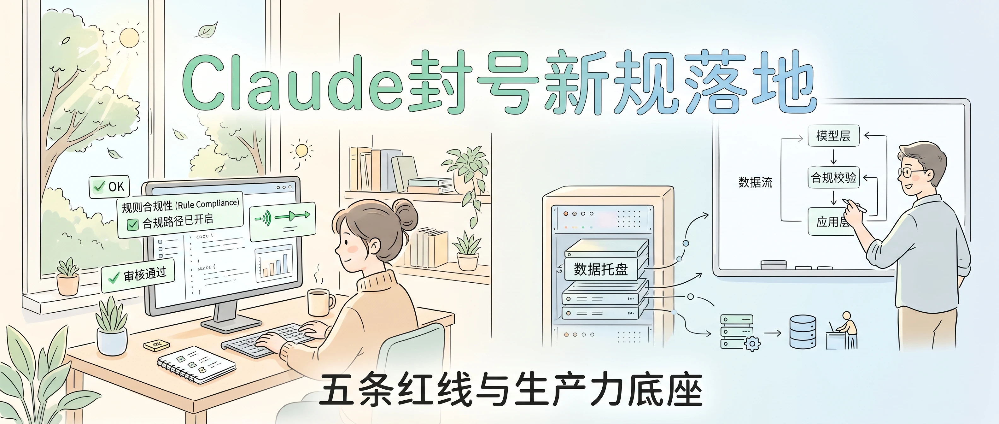
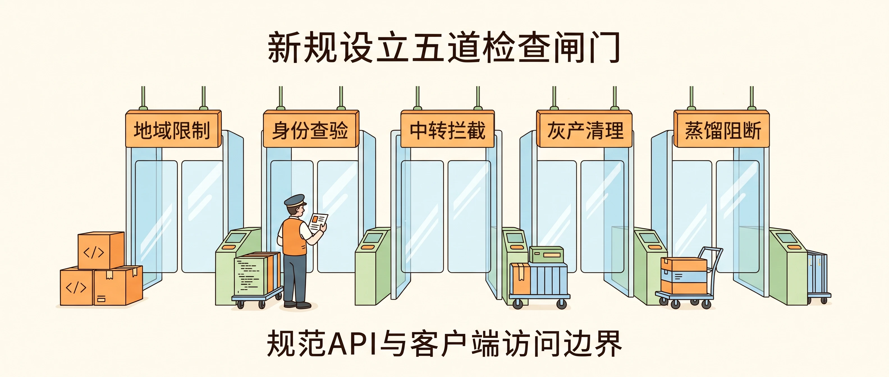
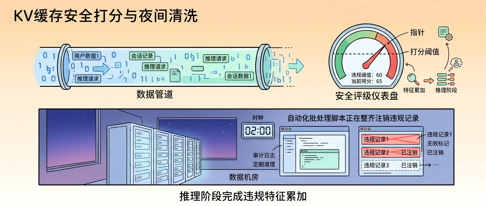
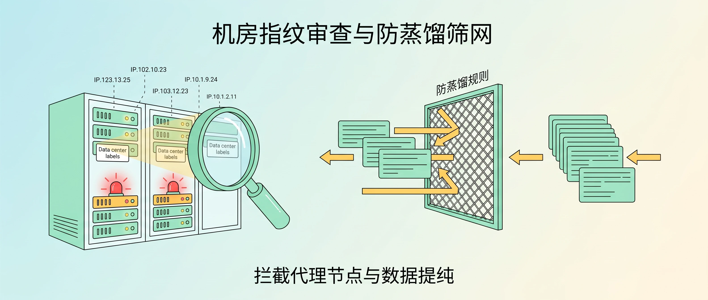
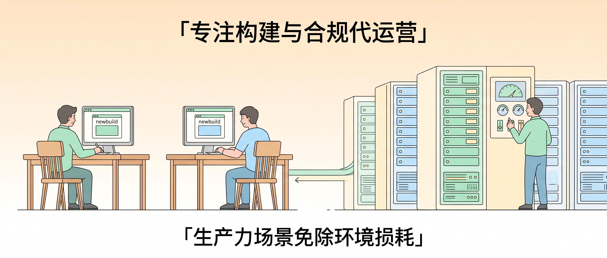

<!-- baoyu-skill cover prompt: 2.35:1小清新治愈知识漫画封面，柔和米白到浅蓝微光渐变，干净纤细线稿，薄荷绿/暖杏/浅天蓝平涂，留白充足。禁止品牌logo与深色赛博UI。画面展示一间明亮的开发者工作室，左侧窗外树影摇曳，办公桌上的显示器显示合规审查提示与绿色运行通道；右侧展示整洁机柜与平稳流转的数据托盘，技术人员正在白板前设计架构图。顶部居中中文大标题「Claude封号新规落地」，底部辅助文字「五条红线与生产力底座」。中文文字端正清晰。 --ar 2.35:1 -->

大家好，我是 Jason。

几个开发者社群今天转发一张红色弹窗截图：账号停用。

Anthropic 贴出通知，新版使用条款定在 11 月 12 日执行。

官方正在收网。

很多人把封号归咎于运气，翻开新版条款，五条红线条目清晰。

---

<!-- baoyu-skill prompt: 2.35:1小清新知识漫画，米白色细腻底色，清爽细线勾勒，暖橙/淡绿/天蓝平涂，留白充足。禁止品牌logo与深色赛博UI。画面展示五道并排的透明检查闸门，每道闸门上方悬挂指示牌：地域限制、身份查验、中转拦截、灰产清理、蒸馏阻断。闸门前整齐停放着代码箱与数据车，检查员正在核验通行证。顶部中文「新规设立五道检查闸门」，底部「规范API与客户端访问边界」。中文文字工整清晰。 --ar 2.35:1 -->

### 五道闸门拉起红线

新条款划出明确边界。

身处未受支持地区的用户，以及在这些地区注册的企业主体，访问权限受到限制。

账号遭到封禁后，换号、借号继续调用的行为算作违规。通过 KYC 实名认证的账号一旦被封，该身份进入黑名单，失去注册资格。

未经官方授权的中转站、转售访问权限、谎报客户端环境的请求，列入清理范围。市面上大批二手代理服务排期下线。

灰产团伙操纵多账号反复提交违规内容，系统执行关联处置。

没有官方书面许可，用户不得使用 Claude 的输出训练其他 AI 模型，模型蒸馏受到明确禁止。

五条规矩落下来，个人小作坊和灰产通道堵死。

---

<!-- baoyu-skill prompt: 2.35:1小清新知识漫画，淡暖杏向米白渐变，清线描边，薄荷绿/天蓝平涂，留白充足。禁止品牌logo与深色赛博UI。画面展示两组运转组件：上方是正在缓存计算的数据管道，管道旁标注安全评级仪表盘，指针指向打分阈值；下方展示夜幕中的数据机房，时钟指向凌晨两点，自动化批处理脚本正在整齐注销违规记录。顶部中文「KV缓存安全打分与夜间清洗」，底部「推理阶段完成违规特征累加」。中文文字端正清晰。 --ar 2.35:1 -->

### 推理缓存打分与夜间跑批

Anthropic 正在筹备上市，法务团队清理合规隐患。

官方透明度报告显示，上半年平台注销了 1140 万个账号，申诉成功率只有 3.7%。

系统查杀违规，不设人工抽检。

用户发送提示词，服务端把上下文压入 KV 缓存。内部安全模型读取缓存切片，对会话特征打上风险分值。

前台界面正常输出文本，后台记录违规分值。

分值越过警戒线，系统给账号打上标记。

凌晨时分，服务器启动自动化批处理任务，吊销标记账号的访问令牌。

程序员夜里敲完代码去睡觉，早晨推开机房大门，终端提示连接拒绝。

---

<!-- baoyu-skill prompt: 2.35:1小清新知识漫画，浅湖蓝向米白微光渐变，干净纤细线稿，薄荷绿/暖阳黄平涂，留白充足。禁止品牌logo与深色赛博UI。画面展示网络检测流水线：左侧机房服务器IP经过透镜扫描，显露出数据中心标签并被红灯标出；右侧一束结构化提取提问被滤网拦下，滤网标注防蒸馏规则，只放行常规业务请求。顶部中文「机房指纹审查与防蒸馏筛网」，底部「拦截代理节点与数据提纯」。中文文字工整清晰。 --ar 2.35:1 -->

### 机房指纹与蒸馏拦截

很多团队遭遇封号，原因出在网络环境上。

Anthropic 维护着网络指纹库。

公有云数据中心 IP 带着机房标签。多个人共用一个公网出口，数据包协议栈留下代理特征。系统比对自治系统编号与网络往返时延，判定链路属于代理通道。

家庭原生宽带网络留有真实物理特征：住宅 IP、固定硬件指纹、干净的浏览器环境。

防蒸馏机制也在过滤请求。

一些团队写脚本高频抓取结构化问答，拿优质代码反哺自己的小模型。系统监测请求频率、词元分布特征。命中蒸馏行为的调用，接口抛出错误，账号送入待封名单。

---

### 恶性退款与误伤老实人

前几个月我写过：前人疯狂白嫖退款，后人直接把路走绝。

黑产利用苹果内购退款时间差，订阅后立刻找苹果申请退款。钱退回账户，会员权益依然生效。有人甚至借机批量低价代充。

羊毛党吃饱离场，Anthropic 连夜上线硬风控，直接把 iOS 充值通道焊死。

老实掏钱的用户全被误伤：点下订阅，扣款短信进来了，界面弹出一行冷冰冰的提示：“无法完成购买，无法将此购买项绑定到 Claude 账号，建议取消订阅并向 Apple 申请退款。”

钱卡在退款周期里，账号无法使用。

---

<!-- baoyu-skill prompt: 2.35:1小清新知识漫画，淡暖杏向米白柔和渐变，干净纤细线稿，薄荷绿/浅天蓝/米黄平涂，留白充足。禁止品牌logo与深色赛博UI。画面展示一条整洁高效的生产流水线：左侧两位开发者坐在木质桌椅前编写产品代码，屏幕显示newbuild构建窗口；右侧是整齐陈列的单租户硬件机柜与海外合规网络专线，代运营工程师正在巡检仪表，护送稳定的算力管道通向开发团队。顶部中文「专注构建与合规代运营」，底部「生产力场景免除环境损耗」。中文文字工整清晰。 --ar 2.35:1 -->

### 专心负责 newbuild

工程师的时间应该用来写代码、交付产品。

买号、换节点、充虚拟卡、写申诉邮件，消耗研发精力。

我们 ClaudeOps 是一个合规面向生产力场景的代运营服务，免除您在使用前的一切摩擦和无效投入，您只需要专心负责 newbuild，其余的交给我们。

我们只做纯正规的代运营服务。我们给您提供的就是最好的体验和服务，第一时间获取最新 AI 资讯。

我们部署海外原生宽带节点，提供单租户隔离硬件，走通官方商业企业账单。

技术团队不再试探边界。

合规防线搭好，生产环境稳固，开发者打开终端，把精力投在业务上。

