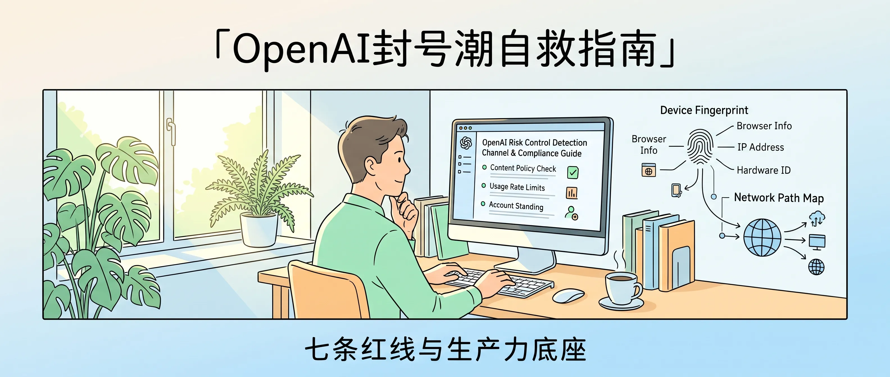
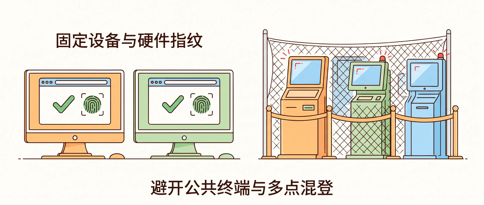
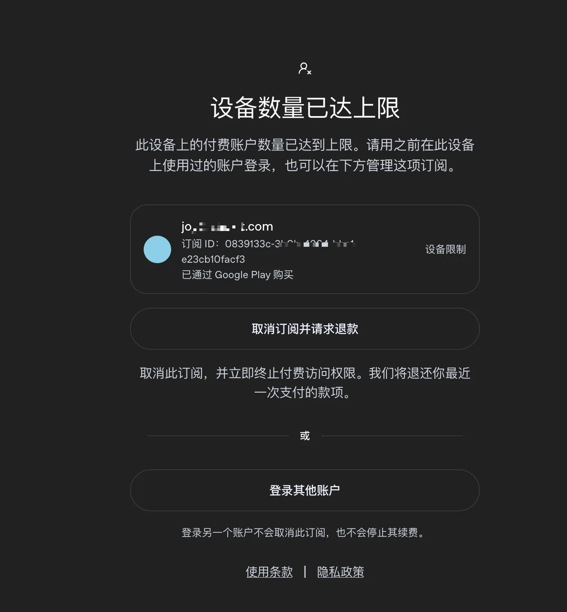
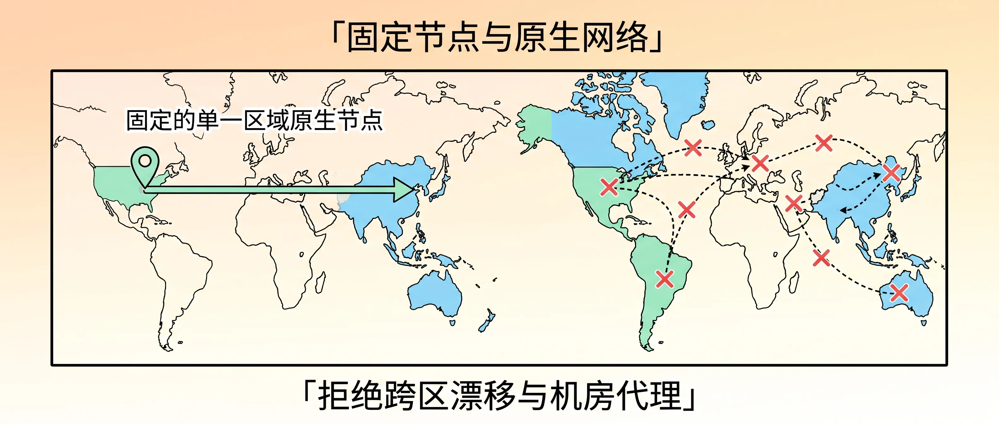
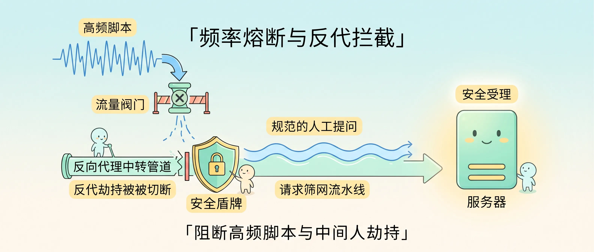
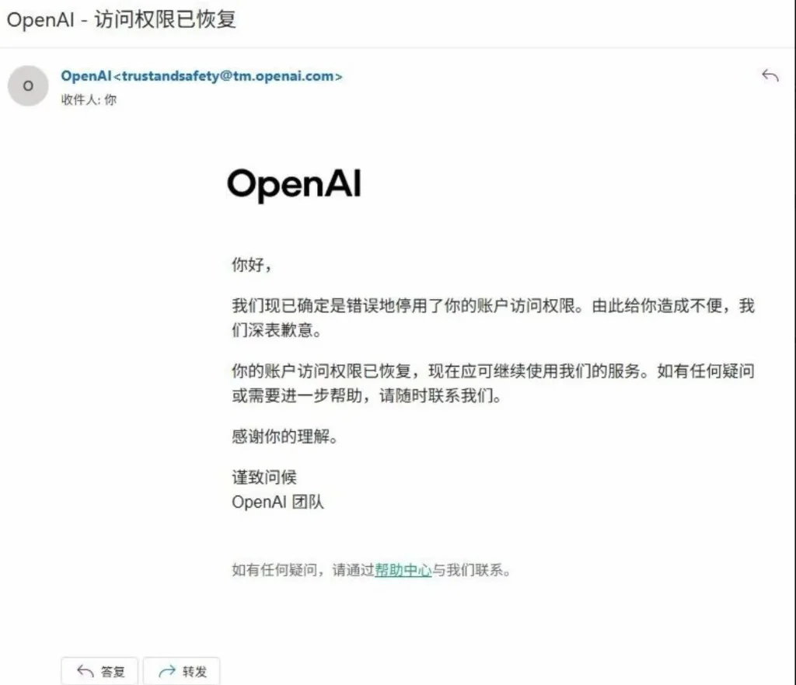
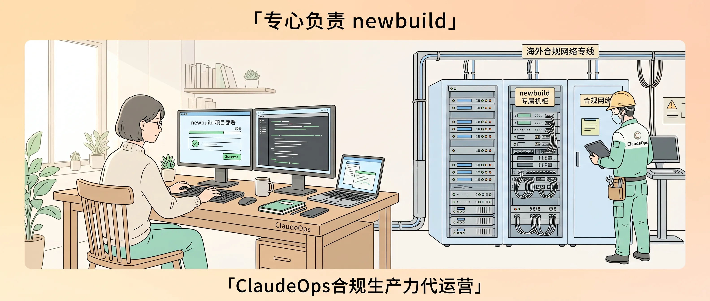

<!-- baoyu-skill cover prompt: 2.35:1小清新治愈知识漫画封面，柔和米白到浅天蓝渐变，干净纤细线稿，薄荷绿、暖杏、浅天蓝平涂，留白充足。画面展示一间明亮的工作室，木质办公桌上的显示器显示OpenAI风控检测通道与合规指南，窗外晨光照在绿植上；右侧绘制着设备指纹与网络链路图，桌前技术人员敲击键盘。顶部居中中文大标题「OpenAI封号潮自救指南」，底部辅助文字「七条红线与生产力底座」。中文文字工整清晰。 --ar 2.35:1 -->

大家好，我是 Jason。

晨会前，手机屏幕亮起几张截图。

对话窗口中央横着一条红框：账号停用。

OpenAI 启动了新一轮清理。

有人抱怨运气差，打开后台审计日志，风控规则全落在明处。

---

<!-- baoyu-skill prompt: 2.35:1小清新知识漫画，米白色细腻底色，清爽细线勾勒，暖杏、淡绿、天蓝平涂，留白充足。画面展示两组工作设备：左侧是两台固定的桌面电脑，浏览器展示绿色通行标记与Canvas硬件指纹匹配认证；右侧是几台闪烁红灯的公共终端被安全网阻隔。顶部中文「固定设备与硬件指纹」，底部「避开公共终端与多点混登」。中文文字工整清晰。 --ar 2.35:1 -->

### 浏览器里的硬件指纹

打开网页，浏览器向服务端提交底层环境参数。

显卡着色器参数、Canvas 绘图切片、屏幕物理分辨率，拼出硬件指纹。

上午在公司台式机提问，中午在网吧电脑查资料，晚上拿陌生手机打开链接。

服务端看到同一账号关联上几套互不相符的硬件指纹。

系统判定账号凭据泄露，风控模块亮起黄灯。

稳妥的做法：固定一至两台常用设备登录，避开陌生设备与公共电脑。

账号密码留给自己，不要发给同事，不要挂进社群。一人一号，设备环境保持干净。

---

### 七个 Pro 200 与设备上限

这道硬件锁，我自己踩过。

工作需要，我开了 7 个每月 200 美元的 ChatGPT Pro 账号。

为了调试流程，我在同一台电脑上轮换切号。

登录到第四个账号，屏幕弹出深灰色弹窗：“设备数量已达上限。此设备上的付费账户数量已达到上限。请用之前在此设备上使用过的账户登录。”

右侧明晃晃标出四个字：设备限制。

官方锁死了物理设备与付费席位的绑定关系。

一台机器登录过多高阶账号，系统判定批量倒号或多租户转租，直接锁死新登录入口，只留退款与登回旧号两个选项。

现在我只能给每台设备分配固定的专属账号，一台机器绝不多登。

---

<!-- baoyu-skill prompt: 2.35:1小清新知识漫画，淡暖杏向米白渐变，清线描边，薄荷绿、天蓝平涂，留白充足。画面展示一张网络地图，一条笔直的浅绿光缆连通固定的单一区域原生节点，指针保持静止；旁边多条频繁跳转的虚线航迹被红叉标出。顶部中文「固定节点与原生网络」，底部「拒绝跨区漂移与机房代理」。中文文字端正清晰。 --ar 2.35:1 -->

### 跳跃的节点与机房特征

网络出口布着第二道夹子。

不少人使用代理工具，随手切换线路。前两分钟挂在美国西海岸，下一秒切到欧洲。

物理世界里，人类无法瞬移。

数据包跨越半个地球，网络延迟突变，服务端抓取异常。

公有云机房 IP 带着数据中心自治系统编号（ASN）。上千个请求从同一个机房出口涌出，协议栈指纹一致。

OpenAI 的防御系统挂着机房黑名单。

工作环境需要固定单一地区的 IP。选定一个节点，不再变动。

避开跨国漂移，避开廉价机房 IP，维持网络特征稳定。

---

<!-- baoyu-skill prompt: 2.35:1小清新知识漫画，浅湖蓝向米白微光渐变，干净纤细线稿，薄荷绿、暖阳黄平涂，留白充足。画面展示请求筛网流水线：上方高频脚本发出的连续波形被流量阀门拦截，下方反向代理中转管道被安全盾牌切断，只有规范的人工提问平缓流向服务器。顶部中文「频率熔断与反代拦截」，底部「阻断高频脚本与中间人劫持」。中文文字工整清晰。 --ar 2.35:1 -->

### 脚本高压与反代红线

调用方式决定账号寿命。

有人写自动化脚本抓取回复，几秒发出几十次并发请求。

网关计数器翻转，流量阀门落下，接口阻断。

短时间内不要发送重复请求，停止批量脚本灌入。

内容边界同样分明。政治、色情、暴力、侵权违规内容不要输入。会话实时经过安全模型打分，违规特征记入后台。

守住官方发布的使用条例与规则，保住账号。

还有一处重灾区：反代。

第三方反向代理服务器拦截请求，转送流量，抽取令牌。

OpenAI 严查伪造的客户端协议头与未授权流量路径。反代通道一旦暴露，整批关联账号一并清除。

停止反代，使用正规渠道接入。

---

### 误伤申诉与解封通道

误伤难免发生。

风控规则由自动化跑批执行，误伤正常用户的状况时常出现。

确认全程合规操作、没有多设备混登与脚本违规，账号若被停用，不要急于放弃。

可以向官方支持邮箱发信申诉：`support@openai.com`。

信中写清三项信息：登录邮箱、常用设备型号与工作场景、平时的业务调用范围，说明自身严格遵守使用条款。

人工审核复核数据后，确认没有违规特征，会撤销封禁。

团队上周申诉成功，邮箱收到官方回复：“我们现已确定是错误地停用了你的账户访问权限。你的账户访问权限已恢复，现在应可继续使用我们的服务。”

申诉留有一条生路，前提是日常操作确实合规。

---

<!-- baoyu-skill prompt: 2.35:1小清新知识漫画，淡暖杏向米白柔和渐变，干净纤细线稿，薄荷绿、浅天蓝、米黄平涂，留白充足。画面展示整洁高效的开发环境：左侧程序员坐在木椅前专注敲击代码，屏幕显示newbuild项目部署窗口；右侧是整齐陈列的单租户硬件机柜与海外合规网络专线，代运营服务工程师巡检设备，确保算力畅通。顶部中文「专心负责 newbuild」，底部「ClaudeOps合规生产力代运营」。中文文字工整清晰。 --ar 2.35:1 -->

### 专心交付 newbuild

买号、换节点、折腾虚拟卡、写英文申诉信，耗尽工程精力。

我们 ClaudeOps 是一个合规面向生产力场景的代运营服务，免除您在使用前的一切摩擦和无效投入，您只需要专心负责 newbuild，其余的交给我们。

我们部署海外原生宽带网络，配置单租户硬件隔离，打通企业商业账单。

技术人员的时间当用于产品迭代与业务构建。

底层通道理顺，开发机接入纯净环境。

开发者拉起终端，敲入指令，专注把产品做出来。

