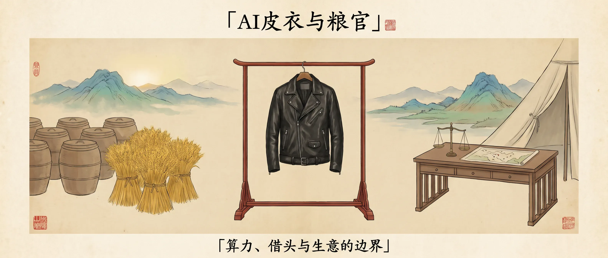
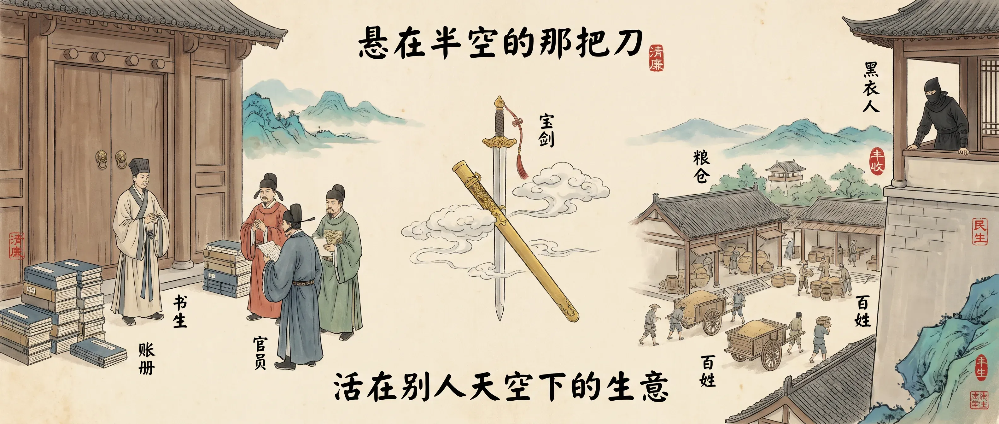

<!-- baoyu-skill cover prompt: 2.35:1横幅，中国古代复古风，宣纸米黄底色，淡墨工笔白描，朱砂红印章点缀，青绿山水设色，留白充足，古籍插画质感。画面中央一件黑色皮衣挂在红木衣架上，左侧是整齐排列的古代粮仓与金黄麦穗，右侧是帅帐木案、天平与舆图，远山晨光。顶部居中中文大标题「AI皮衣与粮官」，底部小字「算力、借头与生意的边界」。中文文字端正清晰。 --ar 2.35:1 -->

大家好，我是 Jason。

打仗不拼刀枪，拼算力。

算力就是军粮。

天下的米，大半出自一个穿黑皮衣的人。他比众人早十年看懂：谁有粮，谁打胜仗。他的仓库遍布天下，米价年年涨，诸侯排队要，仓库身价推上数万亿。

---

<!-- baoyu-skill prompt: 2.35:1横幅，中国古代复古风，宣纸米黄底色，淡墨工笔白描，朱砂红印章点缀，青绿山水设色，留白充足，古籍插画质感。军帐前的台阶，黑衣人物拾级而上，两侧侍从拱手，帐内宴席座次牌与果盘。顶部中文「空军一号与国宴座席」，底部「分发天下的算力军粮」。中文文字端正清晰。 --ar 2.35:1 -->

### 帐中的座次

帐中主公看重他。

空军一号留了座位，国宴席位摆在近旁。他给主公修殿捐过钱，也常去帐中走动。

主公说，有他在，咱们的粮就是天下的粮。

---

<!-- baoyu-skill prompt: 2.35:1横幅，中国古代复古风，宣纸米黄底色，淡墨工笔白描，朱砂红印章点缀，青绿山水设色，留白充足，古籍插画质感。粮仓前一大一小两把木斛并排，米粒从大斛倒入小斛，官员持账簿记一成五，远处两方营帐。顶部中文「小斛改了又改」，底部「令出帐中，米由皮衣递出」。中文文字端正清晰。 --ar 2.35:1 -->

### 小斛

粮发多了，帐中起疑：对面的人，怎么也吃上了这批米？

帐中定规矩：发粮改用小斛。

小斛改过数回：先不准发，后准发缩水的米，再往后放宽一点，但每斗米抽出一成五上缴官库。

令出自帐中，米由皮衣递出。

对岸不领情，直言米里藏了机关，不敢吃。

两头全得罪，两边的账簿上都记着他。

---

### 鸟

后来，身边多出一位南洋来的管事女子。

帐中探子报称女子来路不明，对岸发文斥为栽赃。皮衣认了一半：愧对家人，其余毫不知情。

帐中早知此事，只是此前粮荒未解，没人翻账。

---

<!-- baoyu-skill prompt: 2.35:1横幅，中国古代复古风，宣纸米黄底色，淡墨工笔白描，朱砂红印章点缀，青绿山水设色，留白充足，古籍插画质感。乌云压顶的古代官粮仓，门前悬挂木斛与两份盖印公文，黑衣人物立于台阶托着量斗，影子拉长，旗杆在风中。顶部中文「借头安抚军心」，底部「小斛仍是帐中小斛」。中文文字端正清晰。 --ar 2.35:1 -->

### 借头

那年秋天，帐中主事人换届。

粮价高企，战事日久，军心浮动。

「吾亦知汝无罪，但不杀汝，军心变矣。」

要他头的人心里明白：斩了他，小斛仍是帐中的小斛，南洋中转仓照开，天下的算力需求一分不减。

一天之内，仓库身价蒸发两千亿。

主公出面：他是个体面人，我信他。

一句话拉住刀刃，保住他的头。

---

<!-- baoyu-skill prompt: 2.35:1横幅，中国古代复古风，宣纸米黄底色，淡墨工笔白描，朱砂红印章点缀，青绿山水设色，留白充足，古籍插画质感。左侧古代公堂木门与堆叠书卷账册，一位书生接受查账；右侧高楼窗前黑衣人物俯瞰粮仓；中央一把半出鞘、被金鞘裹住的宝剑悬于半空。顶部中文「悬在半空的那把刀」，底部「活在别人天空下的生意」。中文文字端正清晰。 --ar 2.35:1 -->

### 悬刀

他该看看二十年前做软件的那个人。同样是栽在一只鸟上。

那个人的系统铺满天下，天下人同样离不开。帐中当年要把他一劈两半，拆分判决已下，上面的法庭又把刀按了回去。

没被分家，头上套了五年笼头。

朝廷派专员进库房查账，赔款数以十亿计。他从前只在京城租一间屋、请一人打理，后来租下一整层楼养法务说客。

他自己也从帅位退下。

做软件的人活了下来，仓库比当年更大。只是自那天起，他的每斗米，先送到帐中过目。

---

生意做大，算力便不再是私人买卖。

它是军粮。

粮紧缺，你是座上宾；粮荒动乱，你是最好借的那颗头。你最显眼，身后没有票仓，换掉你的代价最小。

生意的终局，不是避开风暴，而是像当年做软件的人一样：刀落到一半，还能留在谈判桌前。

只是最后，掌握算力的人能不能硬到最后，谁也不敢保证。

一个从 6000 亿涨到 4 万亿用了20年，一个从 5.7 万亿跌到 4.3 万亿用了不到30天。两只不同的鸟，都太昂贵了。
