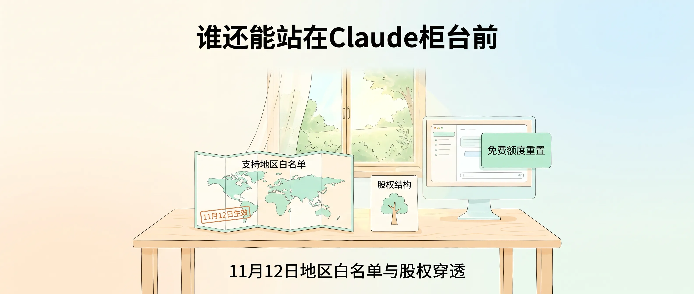
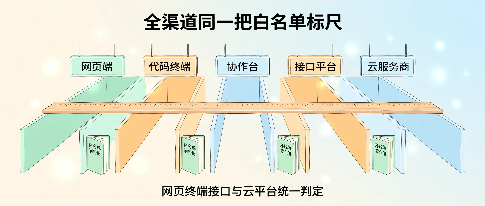
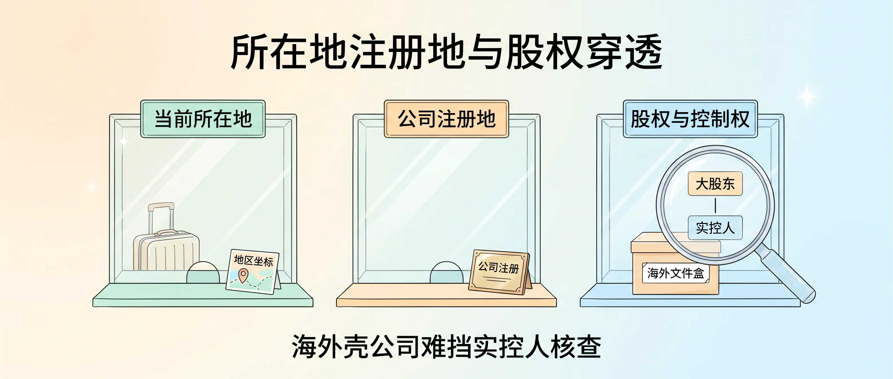
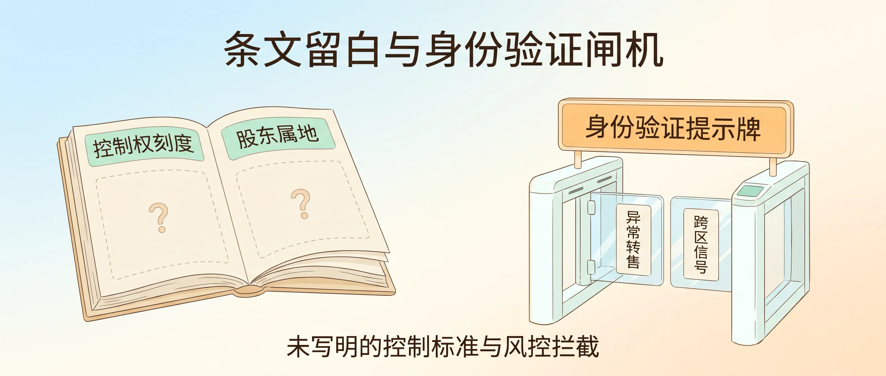

大家好，我是 Jason。

明天（11 月 12 日）起，谁能用 Claude，不再只看人站在哪。

Anthropic 在 10 月 8 日贴出预告，新版[《支持地区政策》](https://www.anthropic.com/legal/supported-regions)和[《用量政策》](https://www.anthropic.com/legal/aup)定于 11 月 12 日生效。官方口径称这次大多在写清既有规则。散落在各处的条款落上白纸黑字，边界摆在桌面，谁也无从装瞎。

把 Claude 当生产资料的创业者，伸手领免费额度之前，先得看懂这条准入线。

<!-- baoyu-skill cover prompt: 2.35:1横幅小清新治愈知识漫画封面，柔和米白到淡暖杏与浅天蓝微光渐变底色，干净纤细手绘线稿，薄荷绿、暖杏色、浅天蓝柔和色块平涂，留白充足，禁止任何品牌Logo与深色赛博UI，禁止弧形弯曲极小字，画面中所有文字均水平端正排版并使用清晰简体中文。画面展示一间明亮清透的一人公司工作室窗边，窗外阳光清透绿意柔和；浅木色书桌上摊开一份世界地图折页，折页上方水平印有清晰端正中文「支持地区白名单」，折页角落贴着一枚水平方形印记「11月12日生效」；地图旁并列摆放一张简洁的「股权结构」树状关系卡；桌面右侧的浅色显示器界面干净明亮，屏幕右侧浮现一张薄荷绿配色的「免费额度重置」卡片。顶部居中醒目端正中文大标题「谁还能站在Claude柜台前」，底部居中辅助中文「11月12日地区白名单与股权穿透」。整体构图舒展平衡，治愈清新，所有汉字笔画清晰准确无变形。 --ar 2.35:1 -->

---

新政策采用白名单机制。官方页面不设黑名单点名，只向名单内的国家和地区提供服务，没上榜的一概拒之门外。

翻开官网名单逐行核对：中国大陆、香港、澳门不在列，俄罗斯、伊朗不在列；台湾、新加坡、日本、韩国在列。

全渠道共用同一把尺子。网页端 claude.ai、终端工具 Claude Code、协作台 Cowork、API 与开发者平台，连同 AWS Bedrock、Google Vertex AI、Microsoft Foundry 等云平台及各级授权经销商，统一按这份白名单放行。换个采购入口，绕不开这套判定口径。

<!-- baoyu-skill prompt: 2.35:1横幅小清新治愈知识漫画，柔和米白到浅天蓝微光渐变底色，干净纤细手绘线稿，薄荷绿、暖杏色、浅天蓝柔和色块平涂，留白充足，禁止任何品牌Logo与深色赛博UI，禁止英文杂字与极小弯曲字，所有文字水平端正排版并使用清晰简体中文。画面展示五条整齐并列向前的清爽通道，五条通道上方依次悬挂端正清晰的中文指示牌：「网页端」、「代码终端」、「协作台」、「接口平台」、「云服务商」；一把温润清新的浅木色长标尺水平横跨全部五条通道，入口旁立着一本翻开的浅绿色「白名单通行册」统一核验准入。顶部居中醒目端正中文标题「全渠道同一把白名单标尺」，底部居中辅助中文「网页终端接口与云平台统一判定」。整体构图整洁对称，明亮治愈，所有汉字笔画清晰准确。 --ar 2.35:1 -->

---

准入审查先看人此刻脚踩在哪片土地。身处不支持地区，平台停止服务。哪怕受雇于支持地区公司，员工或用户落地不支持地区照样断供。条文没给短期出差、转机开会留豁免，也没写停留时长门槛。

目光移向营业执照，公司壳落在哪决定去留。注册地或总部设在不支持地区，员工全员坐进支持地区办公室也拿不到准入资格。

再往股东名册深处翻，股权与控制权穿透锁死了绕道空间。不支持地区的个人或实体直接或间接持股过半，或者握有控制权，这家主体连同旗下员工一并出局，无论员工坐在哪国工位。

把日历翻回 2025 年 9 月 4 日，Anthropic 发过一篇[销售限制博客](https://www.anthropic.com/news/updating-restrictions-of-sales-to-unsupported-regions)，点名中国等不支持地区的企业借海外子公司绕道采购。官方当时列出几重顾虑：当地法律要求企业配合情报机构并共享数据，外部团队借模型蒸馏推进自身研发，模型能力流入军事情报应用。那会儿的门槛盯住「总部在不支持地区的公司持股超 50%」。

一年过去，字面口径收得更宽更硬。持股源头从「公司」扩到「个人或实体」；「多数持股」旁并列写入「控制」；支持地区员工入境不支持地区写进首条；同步生效的新版[《用量政策》](https://www.anthropic.com/legal/aup)追加下游红线，禁止违反地区政策向他人（含产品终端用户）转供访问。

<!-- baoyu-skill prompt: 2.35:1横幅小清新治愈知识漫画，淡暖杏到米白与浅天蓝微光渐变底色，干净纤细手绘线稿，薄荷绿、暖杏色、浅天蓝柔和色块平涂，留白充足，禁止任何品牌Logo与深色赛博UI，禁止英文杂字与文字遮挡，所有文字水平端正排版且不被边框遮挡，标题不带引号或括号。画面展示三扇整齐并列的清爽透明玻璃检票窗：左侧第一扇检票窗上方悬挂标牌当前所在地，台面上摆放一只浅色旅行箱与地图坐标卡；中间第二扇检票窗上方悬挂标牌公司注册地，台面上摆放一块公司注册铭牌；右侧第三扇检票窗上方悬挂标牌股权与控制权，第三扇窗台面上摆放一只贴有海外文件盒标签的档案盒，档案盒正上方悬着一把大号透明放大镜，放大镜镜片内清晰呈现上下连线的大股东与实控人两张卡片，放大镜边框避开海外文件盒五个字不遮挡。顶部居中醒目端正中文标题为所在地注册地与股权穿透，底部居中辅助中文为海外壳公司难挡实控人核查。整体构图舒展对称，明亮治愈，所有汉字笔画清晰完整。 --ar 2.35:1 -->

---

条文收紧的同时，页面留出几处空白。

「控制」二字未配认定刻度，多少投票权、几个董事会席位、有无协议控制落入控制范畴，全文只字未提。个人股东「在」不支持地区按居住地判定，还是按护照国籍判定，官方未作解释。存量合同有无宽限期，AWS Bedrock 与 Vertex AI 等云厂商如何在开户与调用环节穿透查验客户股权，页面一并留白。

这几天中文区传开两句流言，值得拿原文拆穿。

一句传「和中国大陆沾边就一刀切」。翻看英文原句，触发限制的前提写明「多数持股或控制」，参股未过半且不握控制权的商业关联不在限制范围内。

另一句传「明天起封号策略变了」。这话混淆了生效文件与风控程序。明天生效的新规改写地区准入与用量口径；至于警告、停权、销户，以及捕捉到未授权转售或疑似从中国、俄罗斯、伊朗操作等异常信号时弹出身份验证、未过核验即封停账号，整套程序写进既有《用量政策》、[透明度中心](https://www.anthropic.com/transparency/system-trust-reporting)及[今年 9 月的威胁情报报告](https://www.anthropic.com/threat-intelligence-report-september-2026)已有时日。风控闸机立在原地未动，如今判定口径合进同一页纸，平台照章拦人更顺手。

<!-- baoyu-skill prompt: 2.35:1横幅小清新治愈知识漫画，浅天蓝到米白与淡暖杏微光渐变底色，干净纤细手绘线稿，薄荷绿、暖杏色、浅天蓝柔和色块平涂，留白充足，禁止任何品牌Logo与深色赛博UI，禁止英文杂字与文字遮挡，所有文字水平端正排版且标题不带引号或括号。画面左右对称舒展构图：左侧是一本平摊翻开的浅米色规章手册，左页上方水平印着控制权刻度，下方浅色虚线框留白并印着一枚柔和问号，右页上方水平印着股东属地，下方浅色虚线框同样留白并印着一枚柔和问号；右侧是一座清爽整洁的浅色安全检查闸机，闸机上方立着一张醒目的暖杏色身份验证提示牌，闸机透明挡板拦下两张分别写着异常转售与跨区信号的卡片。顶部居中醒目端正中文标题为条文留白与身份验证闸机，底部居中辅助中文为未写明的控制标准与风控拦截。整体构图清晰整洁，明亮治愈，所有汉字笔画端正准确。 --ar 2.35:1 -->

---

做海外业务的一人公司与创业者，别喊口号，摊开自家底牌对号入座。

先查行程轨迹：团队成员回国探亲或去香港出差开会，会不会掀开电脑连公司的 Claude Code。肉身跨过边界连上终端，这笔请求便踩中首条位置红线。

再查主体与股权穿透：公司注册地和总部设在哪，穿透到底的大股东与实控人落不落在名单外的个人或实体名下。不少人注册美国特拉华或新加坡壳公司，团队也在海外办公，只要穿透后由名单外自然人持股过半或握有控制权，海外壳公司在字面上难逃红线，切去云平台采购也面对同一本白名单。

做 AI 应用封装的团队还要看紧下游。把 Claude 能力包进自家产品卖给客户，若放任名单外地区的终端用户调用，用量政策那句禁止违规转供的条款就悬在头顶。

---

准入红线落闸前一天，牌桌另一头撒出额度筹码。

11 月 11 日早上，Anthropic 官方开发者账号宣布 Pro、Max、Ultra、Team 用户获赠一次免费全量重置，覆盖全模型全限额窗口。用户在北京时间 12 月 11 日早上 6 点前打开 Settings > Usage 或访问 [clau.de/reset](https://clau.de/reset) 即可手动启用。这张重置券修补前阵子多扣额度的计费漏洞，一并补救 11 月 9 日 Fable 上市时的那次专项重置。当时系统只退还 Fable 消耗的周额度，早先用其他模型跑空周限额的用户点完额度纹丝不动。

同一天下午，OpenAI Codex 负责人 Tibo 发文暗示，周四（11 月 12 日）或跟进发放可自选时机兑换的 banked reset，方案尚未落地。

<!-- baoyu-skill prompt: 2.35:1横幅小清新治愈知识漫画，柔和米白到淡暖杏与浅天蓝微光渐变底色，干净纤细手绘线稿，薄荷绿、暖杏色、浅天蓝柔和色块平涂，留白充足，禁止任何品牌Logo与深色赛博UI，禁止英文杂字与文字遮挡，所有文字水平端正排版且标题不带任何括号或引号。画面展示一座温暖整洁的浅木色服务柜台：柜台窗口内递出一张印有清晰中文「全量额度重置」的薄荷绿礼券卡；服务柜台前方的浅色地面上画着一条笔直醒目的白色准入线，白线旁水平标注清晰中文「服务名单准入线」；柜台外一位背着单肩电脑包的简约漫画风独立开发者停下脚步，先低头认真核对脚下的名单站位区域。顶部居中醒目端正中文标题：左手发额度右手划准入线，底部居中辅助中文：先看还在不在服务名单里。整体构图舒展温暖，治愈清新，所有汉字笔画清晰准确。 --ar 2.35:1 -->

左手撒额度筹码，右手锁死准入名单。

各家维持月费标价不动，拿重置券当隐形折扣发给重度开发者。地区白名单拿出另一把尺子，丈量你还有没有资格站在柜台前。

额度重置可以攒到周限额见底再点；地区条款没给「先用着再说」留缝。

对一人公司，谈工具顺不顺手之前，先看自己还在不在名单里。
