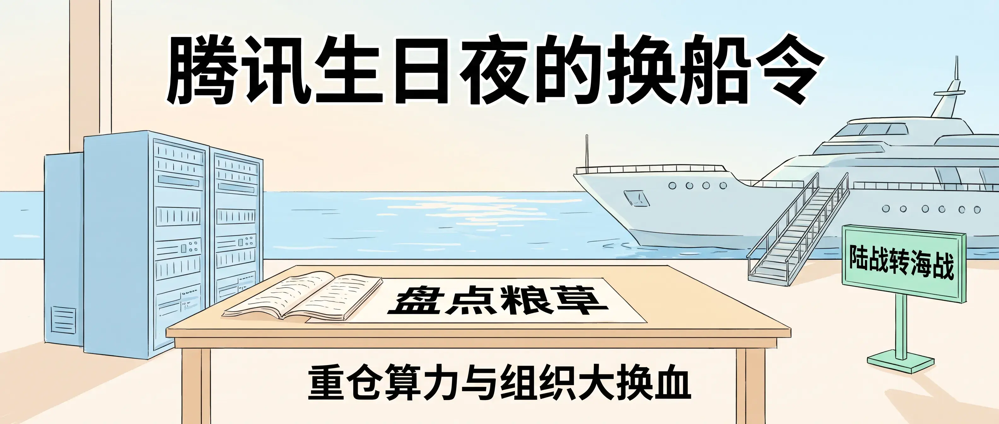
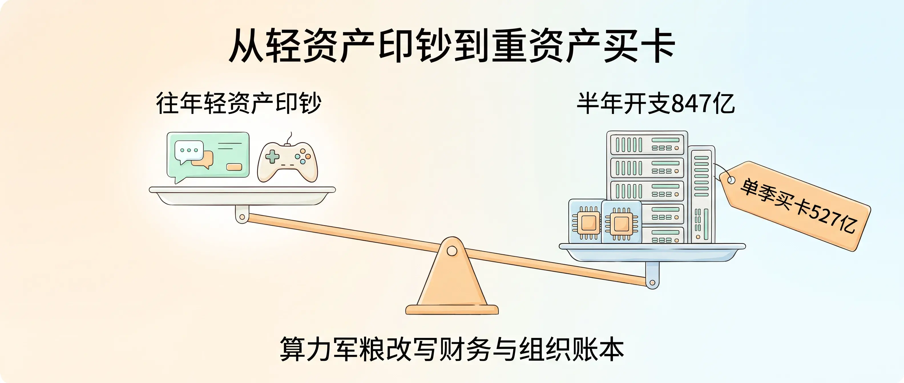
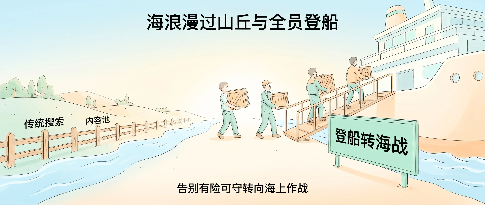
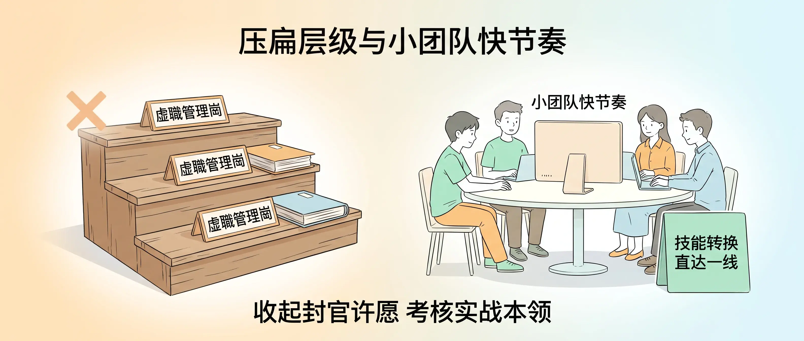
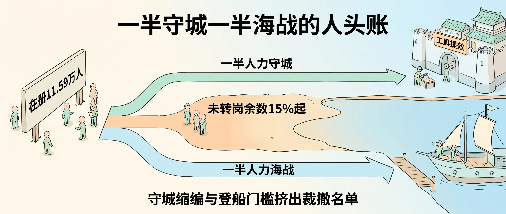

大家好，我是 Jason。

11 月 11 日，腾讯满 28 岁。

生日当晚的 LinkTime 上，Pony 向全员讲话：要组织变革，要人员调整。散会后，滨海大厦的工位群刷屏到天亮。

内部员工传出消息，这一轮裁员比例越过 15%，部分部门重创，腾讯建司以来最大的一次。

<!-- baoyu-skill cover prompt: 2.35:1横幅小清新治愈知识漫画封面，柔和米白到淡暖杏与浅天蓝微光渐变底色，干净纤细手绘线稿，薄荷绿、暖杏色、浅天蓝柔和色块平涂，留白充足，禁止任何品牌Logo、企鹅图标与深色赛博UI，禁止英文杂字与弯曲极小字，画面中所有文字均水平端正排版并使用清晰简体中文，不遮挡文字，标题不带引号或括号。画面展示明亮清透的海滨办公窗景与码头远景：前景浅木色长桌上摊开一本预算账册，账册上方水平印有端正中文盘点粮草，桌旁立着一组浅天蓝手绘算力机柜模型；窗外浅蓝海面上停泊一艘整装待发的浅色现代远洋船，登船舷梯旁立着一块薄荷绿指示牌陆战转海战。顶部居中醒目端正中文大标题腾讯生日夜的换船令，底部居中辅助中文重仓算力与组织大换血。整体构图舒展平衡，治愈清新，所有汉字笔画清晰准确无变形。 --ar 2.35:1 -->

---

Pony 先翻账本。

腾讯做了 28 年轻资产生意。微信有关系链，游戏卖虚拟道具，广告抽佣，代码写完复制分发，多服务一个用户几乎不花钱。2023 年全年资本开支 239 亿元。

翻开[腾讯投资者关系官网](https://www.tencent.com/zh-cn/investors/)的公告，曲线拐了弯。[2025 年全年业绩公告](https://static.www.tencent.com/uploads/2026/03/18/559e5d480a4411165e6c7367d61fefbd.pdf)写着，2024 年资本开支 767.6 亿元，2025 年 792 亿元。[2026 年第二季度公告](https://www.tencent.com/wp-content/uploads/2026/08/%E8%85%BE%E8%AE%AF%E5%85%AC%E5%B8%83%E4%BA%8C%E9%9B%B6%E4%BA%8C%E5%85%AD%E5%B9%B4%E7%AC%AC%E4%BA%8C%E5%AD%A3%E4%B8%9A%E7%BB%A9.pdf)写着，上半年 847.2 亿元，二季度单季 527.84 亿元。

二季度经营现金流进账 527 亿元，资本开支付款 593 亿元，自由现金流转负 138 亿元。

Pony 在会上说，过去做的都是轻资产，第一次做这样的重资产业务，财务和组织架构的打法都得换。

<!-- baoyu-skill prompt: 2.35:1横幅小清新治愈知识漫画，柔和米白到淡暖杏与浅天蓝微光渐变底色，干净纤细手绘线稿，薄荷绿、暖杏色、浅天蓝柔和色块平涂，留白充足，禁止任何品牌Logo、企鹅图标与深色赛博UI，禁止英文杂字与文字遮挡，所有文字水平端正排版并使用清晰简体中文，标题不带引号或括号。画面采用左右舒展对照构图，中央立着一架温润浅木色天平向右沉降：左侧高高抬起的轻巧托盘上放着清爽浅色聊天气泡卡与手柄图标，上方水平标注端正中文往年轻资产印钞；右侧沉降的重托盘上整齐排列着手绘算力服务器机柜与芯片卡，上方水平标注端正中文半年开支847亿，机柜旁贴着一张暖杏色标签单季买卡527亿。顶部居中醒目端正中文标题从轻资产印钞到重资产买卡，底部居中辅助中文算力军粮改写财务与组织账本。整体构图整洁清晰，明亮治愈，所有汉字笔画准确完整。 --ar 2.35:1 -->

---

账本之后是战场。

前两年有人盯着搜索，看见 Google 顶住了，把心放回肚子里。今年浪头拍到城门口：豆包月活过 5.28 亿，千问过 1.7 亿，用户有问题直接问对话框，不再打开网页和公众号。

腾讯元宝靠买量追赶，二季度销售及市场推广开支 118.69 亿元。

Pony 让全员站起来，找高地，搬物资，上船，从陆战转海战。陆军里谁能上船，得提前备好。

他说了一句：现在都有点晚。

<!-- baoyu-skill prompt: 2.35:1横幅小清新治愈知识漫画，浅天蓝到米白与淡暖杏微光渐变底色，干净纤细手绘线稿，薄荷绿、暖杏色、浅天蓝柔和色块平涂，留白充足，禁止任何品牌Logo、企鹅图标与深色赛博UI，禁止英文杂字与文字遮挡，所有文字水平端正排版并使用清晰简体中文，标题不带引号或括号。画面采用左陆右海的清爽横幅构图：左侧低矮山丘连同标有传统搜索与内容池的木栅栏漫入浅天蓝海浪；中间高地上几位简约漫画风工程师搬起物资箱迈步走上通往右侧浅色远洋大船的舷梯，舷梯口立着醒目的薄荷绿标牌登船转海战。顶部居中醒目端正中文标题海浪漫过山丘与全员登船，底部居中辅助中文告别有险可守转向海上作战。整体构图舒展生动，明亮治愈，所有汉字笔画端正清晰。 --ar 2.35:1 -->

---

上船的规矩也变了。

以前抽骨干去新业务，要哄，要游说，要先答应管理岗。这一回，Pony 要组织压扁，选人干脆，直接看技能能不能转换。

游戏团队已经交了样板：人少，节奏快，肉眼看得见的变化。

<!-- baoyu-skill prompt: 2.35:1横幅小清新治愈知识漫画，淡暖杏到米白与浅天蓝微光渐变底色，干净纤细手绘线稿，薄荷绿、暖杏色、浅天蓝柔和色块平涂，留白充足，禁止任何品牌Logo、企鹅图标与深色赛博UI，禁止英文杂字与文字遮挡，所有文字水平端正排版并使用清晰简体中文，标题不带引号或括号。画面采用左右对比的整洁办公漫画构图：左侧三层叠放的旧式木台阶上摆着空置的虚职管理岗铭牌与厚重文件夹，旁边标有一枚柔和暖杏色叉号；右侧一张明亮圆桌旁，四名简约漫画风青年开发者围坐协作，浅色显示器上方水平印着小团队快节奏，桌角立着薄荷绿卡片技能转换直达一线。顶部居中醒目端正中文标题压扁层级与小团队快节奏，底部居中辅助中文收起封官许愿考核实战本领。整体构图对称清爽，治愈明亮，所有汉字笔画清晰准确。 --ar 2.35:1 -->

---

再算人头账。

Pony 的方案：一半人守住传统主业，另一半人去打新战役。腾讯在册雇员 115,927 人，守城的靠 AI 工具提效缩编，登船的得有新本事。两头够不着的人，落进那份 15% 起步的名单。

15% 是一万七千多人。上一轮降本增效，腾讯净减一万一千多人。

<!-- baoyu-skill prompt: 2.35:1横幅小清新治愈知识漫画，柔和米白到浅天蓝与淡暖杏微光渐变底色，干净纤细手绘线稿，薄荷绿、暖杏色、浅天蓝柔和色块平涂，留白充足，禁止任何品牌Logo、企鹅图标与深色赛博UI，禁止英文杂字与文字遮挡，所有文字水平端正排版并使用清晰简体中文，标题不带引号或括号。画面展示清晰直观的三向分流漫画构图：左侧起点立着一块浅色人数牌在册11.59万人，向右分出上下两条清爽主通道与中间一处岸滩分流区；上方通道通往挂有工具提效牌子的整洁城池，通道上方水平标注一半人力守城；下方通道通往停靠码头的浅色远洋船，通道上方水平标注一半人力海战；中间岸滩等待区涂以柔和暖杏色，上方水平标注未转岗余数15%起。顶部居中醒目端正中文标题一半守城一半海战的人头账，底部居中辅助中文守城缩编与登船门槛挤出裁撤名单。整体构图逻辑一目了然，明亮治愈，所有汉字笔画清晰完整。 --ar 2.35:1 -->

---

这些话，我 3 月就写过。

3 月 20 日，网易、阿里、腾讯的裁员传闻满天飞，三家都辟谣。我写了一篇[《不是因为 AI 要裁员，而是想用 AI，必须裁员》]({{ site.baseurl }}/ai-layoff-not-because-of-ai-but-for-ai)：中间层砍掉，AI 才用得起来。

5 月 3 日，我和十几位大厂工程师聊完，又写了[《离开大厂，才是真正靠近 AI 的开始》]({{ site.baseurl }}/leave-bigtech-closer-to-ai-django-unchained)：大船难掉头。

如今 Pony 自己认了。腾讯转型偏慢，钱先砸进机房，组织在后面追，只能靠裁员补课。

再不大力投入算力，这艘船真要凉。

---

对个人，我的建议只有一条：尽早转做服务商，拿 AI 时代的入场券。

别等大厂的名单。先看自己的资源和人脉能触达哪些业务，从那里做起。

客户每个月为 Token 付账单，那是 Opex。帮他们买机器、装模型、跑起来，把这笔开支换成自己名下的算力资产，那是 Capex。我自己买 M5 Ultra 跑 Agent 的经历，写在[这篇]({{ site.baseurl }}/m5-ultra-96g-agent-machine-400k-apple)和[这篇]({{ site.baseurl }}/m5-ultra-512g-slow-inference-agent)里，坑我踩过。

大船忙着换引擎，岸上没人替谁兜底。
