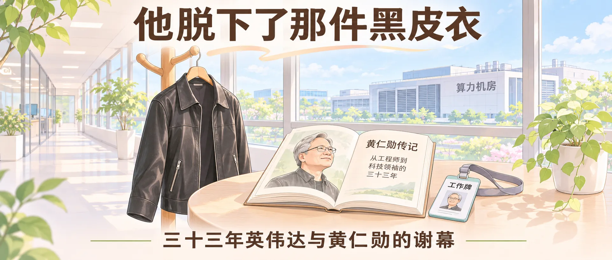
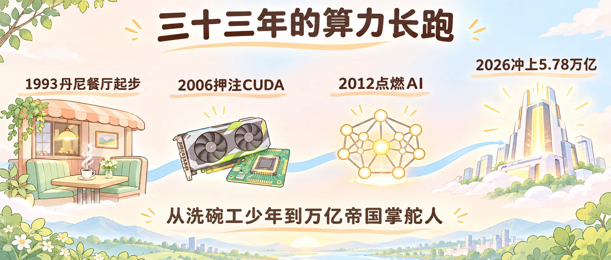

大家好，我是 Jason。

11 月 12 日，英伟达官网挂出公告：黄仁勋辞去总裁、CEO 与董事职务，立即生效。

执行副总裁兼 CFO Colette Kress 接任临时 CEO，1993 年进董事会的老董事 Harvey C. Jones 出任公司史上第一位独立董事长。

我盯着手机屏幕看了很久，咽了口唾沫，胸口发闷。

今年 5 月，我读完他的传记《英伟达之芯》，写了一篇[读书笔记]({{ site.baseurl }}/jensen-huang-thinking-machine-what-kind-of-person)。两天前，我写了[《皮衣粮官和鸟》]({{ site.baseurl }}/ai-leather-jacket-grain-officer)，末尾还写主公一句话拉住刀刃，保住了他的头。

两天后，他自己交出了帅印。

<!-- baoyu-skill cover prompt: 2.35:1横幅小清新治愈知识漫画封面，柔和米白到淡暖杏与浅天蓝微光渐变底色，干净纤细手绘线稿，薄荷绿、暖杏色、浅天蓝柔和色块平涂，留白充足，禁止任何品牌Logo与深色赛博UI，禁止英文杂字与弯曲极小字，画面中所有文字均水平端正排版并使用清晰简体中文，标题不带引号或括号。画面展示明亮清透的科技公司窗边长廊：前景一只温润浅木色衣架上挂着一件整洁的黑色皮衣，衣架旁放着一本摊开的传记与一枚工作牌；窗外淡蓝天色下，远处算力机房建筑轮廓柔和安静。顶部居中醒目端正中文大标题他脱下了那件黑皮衣，底部居中辅助中文三十三年英伟达与黄仁勋的谢幕。整体构图舒展平衡，治愈清新，所有汉字笔画清晰准确无变形。 --ar 2.35:1 -->

---

心里难过，又觉得惋惜。

我佩服这个老头。1963 年生在台湾，10 岁被送去肯塔基州的管教学校。同学欺负他，在吊桥上晃绳索，他去洗宿舍厕所，每晚睡前做一百个俯卧撑。

1993 年，30 岁的他和两位合伙人坐在圣何塞丹尼餐厅的卡座里，写下英伟达的商业计划书。

创业第一款芯片 NV1 惨败，公司账户几次见底。他常把一句话挂在嘴边：我们离破产只有三十天。

1999 年公司上市，推出全球第一块 GPU GeForce 256。2006 年，同行嘲笑他吃饱了撑的，华尔街压低股价，他顶着骂声把钱砸进 CUDA，硬生生把游戏显卡改造成通用计算底座。

2012 年，多伦多学者买下两张 GTX 580 跑通 AlexNet，深度学习大门被撞开。2023 年英伟达市值跨过 1 万亿美元，2024 年 6 月登顶全球第一，2025 年 10 月突破 5 万亿，今年 10 月冲上 5.78 万亿美元。

三十三年，多少公司起高楼又塌房，他守着同一条算力跑道没松过手。

<!-- baoyu-skill prompt: 2.35:1横幅小清新治愈知识漫画，柔和米白到淡暖杏与浅天蓝微光渐变底色，干净纤细手绘线稿，薄荷绿、暖杏色、浅天蓝柔和色块平涂，留白充足，禁止任何品牌Logo与深色赛博UI，禁止英文杂字与文字遮挡，所有文字水平端正排版并使用清晰简体中文，标题不带引号或括号。画面采用从左向右延展的时间长卷构图，一条浅天蓝丝带串联四个简洁暖色节点图标：最左端是一张温暖的餐厅卡座与咖啡杯，上方水平标注1993丹尼餐厅起步；第二个节点是一枚游戏显卡与芯片电路板，上方标注2006押注CUDA；第三个节点是一盏亮起的神经网络节点灯，上方标注2012点燃AI；最右端是一座发光的白色算力高塔，上方标注2026冲上5.78万亿。顶部居中醒目端正中文标题三十三年的算力长跑，底部居中辅助中文从洗碗工少年到万亿帝国掌舵人。整体构图舒展明亮，治愈清新，所有汉字笔画清晰准确。 --ar 2.35:1 -->

---

偏偏拖垮他的，是他自己最引以为傲的那套打法。

读《英伟达之芯》时，我印象最深的是他的“创始人模式”。公司做上几万亿美元，他不设二把手，不指定接班人，一个人直接管着五六十名高管。

他要信息直达，要“光速”推进，不许中间层传话。

可同一个词，换到治理账本上，成了致命的风险敞口。

十一天前，新加坡数据中心公司 Megaspeed 高管 Alice Huang 的名字被媒体翻出。这家公司买过数十亿美元英伟达芯片，美国商务部和司法部追查芯片去向，情报界质疑她的背景。黄仁勋向员工承认婚外情，否认对任何间谍活动知情。紧接着，FBI 和司法部国安部门介入了解，加州联邦法院收到股东集体诉讼，指责公司和他隐瞒高管私人关系和连带风险。

压断最后一根稻草的，在公司内部。11 月 11 日至 12 日媒体披露，他和直接向自己汇报的医疗健康副总裁 Kimberly Powell 也有未披露的婚外情。今年 3 月两人在圣何塞酒店见面，他的安保团队用保密协议把消息压了下去。

这脚踩进了公司利益冲突的红线。董事会独立调查后施压罢免，11 月 12 日他递交辞呈。当天开盘股价一度跌去 6% 到 14%，收盘跌幅收窄到 4% 左右，市值从 10 月高点回落到 4 万亿出头。

直管六十人，所有汇报线聚在一人手里。没有二把手挡风，就没有缓冲垫；私人边界一失守，整栋大楼的地基跟着晃。

<!-- baoyu-skill prompt: 2.35:1横幅小清新治愈知识漫画，淡暖杏到米白与浅天蓝微光渐变底色，干净纤细手绘线稿，薄荷绿、暖杏色、浅天蓝柔和色块平涂，留白充足，禁止任何品牌Logo与深色赛博UI，禁止英文杂字与文字遮挡，所有文字水平端正排版并使用清晰简体中文，标题不带引号或括号。画面展示一座简洁清爽的放射状架构图：中央站着一个单薄的圆点基座，上方水平标注直管六十人无二把手，四周六十条细线全部直接连向中央这一个点；中央基座右下角画出一道浅暖杏色的细小裂纹，裂纹旁贴着一张水平方牌写着直接汇报与治理红线，旁边摆放一本合上的保密协议文件夹。顶部居中醒目端正中文标题同一套扁平架构的另一面，底部居中辅助中文没有缓冲垫也没有退路。整体构图对称直观，明亮治愈，所有汉字笔画清晰完整。 --ar 2.35:1 -->

---

犯了错，认账，挨打立正。

可我心里还是替他憋屈。个人有弱点，该背的锅一分不少，但这抹不去他三十三年造出来的东西。全世界今天能跑起大模型，每一张算力卡背后，都刻着当年他和工程师在没人看好的日子里死磕的痕迹。

更让人后背发凉的，是个人被卷进大漩涡后的无力。

放在一家普通公司，高管私德风波最多调岗、赔钱、发份道歉声明。

英伟达长到了五万亿美元。它早就不只是卖显卡的公司，它长成了国家基础设施，长成了大国手里捏着的筹码。

当你的生意变成别人的军粮，你个人的一点私心、一道缝隙，就会被同时丢进华尔街诉讼、情报审查、华盛顿党争和全球舆论的绞肉机。每一方都拿放大镜盯着你，每一方都在算计怎么用你的弱点换取筹码。

站在船头的人，以为自己手握方向盘。浪打上来的时候才看清，脚下的甲板早就归别人管。

英雄未必完美，传奇也未必有体面的收场。

<!-- baoyu-skill prompt: 2.35:1横幅小清新治愈知识漫画，浅天蓝到米白与淡暖杏微光渐变底色，干净纤细手绘线稿，薄荷绿、暖杏色、浅天蓝柔和色块平涂，留白充足，禁止任何品牌Logo与深色赛博UI，禁止英文杂字与文字遮挡，所有文字水平端正排版并使用清晰简体中文，标题不带引号或括号。画面采用居中聚焦构图：海面中央一艘小巧的浅色木船在柔和螺旋水纹中前行，船上放着一只手绘微芯片；水纹外围四周竖起三块不同方向的淡色指示牌，左侧牌写着资本诉讼，上方牌写着国家安全审查，右侧牌写着地缘舆论风浪，三道温和但巨大的半透明波浪正朝中央小船合拢。顶部居中醒目端正中文标题长成基础设施后的脆弱，底部居中辅助中文个人缝隙会被漩涡成倍放大。整体构图富有张力又保持清新治愈色调，所有汉字笔画端正准确。 --ar 2.35:1 -->

---

同为创业者，看到这一幕，很难不往自己身上照。

我们做小公司、做一人公司，总觉得公司是自己一手带大的孩子，事事抓在手里才踏实，靠自己的意志和精力就能摆平一切。

黄仁勋比谁都勤奋，比谁都懂技术，比谁都扛得住逆境。可三十三年后，拦住他的不是竞争对手，也不是技术迭代，而是他自己亲手拆掉的边界。

公司越小，靠创始人个人冲锋；公司越往上走，越需要一套不依赖你个人品行和体力的护栏。

选出能分担重量的副手，留出敢对你喊停的制衡机制，把公司账目、汇报关系和私人生活切开。这些东西平时看着笨重，拖慢速度，真到风浪拍过来的时候，它们在保公司的命，也在保你的命。

<!-- baoyu-skill prompt: 2.35:1横幅小清新治愈知识漫画，柔和米白到薄荷绿与淡暖杏微光渐变底色，干净纤细手绘线稿，薄荷绿、暖杏色、浅天蓝柔和色块平涂，留白充足，禁止任何品牌Logo与深色赛博UI，禁止英文杂字与文字遮挡，所有文字水平端正排版并使用清晰简体中文，标题不带引号或括号。画面展示一条明亮整洁的登山步道：步道两侧立着坚实温润的浅木色护栏，护栏上依次挂着三枚薄荷绿小木牌，分别写着制衡机制、接班梯队、公私边界；步道中间一位背着背包的简约漫画风创业者稳步向上行走，脚下石阶平稳安全。顶部居中醒目端正中文标题给创业者的三道护栏，底部居中辅助中文平时看似束缚关键时刻保命。整体构图向上明亮，治愈清新，所有汉字笔画清晰准确。 --ar 2.35:1 -->

---

丹尼餐厅的卡座还在，那件黑色皮衣他穿了二十多年。

他把一家离破产只有三十天的芯片小厂，扛到了五万亿的聚光灯下，然后自己走下了台。

机箱里的显卡换了一代又一代。从 2015 年的 TITAN X、2017 年的 1080 Ti、2018 年的 2080 Ti、2020 年的 3090、2022 年的 4090，到 2024 年的 5090，算力翻了几轮。等到下一代 RTX 60 系列发布，台上没有了那件黑皮衣，也没有了那个总说“我永远是个移民”的老头。
