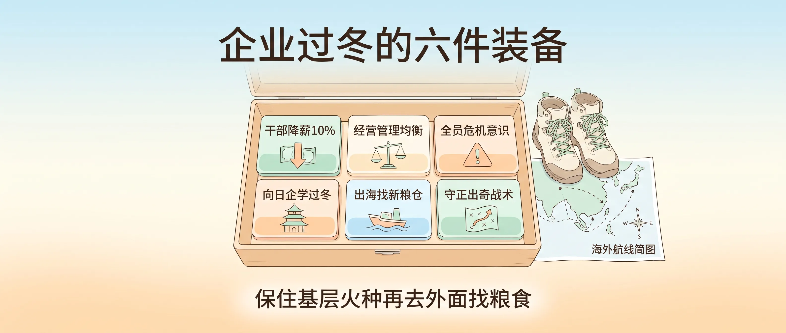

大家好，我是 Jason。

过去四天，我连着写了三篇文章。先是腾讯在 28 岁生日夜宣布换船与人员调整的[《腾讯生日夜的换船令》]({{ site.baseurl }}/tencent-28th-ai-reshuffle-layoff)，接着是黄仁勋交出帅印的[《他脱下了那件黑皮衣，和女人无关》]({{ site.baseurl }}/jensen-huang-leaves-nvidia)和[《这事能有多难，挺过今天就行》]({{ site.baseurl }}/jensen-huang-how-hard-can-it-be)。

写完合上电脑，我在雪球上又翻到一篇老帖：《再读：华为的冬天（附：企业过冬的六大启示）》。

一篇写于 2001 年，一篇复盘后来那场寒潮。放在 2026 年 11 月的今天再读，纸面上的冷风透了出来。

<!-- baoyu-skill cover prompt: 2.35:1横幅小清新治愈知识漫画封面，柔和米白到淡暖杏与浅天蓝微光渐变底色，干净纤细手绘线稿，薄荷绿、暖杏色、浅天蓝柔和色块平涂，留白充足，禁止任何品牌Logo与深色赛博UI，禁止英文杂字与弯曲极小字，画面中所有文字均水平端正排版并使用清晰简体中文，标题不带引号或括号。画面展示明亮清透的冬日书桌与窗景：前景浅木色书桌上摊开一本旧杂志与一份公司财务账册，杂志旁放着一只温热的浅绿色陶瓷茶杯和一件叠放整齐的暖杏色厚棉衣；窗外飘着几片极轻的雪花，远处一艘稳健前行的浅天蓝远洋船轮廓清晰。顶部居中醒目端正中文大标题二十五年后再读华为的冬天，底部居中辅助中文大船都在找棉衣与过冬手册。整体构图舒展平衡，治愈清新，所有汉字笔画清晰准确无变形。 --ar 2.35:1 -->

---

《华为的冬天》发表在 2001 年 2 月至 3 月的《华为人》报上，源头是任正非在科级以上干部大会上讲管理要点。

那一年华为刚交出亮眼成绩单。2000 年销售额 220 亿元，利润 29 亿元，排在全国电子百强第一位。

屋里一片热闹，任正非在台上泼了冷水。

他在开篇写下那句后来被传了二十五年的话：泰坦尼克号也是在一片欢呼声中出海的。

他点出了大公司最容易犯的毛病。太平时间太长，人会变胖，机构会变肿，大家都在讲战略和口号，没人弯腰去看水桶底下最短的那几块木板。

他点名的短木板全是笨活：理货、收发、出纳、订单、用服系统。随便哪一处漏水，船都能在半夜沉掉。

话音没落多久，全球互联网泡沫炸开。思科、朗讯、北电接连裁员过冬。2001 年 5 月，华为作价 7.5 亿美元把安圣电气卖给艾默生换回现金。2002 年，华为迎来史上罕见的负增长。

喊冬天的人，自己先穿上了棉衣。

<!-- baoyu-skill prompt: 2.35:1横幅小清新治愈知识漫画，柔和米白到淡暖杏与浅天蓝微光渐变底色，干净纤细手绘线稿，薄荷绿、暖杏色、浅天蓝柔和色块平涂，留白充足，禁止任何品牌Logo与深色赛博UI，禁止英文杂字与文字遮挡，所有文字水平端正排版并使用清晰简体中文，标题不带引号或括号。画面采用左右对照构图：左侧一只看似饱满的浅木色木桶上画着几块高耸的木板，写着两百二十亿高峰；右侧木桶底部几块短木板正在往外渗出浅天蓝水滴，短木板上分别水平标注理货收发、出纳订单、用服系统，旁边立着一块暖杏色警示牌写着人均效益。顶部居中醒目端正中文标题高峰时盯着最短的木板，底部居中辅助中文太平时间太长船容易漏水。整体构图整洁清晰，明亮治愈，所有汉字笔画准确完整。 --ar 2.35:1 -->

---

很多人记住《华为的冬天》，只记住“居安思危”四个字。整篇讲话里，任正非用了一多半篇幅谈怎么治内部。

先把“对人负责制”拆成“对事负责制”。

公司大了，机关部门叠床架屋，下属忙着琢磨领导脸色，写材料汇报。任正非要求机关消肿，建立以流程和数据库小组为支撑的对事负责制。事有标准，流程跑得通，人自然少一半。

接着是自我批判和任职资格。

他不搞运动式的批斗，提倡和风细雨的民主生活会，让干部自己照镜子。同时推行任职资格与反向考事：不管资历多老，把眼前的事干成才算数，不能拿昨天的功劳抵今天的庸碌。

规矩上，不盲目创新。

IT 系统和基本流程求稳，再求快。一线员工提倡“小改进、大奖励”，把理货、回款、交付里的毛刺一颗颗拔掉，不鼓励人人都去另起炉灶画大饼。

账目上，业务为主导，会计为监督。面对组织变革，要有平常心。

任正非在讲话里写得直白：推行 IT 就是裁员，把冗余人员通过内部流动放到能产粮的岗位上，把成功动作做成模板，少搞一次性的个人英雄主义。

这几天回头看，腾讯 28 周年压扁层级、看技能转换，英伟达在“直管六十人无缓冲垫”上踩线，底层碰到的都是同一道题。

公司从小变大，靠个人冲锋能赢前十年，靠流程和边界才能活过后二十年。

<!-- baoyu-skill prompt: 2.35:1横幅小清新治愈知识漫画，淡暖杏到米白与浅天蓝微光渐变底色，干净纤细手绘线稿，薄荷绿、暖杏色、浅天蓝柔和色块平涂，留白充足，禁止任何品牌Logo与深色赛博UI，禁止英文杂字与文字遮挡，所有文字水平端正排版并使用清晰简体中文，标题不带引号或括号。画面采用上下对照构图：上方一条弯弯曲曲的旧路被几座虚职审批亭挡住，亭子上写着对人负责；下方一条笔直明亮的薄荷绿通道直接通向交付终点，通道上摆着三枚整齐卡片，分别水平标注对事负责制、小改进大奖励、内部流动与模板化。顶部居中醒目端正中文标题把对人负责拆成对事负责，底部居中辅助中文流程顺了机关才能消肿。整体构图干净直观，明亮治愈，所有汉字笔画清晰完整。 --ar 2.35:1 -->

---

光看任正非的讲话不够，吴春波在《企业过冬的六大启示》里补全了那段日子的底色。

华为起步时只有 3000 元家底，6 个人凑了 2.1 万元注册公司。后来一路撞上劳动合同法调整、员工意外事故、海外知识产权诉讼和千禧年 IT 泡沫。

2002 年公司首次负增长，内部人心浮动，副总裁走了七八个，有人带着知识产权出去另立门户。任正非自己在那几年里经历了双亲离世，还患上抑郁症。

撑过那轮冰河期的，是六件摆在台面上的硬动作。

干部自动降薪机制。2003 年 4 月，华为总监级以上行政高管一共 454 人主动申请降薪 10%，公司最终批准 362 人。冬天来了，高管先勒紧裤腰带，保住基层和研发的火种。

经营与管理的均衡。改掉过去“强经营、弱管理”的毛病，用制度和流程对冲外部周期的波动。

建立充满危机意识的群体。不是老板一个人在办公室失眠，而是让整支队伍都知道账上还有多少粮草。

向日本企业学过冬。2001 年 4 月任正非带队去日本考察，写下《北国之春》，看见日企在“失去的十年”里近八年没涨薪，员工照常准点打卡把产品打磨到极致。同一年，松下在内部挂出“泰坦尼克与冰山”的警示图，推动约 1.3 万名员工自愿提前退休。

出海找新的战略生存空间。2000 年前后华为开启海外大出征，东方不亮西方亮，去全球市场找新的产粮地。

最后一条，吴春波借用了那句老话：坚定正确的政治方向，艰苦朴素的工作作风，灵活机动的战略战术。大方向不跑偏，底子守得住，打法能随时跟着战局变。

<!-- baoyu-skill prompt: 2.35:1横幅小清新治愈知识漫画，浅天蓝到米白与淡暖杏微光渐变底色，干净纤细手绘线稿，薄荷绿、暖杏色、浅天蓝柔和色块平涂，留白充足，禁止任何品牌Logo与深色赛博UI，禁止英文杂字与文字遮挡，所有文字水平端正排版并使用清晰简体中文，标题不带引号或括号。画面展示一只整洁敞开的浅木色过冬工具箱，箱内整齐排列六枚柔和色调的圆角卡片，每枚卡片水平印有清晰中文：干部降薪10%、经营管理均衡、全员危机意识、向日企学过冬、出海找新粮仓、守正出奇战术；工具箱旁放着一双结实的浅色登山靴和一张海外航线简图。顶部居中醒目端正中文标题企业过冬的六件装备，底部居中辅助中文保住基层火种再去外面找粮食。整体构图工整明快，治愈清新，所有汉字笔画清晰准确。 --ar 2.35:1 -->

---

很多人以为熬过 2002 年，冬天就翻篇了。没有。

翻开[华为 2025 年年度报告](https://www.huawei.com/cn/annual-report/2025)，账本上的数字摆在那里：2025 年研发费用支出 1,923 亿元，占全年收入 21.8%；近十年累计研发投入超过 13,820 亿元；研发员工约 11.4 万名，占总员工 53.7%。

我在[《从摩尔定律到韬（τ）定律》]({{ site.baseurl }}/tau-law-vs-moore-law-post-moore-era)里写过，技术底座是拿真金白银和人头年份堆出来的。越是外面风大，越要把棉衣缝在自己身上。

任正非当年在结尾还留了一句：低调应对媒体，安静做事。

外面鼓掌的时候，别把棉衣脱了。等掌声停了，真正保命的只有身上那件衣服。

<!-- baoyu-skill prompt: 2.35:1横幅小清新治愈知识漫画，柔和米白到薄荷绿与淡暖杏微光渐变底色，干净纤细手绘线稿，薄荷绿、暖杏色、浅天蓝柔和色块平涂，留白充足，禁止任何品牌Logo与深色赛博UI，禁止英文杂字与文字遮挡，所有文字水平端正排版并使用清晰简体中文，标题不带引号或括号。画面采用居中聚焦构图：一只温暖厚实的浅天蓝与薄荷绿拼接羽绒棉衣挂在明亮木架上，棉衣口袋上贴着三枚整齐的暖杏色数字标签，分别水平写着研发1923亿、占比21.8%、研发人员53.7%；旁边是一本厚实的年度账册，写着十年1.38万亿。顶部居中醒目端正中文标题把真金白银缝进棉衣里，底部居中辅助中文手里有底牌才能扛住下一个冬天。整体构图温暖扎实，明亮治愈，所有汉字笔画端正准确。 --ar 2.35:1 -->

---

回到 2026 年 11 月。

腾讯的工程师在滨海大厦工位群里等名单，硅谷的聚光灯告别了那件黑皮衣，普通人盯着招聘软件刷新页面。大船调头的时候，浪头拍到每个人脚下，变成下个月的房贷、账单和手里的活路。

我在[《真正的裁员潮可能还没开始》]({{ site.baseurl }}/digital-employee-work-node)和[《离开大厂，才是真正靠近 AI 的开始》]({{ site.baseurl }}/leave-bigtech-closer-to-ai-django-unchained)里提过：靠大平台兜底的时代在退潮，每个人得备好自己的划桨。

好日子里少搭虚架子，多盯账本、交付和客户投诉，别让自己成为账本上先砍掉的冗余。

趁手里还有现金流和时间，把钱和精力砸进能产生复利的硬手艺，把算力和工具变成自己名下的资产。

危机和萎缩早晚会来。少听外面的热闹，低头把眼前的每一笔单子做实。

风还没吹进屋里的时候，先检查门窗，再把棉衣穿在里面。
