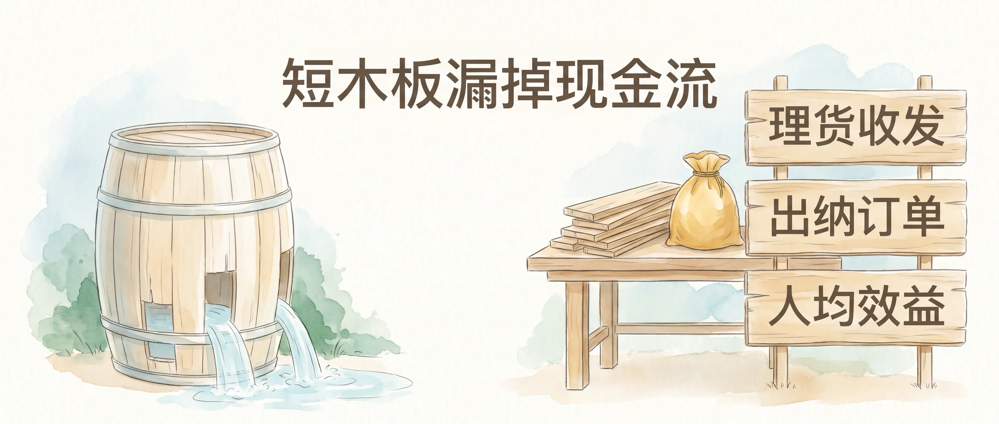
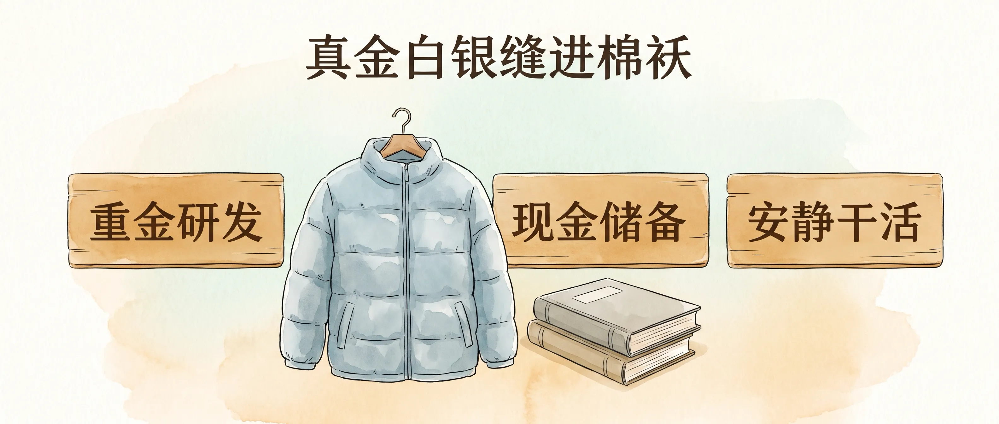

大家好，我是 Jason。

过去四天，我连着发了三篇稿子。11 月 12 日写[《腾讯生日夜的换船令》]({{ site.baseurl }}/tencent-28th-ai-reshuffle-layoff)，聊滨海大厦刷屏整夜的 15% 裁员传闻；13 日写[老黄脱下黑皮衣谢幕]({{ site.baseurl }}/jensen-huang-leaves-nvidia)；14 日又写[《这事能有多难，挺过今天就行》]({{ site.baseurl }}/jensen-huang-how-hard-can-it-be)。

合上电脑刷雪球，翻出[一篇老帖](https://www.xueqiu.com/1268495438/117182159)：上半篇收录 2001 年任正非的《华为的冬天》，下半篇附上人大教授吴春波的《企业过冬的六大启示》。

两篇旧文隔着二十五年时光。半夜读完两页，后脖颈灌进凉风。

<!-- baoyu-skill cover prompt: 2.35:1宽银幕小清新风格水彩手绘插画封面，清透冬日晨光洒满暖米白纸纹底色，晕染雾霾蓝、松霜绿与暖驼色轻柔色块，细钢笔线稿清爽利落，四周大面积呼吸感留白，不画任何商标符号、暗色界面或外文字符，图中汉字水平端正排列且无引号无冒号无数字。画面描绘一间通透明亮的木质书房窗景：前景浅橡木桌上平放一本翻开的旧账册，纸页仅画简洁空白横线绝无细碎小字，账册旁搁着一只冒热气的青瓷茶杯与一件叠得方正厚实的暖驼色冬日棉袄，棉袄上方摆一枚醒目大字木牌写着备足粮草；窗外飘落几片雪花，海平面上一艘雾蓝色大船平稳破浪，船旁立着大字标牌顺风备衣。顶部居中大号端正简体中文主标题顺风局先找棉衣。整体色调清雅温暖，汉字笔画粗细均匀清晰无变形。 --ar 2.35:1 -->

---

时间拨回 2001 年 2 月。任正非召集华为科级以上干部讲十大管理工作要点，整理稿刊登于当年 2 月至 3 月的《华为人》报。

翻开华为 2000 年的成绩单：全年销售额 220 亿元，利润 29 亿元，排全国电子百强首位。庆功酒还没散味，任正非上台浇下一盆冰水。

他提起泰坦尼克号拔锚出海那天，码头欢呼震天。十年间他天天琢磨失败，对掌声视而不见。太平日子久了，顺风局提拔的干部塞满办公室，灾害专挑大伙麻痹的档口扑过来。

营收破纪录，慌什么？我顺着他的账算了一遍。

通信电子产品每年跌价超过 15%。员工人均产出哪怕涨够 15%，挣来的毛利刚够填平跌价窟窿，发完原薪一分余粮不剩。华为连抓三年人均效益，就怕总营收的虚胖遮住人头膨胀。

任正非搬出二战后德国工人不涨薪帮国家回血的旧事，追问台下干部：假如工资砍半回家吃白菜南瓜，再裁掉一半人手，公司亏钱止不住怎么办？他顺嘴抛出一句冷笑话：拉闸关掉机器，省下几度电钱。

算完人头账，他弯腰去敲木桶底部最短的五块板：理货、中央收发、出纳、订单、用服系统。

全公司扎堆往光鲜的研发和营销挤，没人正眼瞧这五摊苦差事。做过小公司的人都懂这几块短板怎么要命：前线销售签回千万大单，仓库发错一箱配件，订单系统漏录一行型号，出纳对账慢半拍，或者售后工程师装机卡壳，客户尾款冻上几个月。货压满仓，现金断流，前头签单再猛也白搭。华为拉平统一价值评价标尺，推着能干的人往短木板岗位补位。

讲话印出来没几个月，全球互联网与电信泡沫炸裂。思科、朗讯、北电排着队大裁员。2001 年 5 月，华为签约把赚钱的电源子公司安圣电气作价 7.5 亿美元现金卖给艾默生，10 月落袋交割。2002 年，华为撞上创业后首次负增长，合同销售额滑到 221 亿元。

台前喊冷的人，入秋前先把现钱缝进了棉袄。

<!-- baoyu-skill prompt: 2.35:1宽银幕小清新风格水彩手绘插画，暖白画纸肌理融合浅雾蓝、松针绿与暖麦色柔润水彩晕染，细线手绘质感通透，构图疏朗留白宽敞，不含任何商标标识、深色科技框或外文字母，图中汉字水平端正无遮挡无数字。画面采用左右对照构图：左侧一只高大浅木桶底部缺了几截矮木板，清澈浅蓝色水流顺着缺口往外流淌；右侧木工台旁整齐立着三块加厚修补木板与一只饱满金黄谷物袋，三块木板上分别印有大号清晰中文理货收发、出纳订单、人均效益。顶部居中大号端正简体中文主标题短木板漏掉现金流。整体清爽直观，所有汉字笔画规范准确无乱码。 --ar 2.35:1 -->

---

外界聊《华为的冬天》，嘴边常挂着居安思危四个字。整篇讲话后半截治内病的招数，刀刀切向大公司软肋。

头一刀砍向对人负责制，换成对事负责制。

对人负责让组织越缩越小：审批关卡叠床架屋，下属整天揣摩上司脸色、熬夜凑周报保乌纱帽。对事负责把权力写进流程，离炮火近的一线明白人按规矩拍板。

怎么给总部机关消肿？任正非下一道硬命令：市场部富余干部次日起编入数据库小组。后台部门调取经营数字找数据库小组，严禁伸手向一线办事处要报表；考评枪口掉转，交由一线办事处给总部机关打分，任正非叮嘱前线少打高分，让机关吃亏才晓得谁养活谁。靠转发 Excel 表格混日子的协调岗露了底。

纠错机制走另一条路。高级干部每年关门开民主生活会，当面揭短红脸，吵完握手搭伙打仗；往下传到基层讲究和风细雨，学绣花一样拆解具体业务动作，严禁搞火药味批斗会。干部拒绝自我批判就不予提拔，屡教不改就降级。运动式追责一开，底下人捂盖子甩锅；对着工序温和复盘，一线才敢把刚冒头的窟窿摆上桌面。

选人用人同步立起任职资格标尺，终结拍脑袋蒙估的糊涂账，外加一招反向考事。PPT 汇报能注水，延期交付的订单和现场趴窝的故障骗不了人。顺着事故链条倒查三层，谁拍胸脯签的期、谁排的产、谁验的货，水落石出；再从打胜仗与败仗的复盘记录挑骨干，老资格躺功劳簿混不下去。

干活规矩定死一条：不盲目创新。跑顺了的 IT 系统与作业流程不许乱改，也别脱离本职写万言书画大饼，折腾系统的切换损耗能把利润吃干抹净。

一线推行小改进、大奖励，大建议只鼓励，拔掉打包、审单、回款的一根毛刺就发真金白银。几十年踩坑试出来的有效动作压成标准模板，新人入职三个月照着模板做就能交出职业水准。我今年给客户搭 Agent 工作流算过同款账：工程化与封装 Skill，二十五年前这套模板早把底子打好了，拿标准件兜底，公司才不用看高薪天才的脸色吃饭。

管钱讲究业务为主导，会计为监督。前线业务冲锋抢机会窗，财务把全球统一监控规则嵌进 IT 流程盯毛利和回款，不拿半个月的报销审批卡死商机，也不等钱亏空了才记马后炮死账。

讲到收尾，任正非掀开组织变革的底牌：变革重分利益，大方丈变小方丈，老庙拆掉，众人得怀一颗平常心。他引用 IBM 与思科高管的原话挑明，推 IT 系统等于一轮接一轮减员。软件接管填表、汇总和传话，中间传话汇总的工位空出来，再靠内部流动转去前线产粮岗。十年顺风局让人忘了疼，华为的危机、萎缩乃至破产迟早敲门。

拿这几段话对照今天腾讯压扁层级考核技能转换，再看英伟达直管六十人缺少治理缓冲垫翻车，商业常识没变过半个字：前十年拼创始人冲锋，后二十年拼流程与边界。

<!-- baoyu-skill prompt: 2.35:1宽银幕小清新风格水彩手绘插画，浅暖杏与霜白纸纹底色晕开松霜绿与雾蓝色柔和色块，纤细手绘墨线干净清爽，构图开阔留白充裕，无任何品牌图标、暗黑背景或外文字符，图中汉字水平端正清晰无数字。画面采用上下分流对比：上方一条曲折窄路堵着两座空置的旧木头审批亭，路尾画一枚柔和暖驼色叉号；下方一条宽阔笔直的松霜绿大道直通明亮交付港口，路边立着三块清爽醒目的浅色大字木牌，分别印有对事负责、标准模板、内部流动。顶部居中大号端正简体中文主标题砍掉传话筒盯交付。画面明快通透，所有汉字笔画结构准确。 --ar 2.35:1 -->

---

任正非讲完管理刀法，吴春波的《企业过冬的六大启示》掀开了 2002 年那场寒潮的里子。

往回倒推华为的起点：1987 年任正非离职又逢婚变，兜里揣着 3,000 元家底；深圳注册科技公司要求凑够五名股东与两万元本金，6 个人东拼西凑攒出 2.1 万元领回执照，早年给员工涨薪没现钱就打白条。

一路走来，公司挨过劳动合同法风波、员工意外事故与海外知识产权官司。熬到 2002 年负增长，内部人心摇晃，副总裁走了七八位，有人揣着技术出去另起炉灶抢单，次年初思科又递来跨国诉状；任正非那几年痛失双亲，挨过两次癌症手术，夜夜失眠患上抑郁症。

船没沉底，靠六记实打实的过冬硬招。

先拿高管工资单开刀，启动干部自动降薪机制。2003 年 4 月，华为总监级以上行政高管共 454 人主动递交降薪 10% 申请，公司审批拍板 362 人。账本背面藏着更硬的一条铁律：严禁扣减基层员工与研发专家一分钱。当时有研发骨干交上降薪申请，任正非退回申请表，直言对方工资没到降薪线，公司还要给研发骨干加薪。

我算过这笔人心账：362 名高管降薪一成省下的几千万，搁进两百亿营收盘子算小钱；高管先割肉受冻，猎头挖不走实验室的技术种子，回暖那天整支队伍拉出来接着打硬仗。

高管勒紧腰带稳住军心，转身把外部经营与内部管理配平。好年景靠销售外出抢单，冰河期外面没单子可抢，向管理要效益，把呆死库存、逾期坏账和流程漏水一处处堵死。

老板独自失眠救不了大船，全公司得长成知冷知热的危机意识群体。把真实财报寒气与行业险情摊开给全员讨论，上下几万人一起查门窗补裂缝。

过冬的参照系找去了邻国。2001 年 4 月任正非带队访日七天，回国写下《北国之春》：日本泡沫破灭后，许多日企员工近八年没涨工资，准点打卡把工艺磨到毫米级；松下电工的办公室、会议室和走廊墙面贴满巨轮撞向冰山的海报，底下写着能救这条船的唯有你；同一年，松下打破终身雇佣惯例，约 1.3 万名员工办理自愿提前退休。顺风比谁跑得快没意思，九死一生后还喘气才叫本事。

本土一块田减产，队伍就拎包出海开辟新的战略生存空间。2000 年前后华为派兵闯亚非拉与欧洲，东方不亮西方亮，拿全球多块市场的周期错位对冲单一市场寒冬。

收尾处，吴春波搬出抗大校训那三句话：坚定正确的政治方向，艰苦朴素的工作作风，灵活机动的战略战术。主航道认准通信底座不贪泡沫快钱，花钱守住三千元起家的节俭底色，前线打法随战局机动变阵。

<!-- baoyu-skill prompt: 2.35:1宽银幕小清新风格水彩手绘插画，雾霾蓝与暖米白纸纹底色清透交融，点缀松霜绿与暖驼色手绘色块，细线勾勒清爽柔和，大片留白透气，无任何商标图标、深色背景或外文字符，所有汉字水平端正排版且无数字。画面描绘一只敞开的温润浅木远行装备箱：箱旁立着一盏点亮的暖光防风马灯与一张仅画简洁航线箭头的航海简图，装备箱旁整齐陈列三枚醒目的大号圆角木牌，分别清晰印有高管降薪、保住研发、出海打粮。顶部居中大号端正简体中文主标题高管先冻着保火种。构图稳重治愈，汉字字形饱满清晰无残缺。 --ar 2.35:1 -->

---

有人觉得熬过 2002 年，苦日子早翻篇了。

点开官网挂着的[华为 2025 年年度报告](https://www.huawei.com/cn/annual-report/2025)，几行数字印得清楚：2025 年全年销售收入 8,809 亿元，净利润 680 亿元，经营活动现金流 1,273.84 亿元；单年研发费用支出 1,923 亿元，占全年收入 21.8%；近十年累计投入研发费用超过 13,820 亿元；研发员工约 11.4 万名，占总人数 53.7%。

五月我写[《从摩尔定律到韬定律》]({{ site.baseurl }}/tau-law-vs-moore-law-post-moore-era)算过工程复利：技术护城河拿真金白银与工程师年头垒出来。外头风雪刮得紧，华为把挣来的现金缝进贴身棉袄。

任正非收尾叮嘱了一条纪律：华为没上市，不用博眼球，全员低调应对媒体，对政府守法纳税，关起门安静干活。

我见过太多创业公司死于顺风局的公关稿。外面掌声一响，老板信了媒体的捧杀，硬撑亏损门面充排场。潮水退干净那天，身上那件厚衣服替你保命。

<!-- baoyu-skill prompt: 2.35:1宽银幕小清新风格水彩手绘插画，暖米白到浅松霜绿与淡驼色纸本水彩底色，细钢笔线条干净利落，画面疏朗留白充裕，不出现任何品牌图标、暗黑界面或外文字母，所有汉字水平端正无变形无数字。画面中央展示一件厚实温暖的雾蓝色冬日防寒棉袄挂在原木衣架上，衣架旁叠放两册封皮素净无碎字的厚账本；棉袄两侧整齐立着三枚暖驼色大字木牌，分别水平印有重金研发、现金储备、安静干活。顶部居中大号端正简体中文主标题真金白银缝进棉袄。色调温暖踏实，汉字笔画清晰工整。 --ar 2.35:1 -->

---

合上旧帖，日历翻到 2026 年 11 月 16 日。

滨海大厦的办公群等着调整名单，硅谷告别穿三十三年黑皮衣的掌门人，写字楼隔间有人低头刷新招聘软件。大船猛打舵盘，浪头拍向岸边，变成普通人下个月的房贷、水电单和饭碗。

回头翻我[三月聊大厂裁员与 AI 变阵的旧文]({{ site.baseurl }}/ai-layoff-not-because-of-ai-but-for-ai)、[五月和十几位大厂工程师聊完的笔记]({{ site.baseurl }}/leave-bigtech-closer-to-ai-django-unchained)，再到[七月拆解数字员工节点的文章]({{ site.baseurl }}/digital-employee-work-node)，二十五年前那句推 IT 减员，换个词成了今天上 AI 砍中间层。工具越聪明，转发消息、汇总周报的席位消失得越快。

我自己做小公司、[掏四十万买苹果设备跑 Agent]({{ site.baseurl }}/m5-ultra-96g-agent-machine-400k-apple)，对照这份过冬手册给自家账本立了规矩。

太平月份少摆虚架子，别贪图坐办公室发表格的清闲，弯腰盯紧客户交付、账期和售后毛刺，做水桶底下不漏水的那块硬木板。

趁手里还有进账，把干活手艺压成能复用的标准模板，把余钱换成自己名下的算力资产与客户渠道。

行业的萎缩和寒潮迟早轮到每个人头上。少凑外面的热闹，低头把眼前这一单做实收稳。霜降之前先拴紧门窗，把棉衣穿好。
