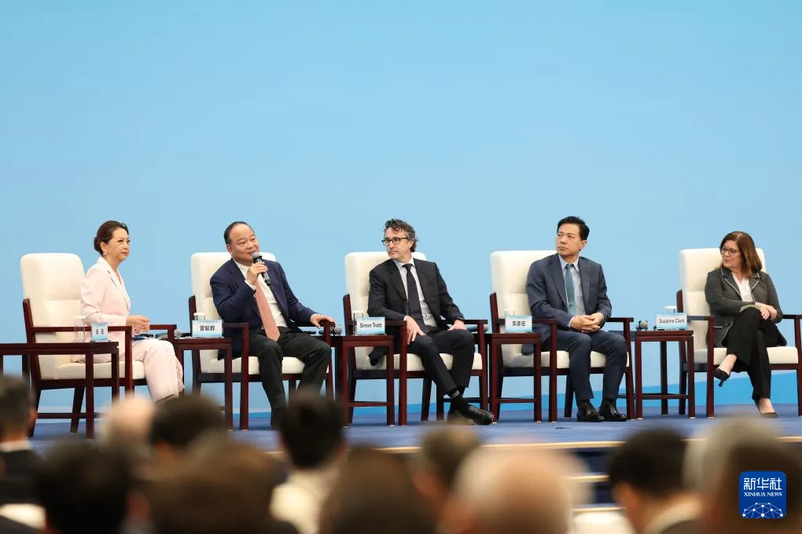
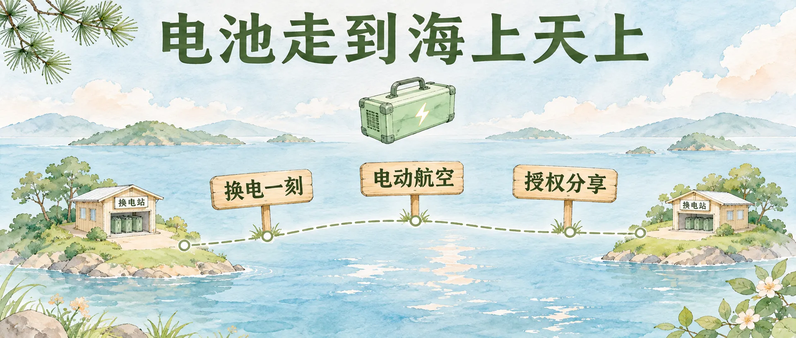
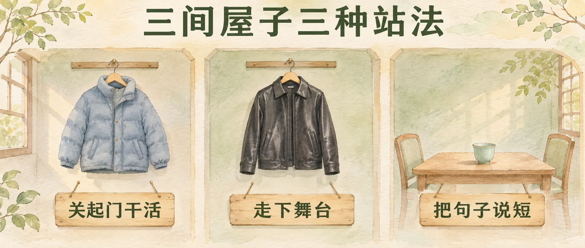

大家好，我是 Jason。

17 日上午，APEC 工商领导人峰会首场工商对话在深圳前海国际会议中心召开，主题是“亚太经济新图景与合作新机遇”。

对话由央视田薇主持，同台的四位嘉宾分别是宁德时代董事长曾毓群、力拓 CEO 乔德、百度董事长李彦宏和美国全国商会会长苏珊·克拉克。据[《中国经济周刊》](https://finance.sina.com.cn/wm/2026-11-18/doc-inizcexi1191226.shtml)报道，这场排到 18 日的峰会来了 2000 多位代表和 115 家世界 500 强企业。

---

他开场没念讲稿，直接用英文反问：做企业到底为了什么？起初是为了赚钱、养家、服务社会、把公司办好；等公司做大了，反而会问自己，为什么还要这么拼，为什么非得去应付地缘政治？

我去翻了[新浪财经当天的现场速记](https://finance.sina.com.cn/hy/hyjz/2026-11-17/doc-iniyyzym5539888.shtml)，中文稿避开了“地缘政治”，翻成了“为何总要处理那些议题”。他后面紧接着说：

“如果一家企业存在的使命是造福人民，让老百姓过上富裕而健康的生活，持续地、可持续地富裕而健康，你就会有恒心、有愿景、有耐心，也会有志同道合的人，与你一同完成这一切。”

[英文转录](https://singjupost.com/transcript-china-hosts-apec-ceo-summit-in-shenzhen/)里他还算了一笔时间账：政府大约五到十年换一轮，企业家之间的关系却可以拉得更长。

坐他对面的就是美国全国商会会长，桌上摆的都是电池、矿产、关税和技术授权这些硬议题。按惯例，这种场合的通稿无非是“机遇与挑战并存”，他却直接翻译成了养家、健康、下一代。不需要翻财报，谁都听得懂。

<!-- baoyu-skill prompt: 2.35:1宽银幕小清新风格水彩手绘插画，暖米白纸纹底色晕开雾霾蓝与浅杏色，细线手绘通透，构图左右对照并留大片空白，无商标，无人物正脸，无外文字母，无引号冒号和阿拉伯数字，汉字水平端正。左侧一只浅木讲台压着一本合拢的空白讲稿，讲稿上只有淡淡横线；右侧一张家里的小餐桌，摆着粥碗和青菜，椅背靠一只儿童书包，桌边立三块圆角木牌，分别写着赚钱养家、富裕健康、下一代。顶部居中大号端正简体中文主标题通稿译成养家。色调温暖清透，汉字笔画准确。 --ar 2.35:1 -->

---

网上有人问：“千亿了还拼什么？”

顺手查了 11 月 17 日的盘中行情，宁德时代 A 股（300750）股价约 240.20 元，总市值约 1.11 万亿元。不是千亿，是万亿，差了一个量级。站在 1 万亿的体量上讲“养家”，分量完全不同。

除了聊使命，现场他还向李彦宏抛了个问题：现有的大模型够不够用，还是需要一种面向科学的原生 AI（报道称之为寻找“AI 爱因斯坦”）？李彦宏把话接了过去，说现在的模型会答题，但还不会出题。

我们平时给客户做 Agent 工作流，核心是把现成工序自动化。但曾毓群要的不是这种效率工具——下一克电池能量密度，靠写周报和做客服的机器人变不出来。

---

情怀之外，一谈到业务，他报的全是硬数字。

换电大约 99 秒，他称之为商业模式创新，亚太现在就能用；电池能量密度目标至少每公斤 350 瓦时，用来支撑电动航空和 eVTOL。城际飞行只要 15 分钟，开车却要两小时——电动化正从陆地往海洋和天空扩，亚太海岛之间最缺的就是这个。

合作原则也很明确。英文转录里他直接把话挑明：按国际通行规则来，尊重知识产权，授权就是分享。

说到底，玩笑解决不了出口管制。地缘政治还在桌上，但通过技术授权，合作方从单纯的买家变成拿许可的一方，双方才有下一轮可谈。台上能笑着讲“养家”，底气还是垫在 99 秒和 350 瓦时这些数字上。

<!-- baoyu-skill prompt: 2.35:1宽银幕小清新风格水彩手绘插画，浅雾蓝与暖白纸纹交融，点缀松叶绿和淡杏色，细钢笔线清爽，留白宽敞，无商标无品牌标志，无人物正脸，无外文字母，无引号冒号和阿拉伯数字，汉字水平端正。画面是一片安静的群岛海面：两座淡绿色小岛之间画一条柔和航线，岛上各有一座小小的浅木换电站，海面上方飘着一只方正的浅绿色电池包，不画飞机商标。航线旁立三块大字木牌，分别写着换电一刻、电动航空、授权分享。顶部居中大号端正简体中文主标题电池走到海上天上。色调清透，汉字笔画完整。 --ar 2.35:1 -->

---

这周连着看了三位企业家的表达，反差挺明显。

2001 年任正非在内部讲[《华为的冬天》]({{ site.baseurl }}/rereading-huawei-winter)，叮嘱干部少对媒体说话、关起门干活，那时公司没上市，听众全在门里。

11 月 12 日黄仁勋卸任总裁、CEO 和董事，网上翻出他早年那句[“挺过今天就行”]({{ site.baseurl }}/jensen-huang-how-hard-can-it-be)。当公司长成别国手里的基础设施，个人的一举一动都会被诉讼、审查和舆论放大，听众早已不在会场。

17 日曾毓群坐在前海，当着美国商会把“为什么要应付地缘政治”直接问出声，再把答案收成富裕和健康。听众一半在台下，一半在镜头后面。

<!-- baoyu-skill prompt: 2.35:1宽银幕小清新风格水彩手绘插画，暖米白到浅松绿与淡驼色纸本底色，细线勾勒柔和，三等分构图留白充足，无商标，无人物正脸，无外文字母，无引号冒号和阿拉伯数字，汉字水平端正。左格一只厚实的雾蓝棉袄挂在浅木衣架上，下方木牌写着关起门干活。中格一只空木衣架挂着一件整齐的黑皮衣，下方木牌写着走下舞台。右格一张会议小桌，桌上只有一只青瓷茶杯，没有纸张，下方木牌写着把句子说短。顶部居中大号端正简体中文主标题三间屋子三种站法。色调安静清透，汉字笔画清晰。 --ar 2.35:1 -->

---

能借鉴的就一点：当你的业务摆上了别人的棋盘，对外说话得让没看过财报的人也能听懂，而且你自己得真信——养家、健康、下一代，就这三样。

过冬靠的是账上的现金，上台靠的是嘴边的话。这两样，都得在顺风的时候提前备好。
