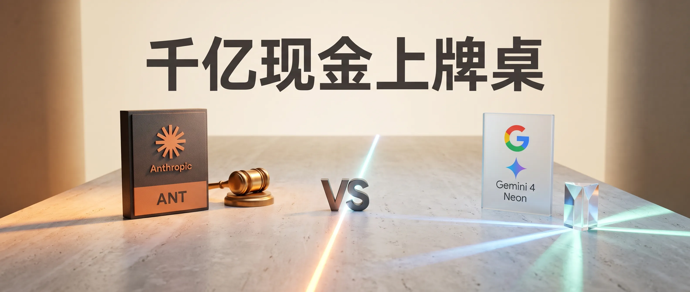
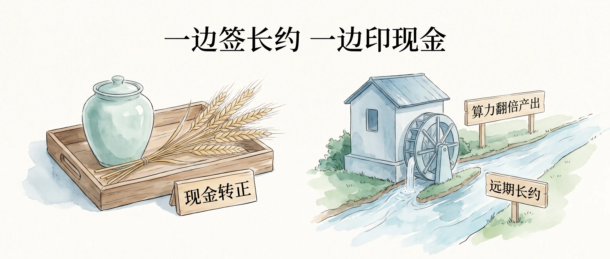
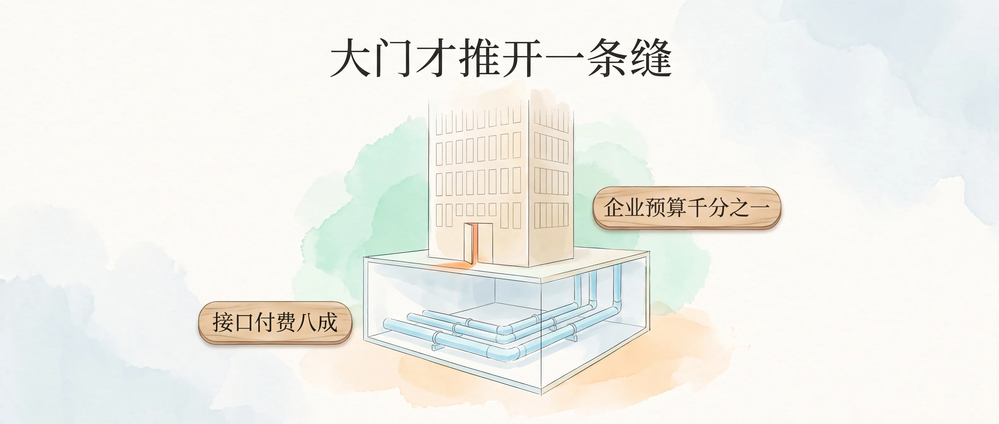
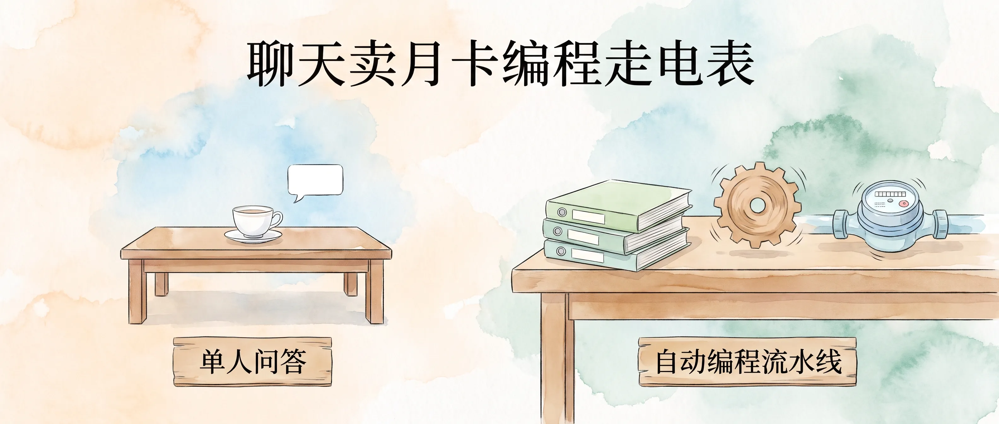
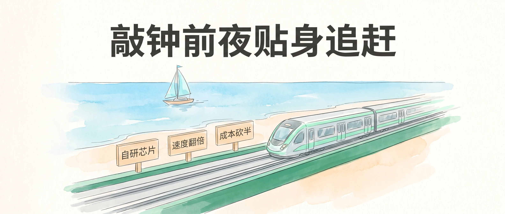

大家好，我是 Jason。

美东时间 2026 年 11 月 19 日周四，对应北京时间今晚到明天凌晨，Anthropic 在纳斯达克敲钟挂牌，股票代码 ANT。

据[《福布斯》](https://www.forbes.com/sites/fionariley/2026/11/19/anthropic-ipo-live-nasdaq-futures-jump-2-ahead-of-record-stock-debut/)和[《卫报》](https://www.theguardian.com/business/live/2026/nov/19/anthropic-float-stock-market-nasdaq-raises-81bn-record-ipo-latest-news-updates)的现场消息，发行价定在 83 美元，公开募资 813 亿美元，叠加谷歌、英伟达、微软、AMD、博通、台积电等伙伴 260 亿美元私募配售，账面涌进超过 1,070 亿美元，完全摊薄估值站上 1.5 万亿美元。

我点开 [SEC 官网挂出的招股书](https://www.sec.gov/edgar/browse/?CIK=0002130357)翻了一遍，里面的几组数字，比敲钟画面更有冲击力。

<!-- baoyu-skill cover prompt: 2.35:1宽银幕真实商业编辑摄影照片质感封面，非插画非水彩，中画幅电影镜头浅景深，延续Anthropic暖米白羊皮纸与克制人文的高端杂志大片质感，无人物正脸。画面呈现一张修长极简的浅灰洞石长桌，左右两大AI巨头正面PK对峙：左侧为Anthropic阵营，温暖琥珀侧光下立着一块质感厚重的哑光炭黑与暖陶土橘色金属立牌，正面清晰端正印有暖橘色Claude放射星芒Logo、英文品牌字样Anthropic以及醒目关键字ANT，立牌旁放置一柄温润黄铜敲钟锤；右侧为Google阵营，清透冷光下立着一块极简磨砂玻璃立牌，正面清晰端正印有经典四色Google Logo、蓝紫渐变Gemini四角星光图标以及醒目关键字Gemini 4 Neon，立牌旁的水晶棱镜折射出凌厉的冷蓝与薄荷霓虹光束；长桌正中央形成暖陶土橘光与冷蓝薄荷霓虹光碰撞的交界线，桌面正中点缀一枚极简克制的深灰金属立体VS标志。画面上方留出开阔干净的暖米白柔光空间，顶部居中水平排印大号端正深炭灰色无衬线简体中文主标题千亿现金上牌桌。整体真实摄影质感细腻高级，光影层次分明，所有中文标题及英文品牌字样Anthropic、ANT、Google、Gemini 4 Neon、VS拼写完全准确、笔画清晰锐利无乱码。 --ar 2.35:1 -->

---

先翻现金账。

截至今年三季度，Anthropic 账上躺着 1,319 亿美元现金及短期投资。整个美股，手头现钱比它多的公司，只剩伯克希尔和谷歌。

过去三年，外界都在算大模型还要烧掉多少投资人的钱。[Anthropic 递交的 S-1 文件](https://www.anthropic.com/news/s1-sec)把真实底数摊了出来：狂烧三年，公司累计经营性消耗约 100 亿美元。转过头看今年，截至 9 月 30 日的前九个月，经营现金流净流入达到 65.7 亿美元。三年烧掉一百亿，九个月挣回六十五亿七，造血闭环已经跑通。

账上钱厚，胃口更大。公司把未来的算力采购和数据中心租约一路签到 2045 年，各项承诺加在一起 9,009 亿美元。

一口气签下九千亿美元的二十年长约，是豪赌还是有底气？招股书给了单美元算力产出数据：2025 年一季度，投进 1 美元算力只能换回 0.40 美元收入；从今年二季度起，每投 1 美元算力产出 2.08 美元收入，二季度调整后营业利润率拉到 19%。

算力进门，Token 出门，一块钱进去，两块零八分出来。只要上游有卡、下游有单，签长约是在锁未来的产能。风险也摆在明面上：九千亿承诺横跨十九年，一旦模型溢价下滑或者价格战打穿毛利，这份长约就会变成脖子上的铁链。

<!-- baoyu-skill prompt: 2.35:1宽银幕小清新风格水彩手绘插画，暖白画纸肌理融合浅雾蓝、松叶绿与淡麦色水彩晕染，纤细手绘墨线干净通透，构图疏朗留白宽敞，无任何品牌图标、人物正脸、深色科技框或外文字母，图中汉字水平端正无遮挡无引号无冒号无阿拉伯数字。画面采用左右对照构图：左侧一只原木托盘稳稳盛着一只青瓷储蓄罐与几支饱满麦穗，托盘下方立木牌写着现金转正；右侧一座简洁的浅雾蓝水车小站，一股细水流经水车后汇成两倍宽的清澈水渠流向远方，水渠旁立两块浅木牌，分别写着算力翻倍产出、远期长约。顶部居中大号端正简体中文主标题一边签长约一边印现金。色调明朗治愈，汉字笔画工整清晰。 --ar 2.35:1 -->

---

这笔钱谁掏的？

翻开营收曲线，2023 年 4,100 万美元，2024 年 3.86 亿美元，2025 年 45.9 亿美元，今年上半年 163 亿美元，三季度单季冲到 170 亿美元，前九个月合计 332 亿美元。

买单的主力不是刷卡充月费的散户。招股书披露，八成营收来自按量计费的 API，面向个人的订阅只占两成。

世界 500 强里，年付 10 万美元以上的客户超过一半，排名前十的企业全部在列。

顺手纠个偏。这两天中文圈流传一份摘抄，写 Anthropic 有 11.9 万家年付 100 万美元的客户，对比一年前的 950 多家。我翻了 SEC 原文和 [TechCrunch 的拆解](https://techcrunch.com/2026/10/26/anthropics-ipo-filing-reveals-its-strategy-for-keeping-enterprise-customers-hooked/)，流传版本把门槛写高了一档，又多添了一个零。招股书里的真实台阶长这样：年付 10 万美元以上的客户超过 1.19 万家，一年前只有 950 多家，一年涨了十倍多；年付 100 万美元以上的超过 1,900 家；年付 1,000 万美元以上的超级大客户有 250 家。不含个人订阅的企业客户净收入留存率，冲到了 900%。

招股书角落还藏着一条注脚：这超一半的世界 500 强客户，花在 Anthropic 上的钱，平均只占公司总运营开销的 0.1%。

千分之一。大公司每年发工资、买传统软件、租机房，花掉几百亿美元，AI 预算刚挤进门缝。只要模型能多接管一成研发、法务、财务和客服工时，千分之一往百分之一挪一小步，盘子就能再翻十倍。

<!-- baoyu-skill prompt: 2.35:1宽银幕小清新风格水彩手绘插画，暖米白与浅雾蓝纸纹底色，点缀薄荷绿与浅杏色水彩，细线手绘通透，留白充裕，无商标标志、人物正脸、暗黑界面或外文字母，图中汉字水平端正无引号无冒号无阿拉伯数字。画面展示一座简洁清爽的建筑横截面：底层宽敞明亮的厂房里排列着整齐的浅天蓝输电管道，管道旁立着圆角木牌写着接口付费八成；上方高大的浅米色写字楼轮廓里，只在门缝处透出一条温暖浅橘色微光，门缝旁立着木牌写着企业预算千分之一。顶部居中大号端正简体中文主标题大门才推开一条缝。画面清爽直观，汉字结构规范无乱码。 --ar 2.35:1 -->

---

翻到人头那一页，反差更大。

截至今年 9 月 30 日，Anthropic 全公司 5,300 名员工。拿三季度单季 170 亿美元营收年化，全年跑在 680 亿美元的线上，平摊到 5,300 人头上，人均年产值超过 1,200 万美元（精确算约 1,280 万美元）。

前两天我重读[《华为的冬天》]({{ site.baseurl }}/rereading-huawei-winter)，二十五年前任正非追着干部抓人均效益，怕人头膨胀吃掉利润。五千人的模型厂干出人均千万美元产值，改写了传统软件公司堆销售、堆实施顾问的账本。

为什么大企业肯往 API 里打钱？答案不在网页聊天框里。

招股书拆了企业内部两类用户的账单：不用 Claude Code、只在网页里聊天的客户，月均消费不到 75 美元；用 Claude Code 写代码的高频用户（前 5%），月均消费是聊天用户的 20 倍。

账算得明明白白。网页聊天是人敲一句、模型回一句，你一天手速再快，也吞不下多少 Token。换上 Claude Code，工程师丢过去一个需求，它自己读代码库、改文件、跑测试、修报错，半小时烧掉几百万 Token。

聊天卖的是软件月卡，Claude Code 和 API 卖的是产线电力。活儿越多，电表转得越快，大客户也愿意照单全收，因为省下来的是工程师排期和上线时间。

<!-- baoyu-skill prompt: 2.35:1宽银幕小清新风格水彩手绘插画，浅暖杏与霜白纸纹底色晕开淡天蓝与松霜绿柔和色块，纤细钢笔线稿清爽利落，构图疏朗留白宽敞，无商标标识、人物正脸、深色界面或外文字母，图中汉字水平端正清晰无引号无冒号无阿拉伯数字。画面采用左右对照构图：左侧一张安静的小木茶几，桌上放着一只白瓷茶杯与一枚小小的空白对话泡泡，茶几下方立木牌写着单人问答；右侧一张宽敞原木工作台，桌上整齐叠着几本淡绿色活页夹、一只轻快旋转的木齿轮与一只飞速走字的浅蓝水表，桌下立木牌写着自动编程流水线。顶部居中大号端正简体中文主标题聊天卖月卡编程走电表。色调清透明亮，汉字笔画完整准确。 --ar 2.35:1 -->

---

账本亮眼到这份上，Anthropic 赢定了吗？我照样看好 Google 追上来。

先看发牌时间。Anthropic 定在 11 月 19 日敲钟，Google DeepMind 挑在 11 月 18 日，也就是敲钟前一天，在[官方博客](https://blog.google/innovation-and-ai/models-and-research/gemini-models/introducing-gemini-4-neon/)发布了新模型 Gemini 4 Neon。

这套组合拳连着出。11 月 10 日，Google 刚把重型旗舰 [Gemini 4 Carbon 全面开放](https://blog.google/innovation-and-ai/models-and-research/gemini-models/gemini-4-carbon-now-available/)，专攻长周期软件工程、全栈自验证和复杂漏洞修复。隔了八天，又把从 Carbon 蒸馏适配而来的 Gemini 4 Neon 推上桌，卡在轻快的 Hydrogen 和重型的 Carbon 中间。

Neon 瞄准的靶心就两样：编码 Agent 的速度和账单。

看官方放出来的规格：100 万 Token 统一多模态上下文，后台模式支持最高 100 万 Token 长输出，提供 low、medium、high、xhigh 四档思考深度随任务切换。输出速度跑在每秒 110 个 Token 左右，比 Carbon 快出将近一倍。

独立评测机构 [Artificial Analysis 发布的榜单](https://artificialanalysis.ai/articles/gemini-4-neon-intelligence-gain)里，Neon 开满思考深度拿到 61 分，排进全球前三，反超自家的 Carbon，也压过 Claude Opus 5.5 的 59 分和 GPT-6.2 Sol 的 57 分。

更狠的是报价。Neon 的 API 挂牌价为每百万输入 3 美元、每百万输出 15 美元，自动缓存读取只要 0.15 美元（打了九五折），比 Carbon 标准价便宜四分之一。落到编码 Agent 实战评测里，Neon 跑完单个复杂任务的综合成本约 6.86 美元，同级 Claude 模型要 12 到 15 美元，少花一半。

<!-- baoyu-skill prompt: 2.35:1宽银幕小清新风格水彩手绘插画，清透天蓝与暖米白纸纹底色融合薄荷绿与浅杏色水彩，细线手绘质感轻盈，构图开阔留白充足，无品牌图标、人物正脸、暗色背景或外文字符，图中汉字水平端正无遮挡无引号无冒号无阿拉伯数字。画面描绘一条安静明亮的海岸双线跑道：上方海面一艘挂着淡蓝风帆的小艇向前航行，下方紧贴海岸的平整轨道上一列银白配薄荷绿的流线型轻轨加速追近，轻轨下方垫着一块坚固的松绿色基座。轨道旁整齐立着三块端正浅木牌，分别清晰写着自研芯片、速度翻倍、成本砍半。顶部居中大号端正简体中文主标题敲钟前夜贴身追赶。整体清新有动感，汉字笔画饱满准确。 --ar 2.35:1 -->

---

把两家公司的底牌并排摆在桌上，能看清下一轮打什么。

Anthropic 手握先发口碑和 Claude Code 养出来的工程习惯，但头上压着 9,009 亿美元的外部算力长约。芯片要买英伟达，机房要租云厂商，每跑出一个 Token，上游都要分走一块利润。

Google 攥着自研 TPU。芯片、机房、云平台、模型全在自己院子里闭环，不用向外签近万亿的远期买卡账单。自家芯片省下的毛利，撑起了 Neon 腰斩的单任务报价。

分发渠道也在手里。发布当天，Google 就把 Neon 接入 [Google Antigravity](https://antigravity.google/blog/gemini-4-neon-in-google-antigravity/)、Vertex AI 和 GitHub Copilot，在自家 Agent 编排里拆成分工：Neon 当规划大脑，Hydrogen 当高速执行手，把长思考和快执行拆开计费。

Anthropic 敲响纳斯达克开市钟，把一件事钉死了：AI 跨过了靠讲故事融钱的阶段。企业愿意为能干活的编码 Agent 和 API 付真金白银，且这笔钱目前只占企业总开销的千分之一。

牌局远没散场。Anthropic 靠 2.08 倍的算力产出和先发客户占住高地，Google 踩着敲钟前夜递出 Gemini 4 Neon，用更快的速度、砍半的账单和全栈 TPU 贴身追赶。

两家把单任务价格越压越低、把编码能力磨得越稳，我们这些每天买 Token 干活的人最先受益。
