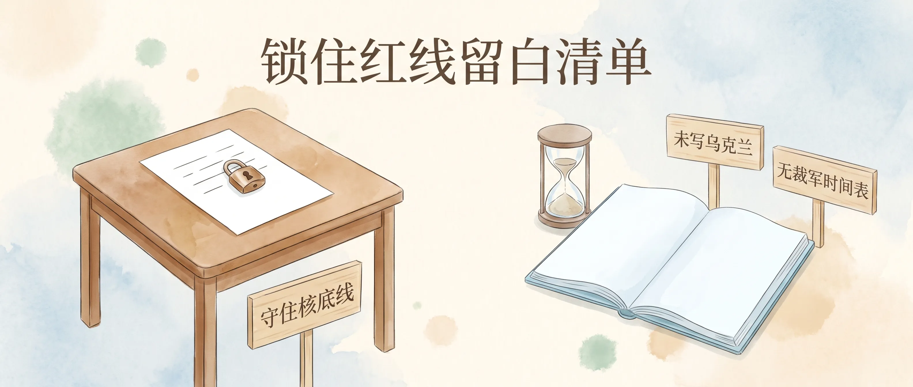
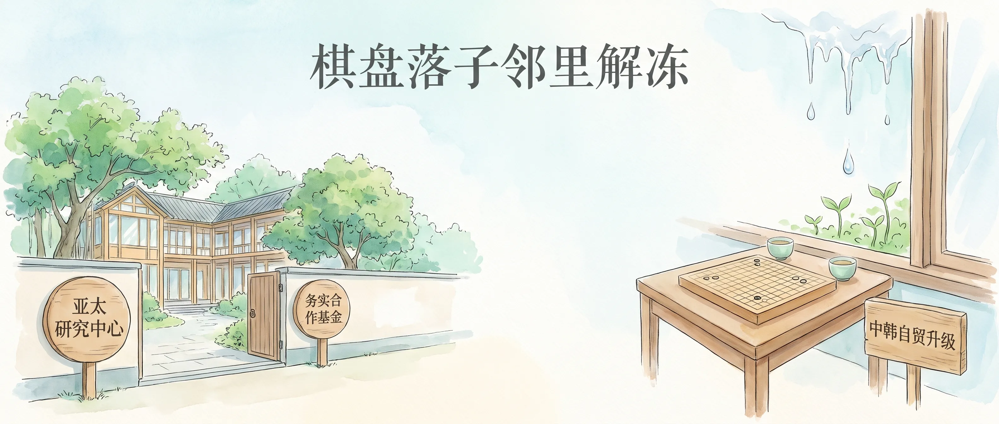
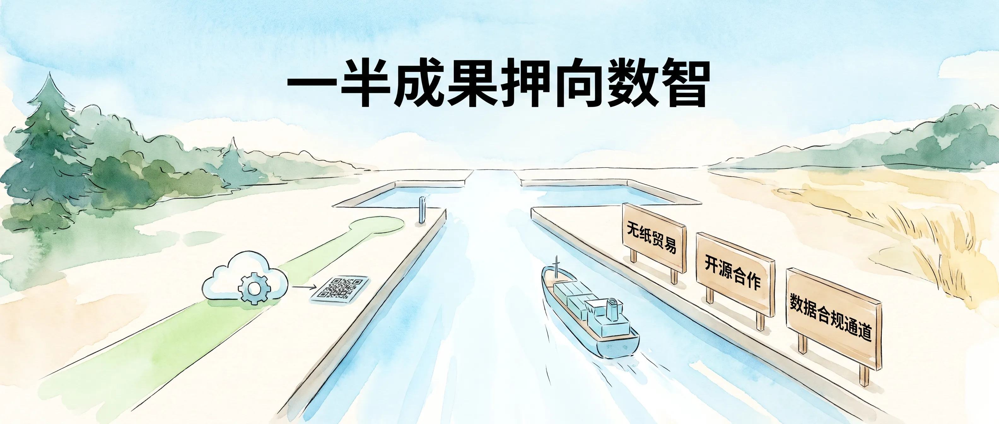

大家好，我是 Jason。

11 月 19 日晚，空军一号从深圳宝安国际机场起飞。特朗普结束在深圳约 26 小时的行程，启程返美。

王毅走到机坪送行，仪仗队列阵。两人在红毯上边走边谈，特朗普在登机口挥拳告别。送完机，王毅转场开了中外记者会。按 [APEC 官网新闻稿](https://www.apec.org/press/news-releases/2026/1119_AELM_PR) 和[中央社报道](https://www.cna.com.tw/news/acn/202611190363.aspx)，第 33 次 APEC 领导人非正式会议在 18 至 19 日开完，各经济体通过《2026 年亚太经合组织领导人深圳展望》，深圳主场收官。

前两天写[《万亿之后，他开口先讲养家》]({{ site.baseurl }}/zeng-yuqun-apec-family)时，曾毓群坐在深圳前海，当着美国全国商会会长反问，企业做大之后为何还要应付地缘政治。两天后，各国元首专机离港。我翻了一遍外交部、商务部和 APEC 官网挂出的一手文件，理清这次谈成哪些硬牌、留了哪些空白，又给普通人打开哪几条通道。

<!-- baoyu-skill cover prompt: 2.35:1宽银幕小清新风格水彩手绘插画封面，晴朗海风晨光洒满暖米白画纸肌理，晕染浅海蓝、松叶绿与淡杏橘柔和色块，纤细钢笔线稿清爽利落，四周大片呼吸感留白，无任何国旗标志、商标图标、人物正脸、深色背景或外文字母，图中汉字水平端正无引号无冒号无阿拉伯数字。画面描绘开阔宁静的深圳湾海滨远景：海面波光轻漾，远处一架简洁的浅灰白客机斜向起飞掠过淡蓝晴空，近景海岸木栈道旁立着一座素净的浅木航标灯塔与三块圆角木牌，分别清晰写着核底线、二十五项数智、下一站富国岛。顶部居中大号端正简体中文主标题风向落在深圳湾。整体清透明亮有层次，汉字笔画粗细均匀工整无乱码。 --ar 2.35:1 -->

---

先看 11 月 19 日那张桌。

习近平、普京、特朗普在深圳坐到一起，这是中俄美三国元首头一回三方会晤。会后发出的[《中俄美元首和平宣言》](https://www.mfa.gov.cn/zyxw/202611/t20261119_12063191.shtml)，我对照了[美国驻华大使馆的英文原文](https://china.usembassy-china.org.cn/u-s-russia-china-heads-of-state-declaration-toward-peace/)，全文只有四条。

第一条，三个安理会常任理事国推动联合国改革。第二条，增加精炼石油产品生产与供应，维持能源稳定流动。第三条，认可国家同意原则和国家官员豁免权，反对国际刑事法院（ICC）及类似机构滥用管辖权。第四条，重申“核战争打不赢也打不得”，谈减少核风险、防核扩散。

四条写完，收尾。

[《卫报》](https://www.theguardian.com/world/2026/nov/19/china-russia-us-agree-peace-statement-no-mention-ukraine-iran-wars)点出了纸面外的空白：整份宣言没提乌克兰，没提中东和伊朗，核裁军没有时间表，也没有带约束力的军控条约，落脚点停在“对话”二字。

我的看法简单：三个核大国先把核按钮按住，锁死底线，让市场和周边国家松半口气。地缘摩擦、制裁清单和地区战火，一笔没勾销。大国划出底线，其余国家还得盯着风向走路。

<!-- baoyu-skill prompt: 2.35:1宽银幕小清新风格水彩手绘插画，暖米白与浅雾蓝水彩纸纹底色，点缀松霜绿与淡驼色柔润色块，细钢笔线干净通透，构图疏朗留白宽敞，无国旗、商标、人物正脸、深色框或外文字母，图中汉字水平端正无引号无冒号无阿拉伯数字。画面采用左右对照构图：左侧一只温润原木方桌上平放一页写有四条短横线的素白信笺，信笺中央压着一把精致的青铜小铜锁，桌下立木牌写着守住核底线；右侧摊开一本留有大片空白页的浅蓝笔记本与一只停驻的沙漏，本旁立两块浅木牌，分别写着未写乌克兰、无裁军时间表。顶部居中大号端正简体中文主标题锁住红线留白清单。色调克制清雅，汉字笔画清晰工整。 --ar 2.35:1 -->

---

底线之外，深圳留下一批常设机构和真金白银。

11 月 19 日，习近平在[峰会讲话](https://www.fmprc.gov.cn/zyxw/202611/t20261119_12062707.shtml)里亮出几笔安排（[中国政府网英文稿](https://english.www.gov.cn/news/202611/19/content_WS6afe6572c6d00ca5f9a0e70e.html)与[新华社](https://app.xinhuanet.com/news/article.html?articleId=202611208f90a72152ab4de4b459e6bd0ff71afb)均有全文）：中方出资 2000 万美元，资助 APEC 务实合作；在深圳设“亚太共同体研究中心”，做政策研究和学术交流；在数字技术、清洁能源、中小企业领域设专项合作机构，前海落户 APEC 数据跨境流动合作中国中心。

顺手纠个偏。这两天网上不少摘抄，把前两条揉成“中方花 2000 万美元建研究中心”。翻回原文，2000 万美元资助 APEC 整体合作，在深圳设研究中心是另一项并列安排，两笔账分开算。

另一块松动出在中韩。

11 月 18 日上午，习近平在深圳麒麟山庄见了韩国总统李在明，蔡奇、王毅、黄坤明在座。按[外交部英文通稿](https://www.fmprc.gov.cn/mfa_eng/xw/zyxw/202611/t20261118_12062076.html)和[《人民日报》](http://paper.people.com.cn/rmrb/pc/content/202611/19/content_30192099.html)的记录，算上 2025 年 11 月庆州 APEC 和今年 1 月访华，两人在一年多里见了三面。李在明约下回下围棋，提议合作大熊猫，重申坚持一个中国政策。

寒暄背后压着硬协议。双方确认，中韩自贸协定（FTA）第二阶段谈判实质性完成。媒体披露，中方承诺在电影和游戏领域给予韩方最惠国待遇，视听合拍范围扩到剧集、动漫、综艺和纪录片；双方同意推进 AI 等新兴产业合作，稳住供应链。今年前 9 个月，中韩双向人员往来逼近千万人次，2027 年两国迎来建交 35 周年，冻了几年的文娱和商贸通道拧开了闸。

<!-- baoyu-skill prompt: 2.35:1宽银幕小清新风格水彩手绘插画，浅暖杏与霜白纸纹底色晕开淡天蓝与薄荷绿水彩，纤细手绘墨线清爽柔和，留白充足，无国旗、商标、人物正脸或外文字母，图中汉字水平端正无引号无冒号无阿拉伯数字。画面采用左右呼应构图：左侧一座通透明亮的浅木与玻璃院落掩映在几株青翠榕树间，门口立两块圆角木牌分别写着亚太研究中心、务实合作基金；右侧一张临窗小木桌摆着一副简笔木质围棋盘与两只温热青瓷茶杯，窗外几枚冰晶化成清澈水滴落进新绿嫩芽，桌旁立木牌写着中韩自贸升级。顶部居中大号端正简体中文主标题棋盘落子邻里解冻。整体明朗治愈，汉字结构规范无变形。 --ar 2.35:1 -->

---

再核一笔转发量最高的经贸账。

这里也要纠个偏。不少帖子写深圳签下“近 50 项经贸大单”，听着像一摞商业采购合同。我查了商务部 11 月 16 日发布会和[新华社报道](https://app.xinhuanet.com/news/article.html?articleId=20261116ca33dbfb395d4517a653731a963ebf5a)，这近 50 项出自 APEC“中国年”经贸合作清单（东道主总清单共 75 项），装的是多边机制、规则框架和合作平台，和买卖合同两码事。

“一半押向数智”倒有实据。商务部国际司司长陈超在[人民网报道](https://world.people.com.cn/n1/2026/1116/c1002-40834909.html)里报了底数：数字经济、AI、跨境电商、贸易数字化四块加起来 25 项，占了一半。

翻开[《深圳展望》原文](https://www.apec.org/meeting-papers/leaders-declarations/2026/2026-apec-leaders--shenzhen-outlook)和[新华社要点](https://app.xinhuanet.com/news/article.html?articleId=2026111948b890387d5a48319b99f8c6228fa0b3)，里面写了不少能省钱的规矩。

亚太示范电子口岸网络（APMEN）扩到 13 个经济体、26 个口岸，试点“一次录入、多边复用”，报关成本压低 66%，报关时间省掉近一半。中方启动“APEC 无纸贸易卓越中心”，牵头推进 2027 至 2030 年贸易数字化合作框架。APEC 数字和 AI 部长会首次把“开源”升到部长级合作议程。工商领导人峰会办了 30 年，头一回发布《深圳倡议》，推进跨境二维码支付互操作。亚太自贸区（FTAAP）愿景走过 20 年，各方再发一份新声明。

面对到齐的 21 个经济体，中方在“十五五”开局提出扩大开放、增加进口，放开服务业准入，落实降关税与零关税，继续办“出口中国”系列活动。按[《中国日报》](https://china.chinadaily.com.cn/a/202611/19/WS6afef180e4b0e14252fcc487.html)的数据，第九届进博会来了 4,100 多家企业，意向成交额 854.5 亿美元；深圳今年前 10 个月进出口 5.25 万亿元（涨 40.9%），其中进口 2.54 万亿元，同比涨 73.7%。这里留个心眼：这次讲话没给新的“未来几年进口几万亿美元”定量目标，拿进博会和深圳口岸的现成数据说话。

<!-- baoyu-skill prompt: 2.35:1宽银幕小清新风格水彩手绘插画，清透天蓝与暖白画纸底色融合松叶绿与淡麦色水彩晕染，细线手绘质感轻盈，构图开阔留白充裕，无商标图标、人物正脸、暗黑界面或外文字母，图中汉字水平端正无引号无冒号无阿拉伯数字。画面描绘一座整洁现代的海滨电子口岸简画：一只浅蓝小货轮顺着笔直明亮的水道驶入港口，岸上一条轻快的绿色通道连着一枚简洁的云朵齿轮图标与扫码小图标，水道旁整齐立着三块浅木牌，分别清晰写着无纸贸易、开源合作、数据合规通道。顶部居中大号端正简体中文主标题一半成果押向数智。色调清新直观，汉字笔画饱满准确。 --ar 2.35:1 -->

---

会场的宏观口径讲完，回到普通人和创业者的账本。

《深圳展望》和这 25 项数智成果，留出五条新通道：跨境电商、数字贸易、AI 应用、数据合规、绿色转型。

跨境电商和数字贸易先见效。无纸贸易、APMEN 电子口岸和跨境二维码支付互操作铺开后，报关费少交三分之二，通关时间省一半，扫码收单打通，省下的钱留进中小卖家口袋。

AI 开发者多了一层护身符。APEC 首次把“开源”抬到部长级，开源模型和工具在亚太跨境落地少些制度摩擦，小团队做垂类应用、接海外企业订单好谈不少。出海 SaaS 和数据合规服务商可以盯紧前海，新设的数据跨境流动合作中国中心落在家门口，谁先吃透跨境数据流动和隐私规则细则，谁先拿到亚太通行证。绿色制造也在名单里，亚太数字化绿色化协同与清洁能源合作写进共识，光储充、电动化和低碳供应链的海外需求仍在涨，但各经济体标准不一，最终落地要看执行细则。

深圳自己攒下三样家底：亚太共同体研究中心、前海数据跨境中心、电子口岸节点。规则话语权和口岸流量留在湾区，红毯收走之后，能走多远，要看企业能不能照着新规矩把货发出去、把钱收回来。

闭幕前，习近平把 2027 年 APEC 东道主的接力棒交给了越共中央总书记、国家主席苏林。据 [VietnamNet](https://vietnamnet.vn/en/vietnam-officially-takes-over-as-apec-2027-host-from-china-2576932.html) 报道，越南继 2006 年河内、2017 年岘港之后第三次办会，明年场地定在越南第一大岛富国岛，主打互联互通、韧性与包容性增长。

<!-- baoyu-skill prompt: 2.35:1宽银幕小清新风格水彩手绘插画，暖米白与浅海蓝纸纹底色晕开薄荷绿、淡杏色与浅鹅黄柔和色块，纤细钢笔线稿干净利落，四周大面积留白透气，无商标、人物正脸、深色框或外文字母，图中汉字水平端正无引号无冒号无阿拉伯数字。画面描绘一条宽阔平整的海滨五线木栈道从前景延伸向远处洒满阳光的海湾，栈道入口整齐插着五块清爽小木牌，自左向右分别清晰写着跨境电商、数字贸易、智能应用、数据合规、绿色转型，远处海面上挂着浅白风帆的小船正驶向下一座热带绿岛。顶部居中大号端正简体中文主标题顺着规则找新赛道。画面明快通透，所有汉字笔画工整无乱码。 --ar 2.35:1 -->

---

专机离港，会场留下一份账本：核按钮按住，中韩自贸解冻，一半经贸成果押在数智和规则上，没谈拢的难题留给下一轮。

大国定规矩，创业者找缝隙。风向写在深圳湾的纸面上，剩下的活儿，靠动手兑现。
