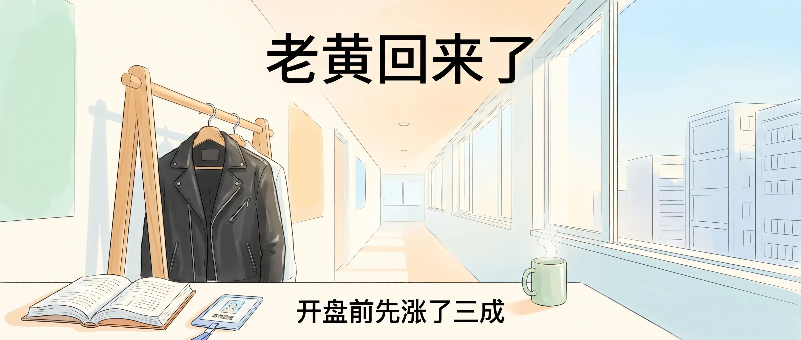
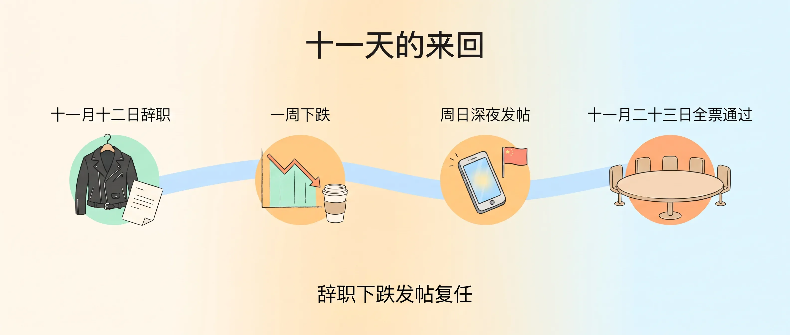
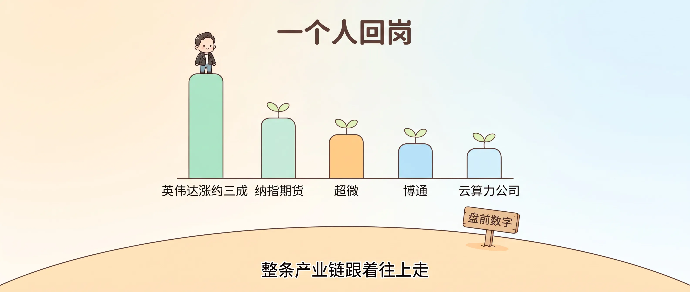
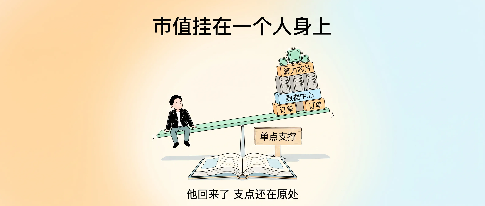
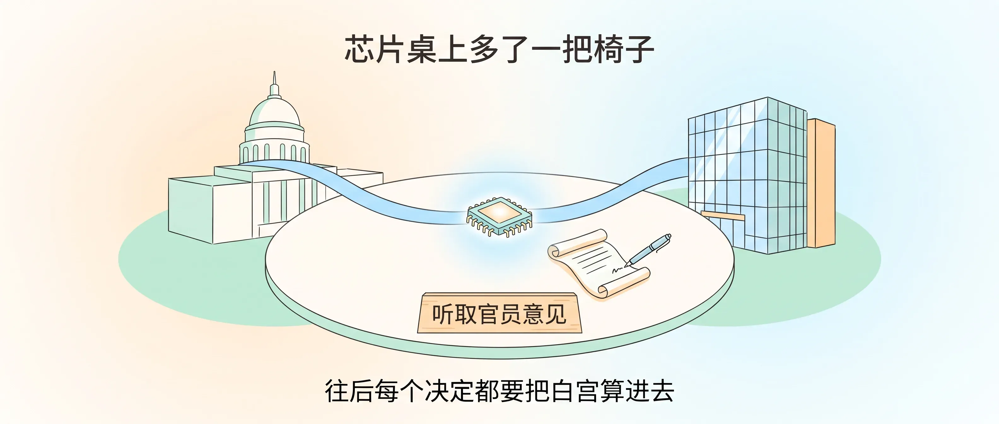

大家好，我是 Jason。

今天圈子里最大的事，老黄回来了。

11 月 23 日，英伟达官网挂出公告：董事会一致投票，恢复黄仁勋的总裁、CEO 与董事职务，即日生效。

距离他 11 月 12 日交出帅印，11 天。

这段时间我在二刷《黄仁勋：英伟达之芯》，翻到他讲“光速”那几章，手机弹出推送。我把书扣在桌上，又拿起来。

<!-- baoyu-skill cover prompt: 2.35:1横幅小清新治愈知识漫画封面，柔和米白到淡暖杏与浅天蓝微光渐变底色，干净纤细手绘线稿，薄荷绿、暖杏色、浅天蓝柔和色块平涂，留白充足，禁止任何品牌Logo与深色赛博UI，禁止英文杂字与弯曲极小字，画面中所有文字均水平端正排版并使用清晰简体中文，标题不带引号或括号。画面展示明亮清透的科技公司窗边长廊：前景一只温润浅木色衣架上重新挂着一件整洁的黑色皮衣，衣架旁放着一本摊开的传记与一枚崭新的工作牌，桌上一杯冒着热气的浅绿色马克杯；窗外淡蓝天色下，远处算力机房建筑轮廓柔和，一缕晨光从窗边斜洒进来。顶部居中醒目端正中文大标题老黄回来了，底部居中辅助中文开盘前先涨了三成。整体构图舒展平衡，治愈清新，所有汉字笔画清晰准确无变形。 --ar 2.35:1 -->

---

先把时间线排清楚。

11 月 12 日，黄仁勋辞职。董事会当时表态，无意恢复他的职务。Colette Kress 接任临时 CEO，Harvey C. Jones 出任独立董事长。

随后一周，英伟达股价一路下滑。上周五，美股 AI 板块收出一根大阴线，市值蒸发的数字，够买下好几家上市公司。

11 月 22 日周日晚，特朗普在 Truth Social 发帖：“我希望英伟达董事会重新聘用黄仁勋。这对公司最好，对美国也最好。”

隔了一夜，董事会改了口。

公告里有一句我看了两遍：董事会听取了美国政府高级官员的意见，认定他回归不构成国家安全风险。

<!-- baoyu-skill prompt: 2.35:1横幅小清新治愈知识漫画，柔和米白到淡暖杏与浅天蓝微光渐变底色，干净纤细手绘线稿，薄荷绿、暖杏色、浅天蓝柔和色块平涂，留白充足，禁止任何品牌Logo与深色赛博UI，禁止英文杂字与文字遮挡，所有文字水平端正排版并使用清晰简体中文，标题不带引号或括号。画面采用从左向右延展的时间长卷构图，一条浅天蓝丝带串联四个简洁暖色节点图标：最左端是一件挂起的黑色皮衣与一封辞呈，上方水平标注十一月十二日辞职；第二个节点是一条向下走低的折线与一只空咖啡杯，上方标注一周下跌；第三个节点是一部亮着屏幕的手机与一枚小小的国旗，上方标注周日深夜发帖；最右端是一张圆桌与一排举手的小椅子，上方标注十一月二十三日全票通过。顶部居中醒目端正中文标题十一天的来回，底部居中辅助中文辞职下跌发帖复任。整体构图舒展明亮，治愈清新，所有汉字笔画清晰准确。 --ar 2.35:1 -->

---

我对白宫这一手没有定论。

往好处想，英伟达的芯片牵着美国的算力、出口管制和资本市场，白宫开口，等于替一个国家级资产兜底。

往坏处想，一家上市公司的 CEO 去留，一条社交帖子翻转了董事会的决定。11 天前董事会说的是一套，11 天后说的是另一套，中间只隔一个周末。

我读到的消息里，没有人讲清董事会 11 月 12 日查出的那些事，后来怎么处置了。公告没写，我也不乱猜。

只说一点：治理上的账，没有因为股价涨了就消失。

---

再看盘面。

据 CNN 等媒体盘前报道：

英伟达涨约 27% 到 33%。纳指期货涨约 6% 到 7%。AMD 涨约 7%，博通涨 2.5% 到 5%，CoreWeave 涨 27% 到 30%。

一个人回岗，带着整条产业链往上走。

这些是盘前数字，收盘怎么走，要看开盘后资金接不接。上周五砸下去的恐慌盘，今天有一部分会变成追高盘，两头都得小心。

我自己让 Grok Bot 帮我做了几次缺口回补。现在看来，做对了。

<!-- baoyu-skill prompt: 2.35:1横幅小清新治愈知识漫画，淡暖杏到米白与浅天蓝微光渐变底色，干净纤细手绘线稿，薄荷绿、暖杏色、浅天蓝柔和色块平涂，留白充足，禁止任何品牌Logo与深色赛博UI，禁止英文杂字与文字遮挡，所有文字水平端正排版并使用清晰简体中文，标题不带引号或括号。画面展示一组清爽的柱状图：五根圆角柱子从左到右高低不一，最高的一根顶着一顶小小的皮衣小人像，柱下水平标注英伟达涨约三成；右侧四根较矮的柱子分别标注纳指期货、超微、博通、云算力公司，柱顶各冒出一朵淡绿色小芽。背景是一条向上翘起的浅暖杏色缓坡，坡上插着一块小木牌写着盘前数字。顶部居中醒目端正中文标题一个人回岗，底部居中辅助中文整条产业链跟着往上走。整体构图对称直观，明亮治愈，所有汉字笔画清晰完整。 --ar 2.35:1 -->

---

回头说书。

《英伟达之芯》里，黄仁勋管着几十名直接汇报的高管，没有二把手，没有接班人。他要信息直达，要“光速”，讨厌中间层转述。

11 月 13 日我写的是，这套打法的另一面，是所有风险压在一个人身上。

今天的盘面，把另一面也演了一遍。

他走，股价掉。他回，股价涨三成。

市场用价格投了一票：英伟达的估值，有相当一部分挂在他这个人身上。

我读到这儿，没觉得高兴。一家 5 万亿美元量级的公司，最大的单点故障是一个 63 岁的人。他回来，故障还在原位。

<!-- baoyu-skill prompt: 2.35:1横幅小清新治愈知识漫画，淡暖杏到米白与浅天蓝微光渐变底色，干净纤细手绘线稿，薄荷绿、暖杏色、浅天蓝柔和色块平涂，留白充足，禁止任何品牌Logo与深色赛博UI，禁止英文杂字与文字遮挡，所有文字水平端正排版并使用清晰简体中文，标题不带引号或括号。画面展示一架简洁的跷跷板：左端坐着一个穿黑色皮衣的小人，右端堆着一座由算力芯片、数据中心和订单小方块搭成的高塔，跷跷板只靠一根细细的支点撑着，支点旁立一块浅木牌写着单点支撑；板子下方摊开一本翻到一半的传记。顶部居中醒目端正中文标题市值挂在一个人身上，底部居中辅助中文他回来了支点还在原处。整体构图对称直观，明亮治愈，所有汉字笔画清晰完整。 --ar 2.35:1 -->

---

读者问得最多的一句：他是为白宫回来救市的吗？

我的看法：先有 11 天的下跌，才有一条帖子的力量。救市这个词太大，但白宫看见了英伟达是美国 AI 版图的支点，这点没有疑问。

<!-- baoyu-skill prompt: 2.35:1横幅小清新治愈知识漫画，柔和米白到淡暖杏与浅天蓝微光渐变底色，干净纤细手绘线稿，薄荷绿、暖杏色、浅天蓝柔和色块平涂，留白充足，禁止任何品牌Logo与深色赛博UI，禁止英文杂字与文字遮挡，所有文字水平端正排版并使用清晰简体中文，标题不带引号或括号。画面展示一张圆桌会议场景：圆桌一侧是一座简洁的白色圆顶政府大楼剪影，另一侧是一座玻璃幕墙的芯片公司大楼剪影，两栋楼之间由一条浅天蓝丝带连到圆桌中央的一枚发光芯片上，芯片旁放着一份摊开的公告与一支笔，桌边一块浅木牌写着听取官员意见。顶部居中醒目端正中文标题芯片桌上多了一把椅子，底部居中辅助中文往后每个决定都要把白宫算进去。整体构图对称舒展，明亮治愈，所有汉字笔画清晰完整。 --ar 2.35:1 -->

最后留一个观察点。

董事会这次表态说，已经听取了政府官员的意见。往后英伟达每一次出口、芯片和选人的决定，大概都要把这个因素算进去。

书我还剩三分之一，继续读。

老黄回来了，下一个问题是：他身边，谁来当二把手？
