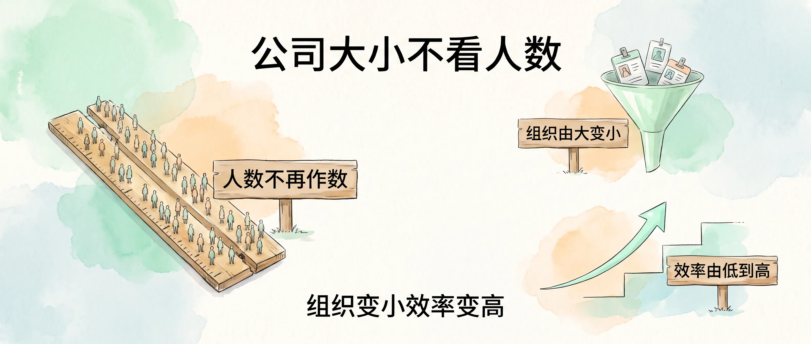

大家好，我是 Jason。

老黄回来了。昨天那篇[《老黄回来了，开盘前先涨了三成》]({{ site.baseurl }}/jensen-huang-returns-nvidia)写了复职时间线和盘前数字，今天不重复那 11 天。

我想写一个容易看反的地方。

英伟达一晃，模型、云、算力租赁、手里有期权的人，全跟着晃。很多人读成：平台太强，所以谁都得靠它。

我读成另一句。平台强，是平台的事。你站在上面，不等于你强。

<!-- baoyu-skill cover prompt: 2.35:1宽银幕小清新钢笔白描加淡水彩封面，温润米白画纸底色，极简干净纤细墨线，点缀极淡薄荷绿与浅天蓝，留白充足，禁止任何品牌Logo、深色背景、英文杂字与弯曲极小字，图中所有文字水平端正并使用清晰简体中文，不带引号冒号与阿拉伯数字。画面左右对照：左侧一个人站在一块巨大的芯片平台上，双手空空，脚下平台发光，他却没有自己的工具；右侧同一个人蹲下来，把图纸、扳手和小块芯片铺进地面，铺成别人可以站上去的一层。顶部居中醒目端正简体中文大标题别把平台当成你自己，底部居中辅助中文英伟达是反过来做的。白描清新，汉字笔画清晰准确。 --ar 2.35:1 -->

---

说件这两年常看到的事。

模型写出能跑的代码，就说自己会做产品。账号里有额度，就说自己有算力。英伟达一涨，就说自己看懂了这个时代。演示能亮，朋友圈里像一家公司。

这些开关都不在你手里。

模型涨价，毛利薄了。平台封号，交付停了。芯片紧一紧，排期就作废。你以为那是本事，其实是租约。租约改一条，本事当场还回去。

平台的能力，不是你的能力。别把这两本账记在一起。

<!-- baoyu-skill prompt: 2.35:1宽银幕小清新治愈水彩手绘插画，柔和米白到淡暖杏与浅天蓝微光渐变底色，干净纤细钢笔线稿，薄荷绿、暖杏色、浅天蓝柔和色块平涂，留白充足，禁止任何品牌Logo与深色背景，禁止英文杂字与弯曲极小字，图中所有文字水平端正并使用清晰简体中文，不带引号冒号与阿拉伯数字。画面左右对照：左侧一张租来的工作台上摆着一把借来的钥匙、一朵云和一扇亮着的窗口，桌牌写着平台的；右侧同一张桌子被抽空，只剩一张被收回的租约和一只空口袋，桌牌写着还回去。顶部居中端正简体中文主标题借来的本事，底部居中辅助中文租约一改当场归零。整体清新，汉字笔画清晰准确。 --ar 2.35:1 -->

---

反过来做成的，很少。我看来看去，英伟达是一个。

黄仁勋不是借了一层现成的平台，再把平台的成绩算到自己头上。图形卡还在画三角形的年月，他把判断、工程师和亏得起的年头，押进当时没人当回事的 CUDA 里。等 AI 真的要算力，大家才发现脚下那层是英伟达铺的。

是他自己的能力在给平台输血。不是平台在给他输血。

所以人一离开，平台就晃。他走了 11 天，股价掉下去。人回来，11 月 23 日单日涨超 31%，市值加回约 9,500 亿美元。市场不是在给一块招牌投票。市场在问：给这个平台续命的那个人，还在不在。

马斯克那句 chips，我昨天拿来写朋友。今天改一个读法。顺境里人人觉得自己手里有筹码，也觉得自己懂芯片。逆境里才分得清，涨的是平台，还是你。

云厂商、模型公司、签了名的员工，多数是站在这层上的人。船要沉，他们得扶，这很正常。扶船和造船，不是一种能力。

<!-- baoyu-skill prompt: 2.35:1宽银幕小清新治愈水彩手绘插画，淡暖杏到米白与浅天蓝微光渐变底色，干净纤细钢笔线稿，薄荷绿、暖杏色、浅天蓝柔和色块平涂，留白充足，禁止任何品牌Logo与人物正脸，禁止英文杂字与弯曲极小字，图中所有文字水平端正并使用清晰简体中文，不带引号冒号与阿拉伯数字。画面从左向右：左侧一位背影把图纸、小锤和一叠芯片砌进地面，砌成一条可以走人的浅石平台，旁立木牌写着自己的能力；平台向右延伸，几个小小的背影站在上面往前走，旁立木牌写着别人站上来。顶部居中端正简体中文主标题自己给平台输血，底部居中辅助中文不是站在别人的平台上。整体舒展明亮，汉字笔画清晰准确。 --ar 2.35:1 -->

---

另外有人跟我说，你这公司太小了。

我听得懂。他在数人。没有销售部，没有中台，没有几百张工牌，看起来就不像一家公司。过去这把尺子好用：公司大不大，看你能撬动多少人。人力是杠杆，招得动人，就做得到事。

AI 时代，公司的大小早就不由人力杠杆决定了。

会一起发生的是两件事。

组织会由大变小。过去要一个部门、一条业务线才扛得住的活，现在一个小团队就能接下来。判断、交付、收款、改下一版，人少了，链路反而短。

效率会由低到高。人少，对齐、汇报、转述跟着砍掉。执行被做便宜以后，小团队去掉了摩擦，每个人推出去的产出反而拉高。

别人说你公司小，把两本账分开。人数小，不是问题。问题是平台一抽走，你还剩不剩下自己的东西。

<!-- baoyu-skill prompt: 2.35:1宽银幕小清新治愈水彩手绘插画，柔和米白与浅雾蓝画纸肌理，晕染薄荷绿、淡杏橘与浅海蓝，纤细钢笔线稿，留白充足，禁止任何品牌Logo与人物正脸，禁止英文杂字与弯曲极小字，图中所有文字水平端正并使用清晰简体中文，不带引号冒号与阿拉伯数字。画面左右对照：左侧一把刻着许多人影的旧木尺从中裂开，尺旁木牌写着人数不再作数；右侧上方一条由大变小的浅绿漏斗带着三张小工牌，木牌写着组织由大变小；右侧下方一条由低向高跃起的薄荷绿箭头，箭头旁只有几步简明链路，木牌写着效率由低到高。顶部居中端正简体中文主标题公司大小不看人数，底部居中辅助中文组织变小效率变高。整体清新克制，汉字笔画清晰完整。 --ar 2.35:1 -->

---

我自己天天用 Claude，用 Codex，也用算力卡。它们强。强的是它们。

我能记在自己名下的，只有几件：做什么，做到哪一步算完，谁愿意付钱，做错了怎么改。这些不跟着一次模型换代清零。清得掉的，都是平台的。

英伟达用了很多年，才把自己的能力做成别人要站上来的那一层。大多数公司走不到，我也走不到。方向不能反。先把自己的能力做实，再谈借平台。借来的，来的时候很响，还的时候也很快。

公司小不小，让他们去数人数。你数一件事：明天平台改了规则，你还剩下什么。

<!-- baoyu-skill prompt: 2.35:1宽银幕小清新治愈水彩手绘插画，暖米白与浅海蓝水彩纸纹底色，点缀薄荷绿与淡杏橘，纤细钢笔线稿，留白宽敞，禁止任何品牌Logo与人物正脸，禁止英文杂字与弯曲极小字，图中所有文字水平端正并使用清晰简体中文，不带引号冒号与阿拉伯数字。画面一张浅木桌被从中分开：桌面左侧几样东西被风吹走，分别是一朵云、一块芯片和一扇关掉的窗口，下方木牌写着清得掉的；桌面右侧留着四张压住的卡片，卡片上写着做什么、做到哪、谁付钱、怎么改，下方木牌写着剩下的。顶部居中端正简体中文主标题平台改规则之后，底部居中辅助中文清得掉的都是平台的。整体清雅通透，汉字笔画清晰完整。 --ar 2.35:1 -->

